# Explorer: word tag sheet links + a character's own card

Phone viewport (412×915, 2×). The web app is light-only today (its dark tokens only cover buttons), so the dark shots are the Lab app's.

## Web

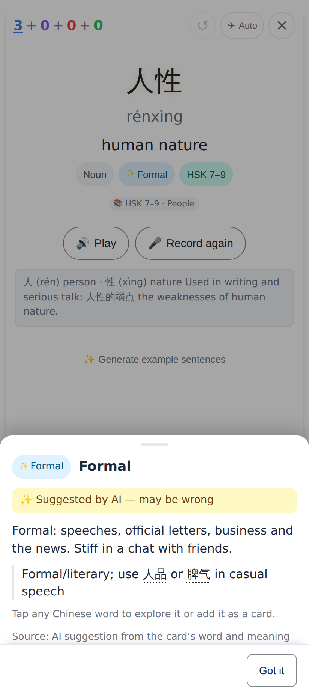
人性 → ✨ Formal: the AI note "use 人品 or 脾气 in casual speech" is tappable by word (dotted), plus a hint line.

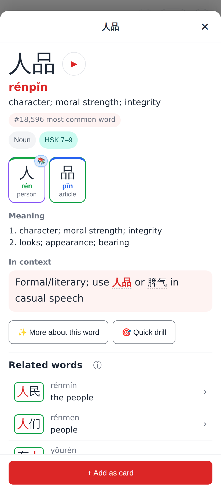
Tap 人品 → the explorer's Word view (+ Add as card). The 人 chip has 📚 because 人 is one of his cards.

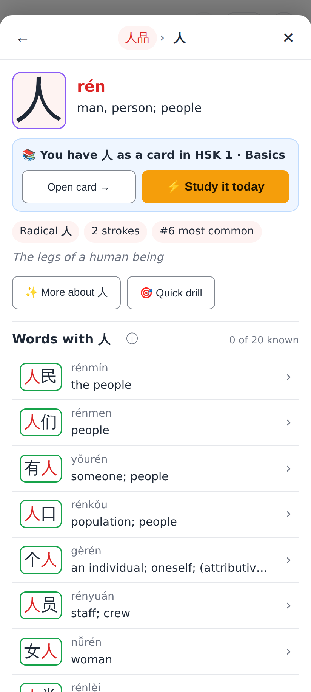
Tap 人 → "📚 You have 人 as a card in HSK 1 · Basics" with Open card → and ⚡ Study it today, first thing under the glyph.

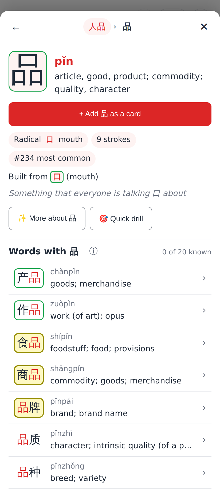
品 has no card of its own → "+ Add 品 as a card".

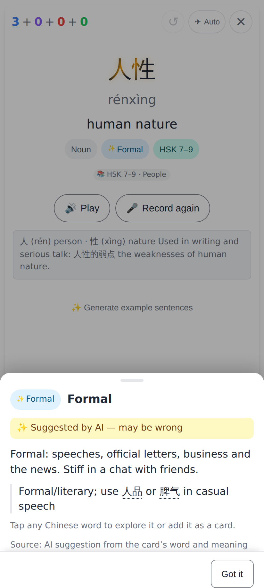
✕ on the explorer → the Formal sheet comes back, ready for 脾气.

## Lab app

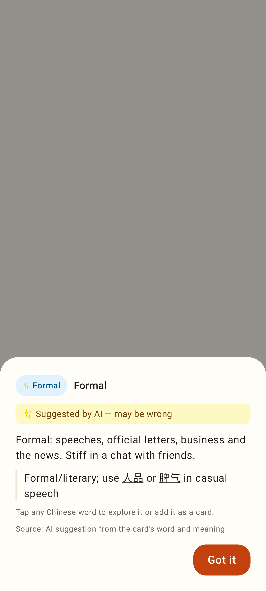
The same sheet in the Lab app (underlined words).

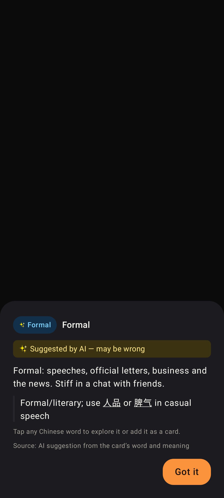
Dark.

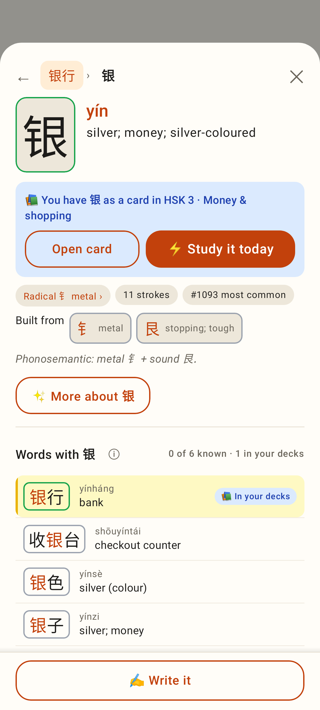
"📚 You have 银 as a card in …" + Open card / ⚡ Study it today.

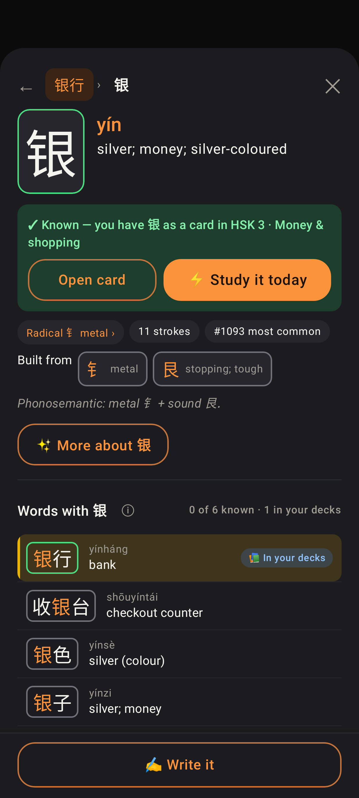
Known, dark: "✓ Known — you have 银 as a card in …".

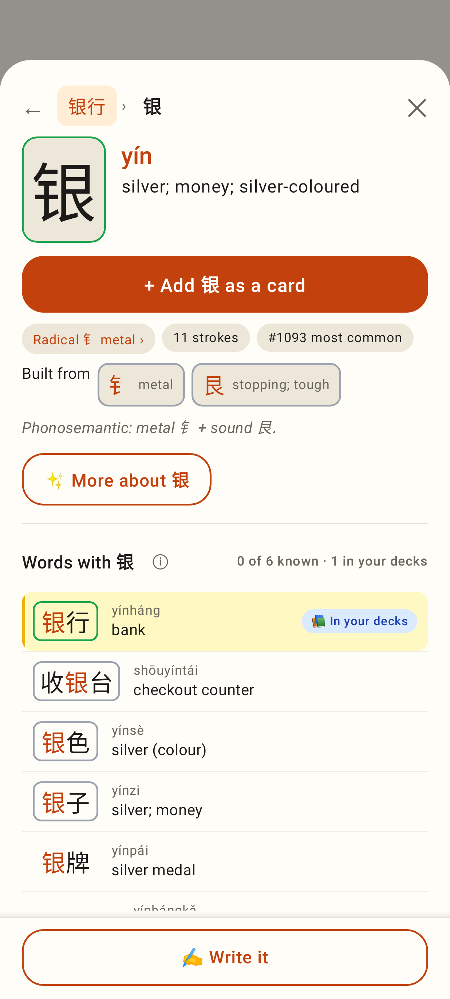
No card of its own: "+ Add 银 as a card".

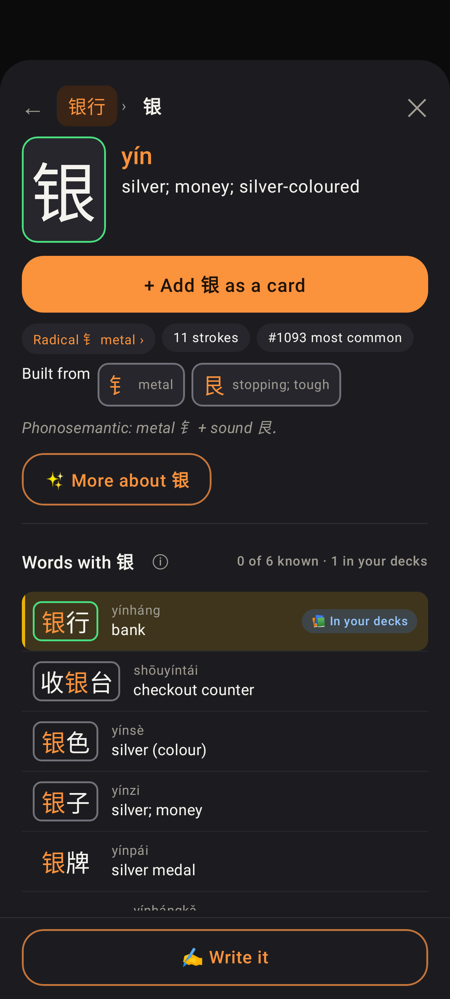
Same, dark.

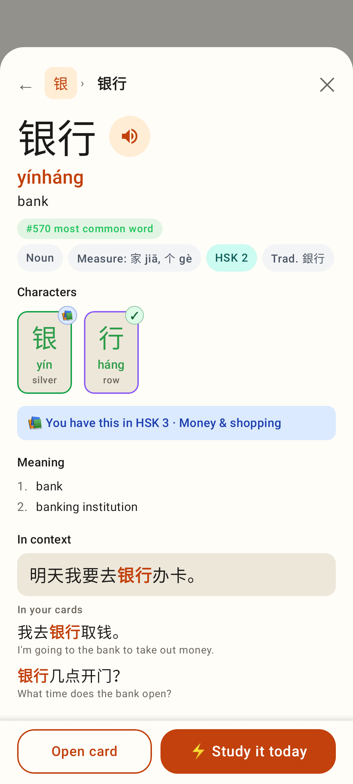
Word view chips: 📚 on 银 (in your decks), ✓ on 行 (known).

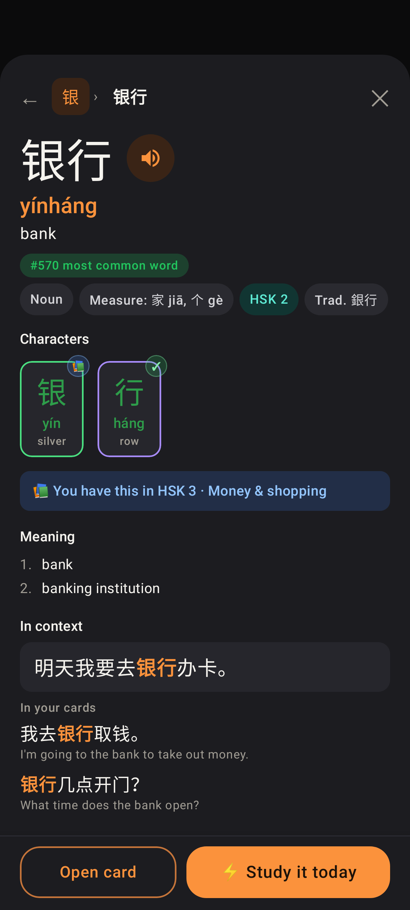
Same, dark.
