# In-app feedback — screenshots

Web (412×915 @2×):

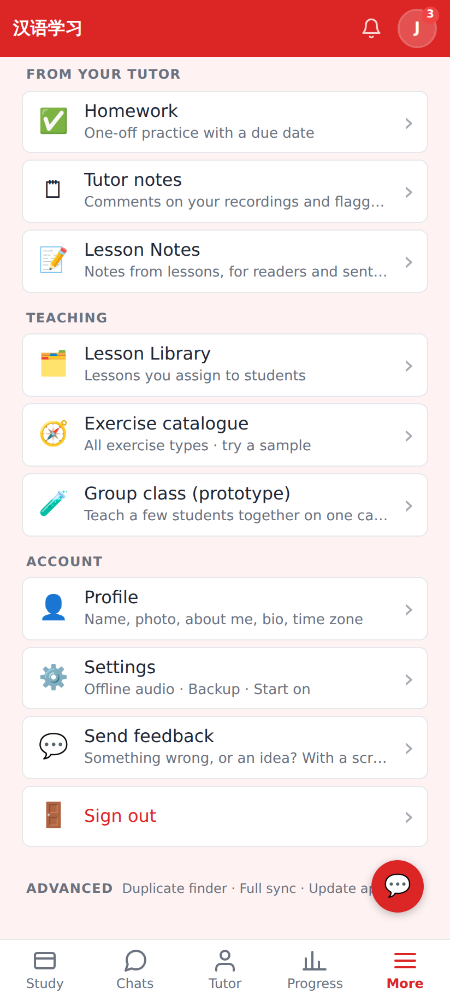
More → 💬 Send feedback (Account section).

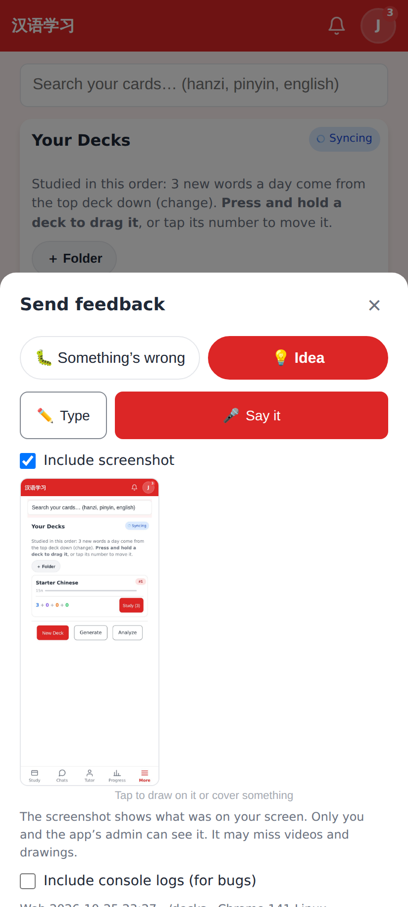
The sheet opened with Shift + ? on the deck list: 💡 Idea / 🐛 Something's wrong, the voice-first box, the page's screenshot (tap to draw on it), console logs opt-in.

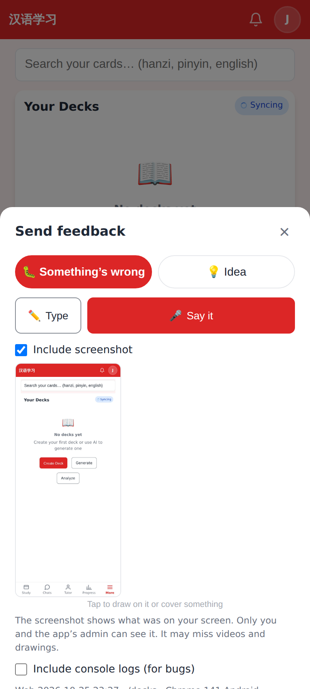
A shake (DeviceMotion jolts, Android Chrome) opens it on 🐛 Something's wrong.

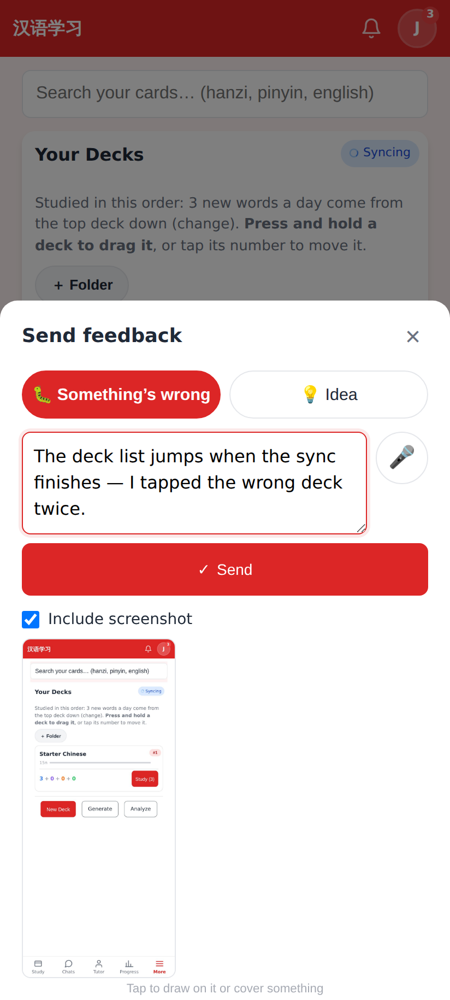
✏️ Type → the message → ✓ Send.

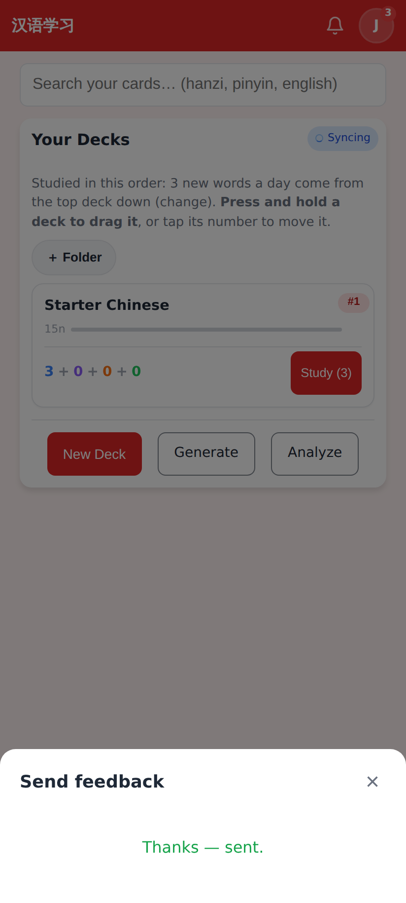
Sent (offline: "Saved — it will be sent when you're back online").

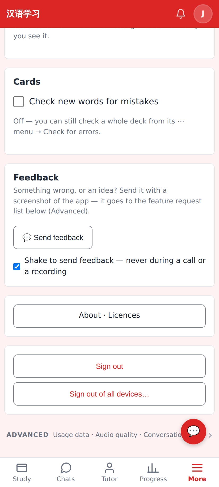
Settings → Feedback: Send feedback + "Shake to send feedback" (phones only).

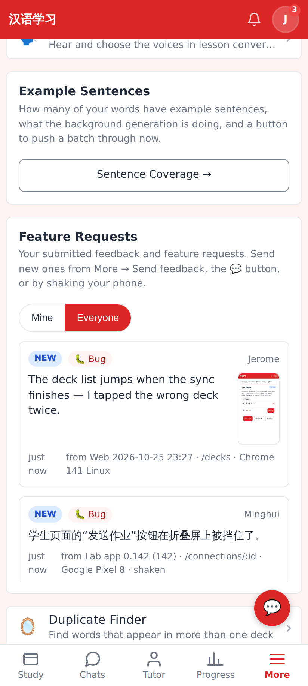
Settings → Advanced → Feature requests (admin, Everyone): 🐛 Bug badge, screenshot thumbnail, the context line (Web build · /decks · browser; Lab app version · route · device · shaken).

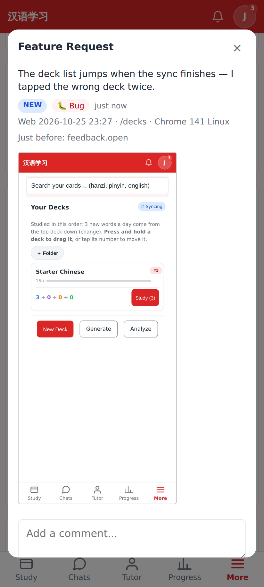
The detail: context line, the last app events, the screenshot (private media, author + admins only).

Lab app (Roborazzi, 412dp):

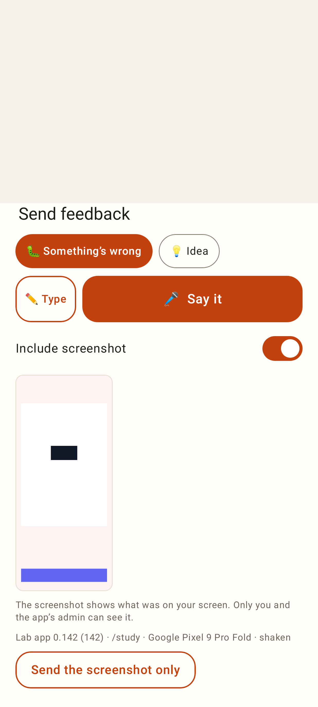
After a shake: 🐛 preselected, 🎤 Say it / ✏️ Type, the window screenshot (PixelCopy) with "Include screenshot", context line, "Send the screenshot only".

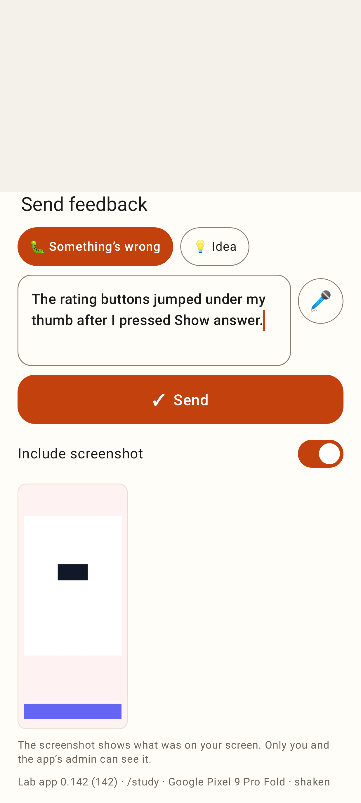
Typed message → ✓ Send.

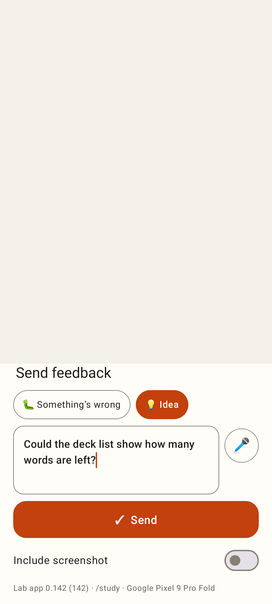
Screenshot switched off.

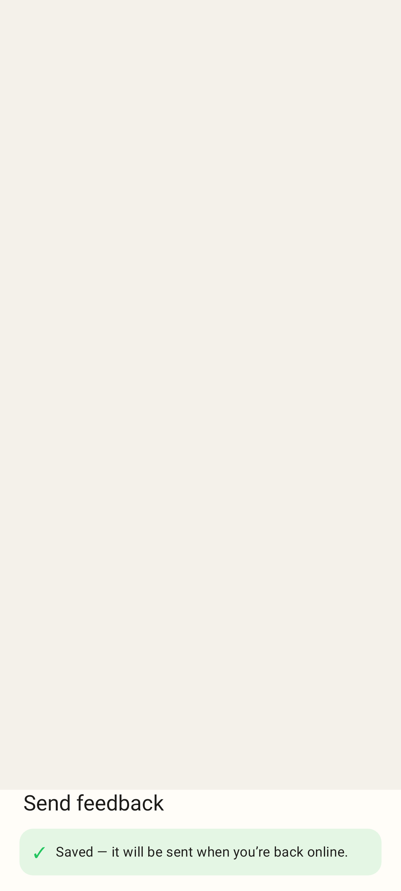
Offline: saved in the Outbox, sent on the next sync.
