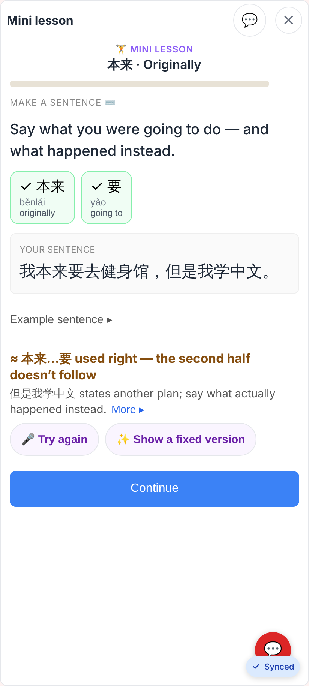
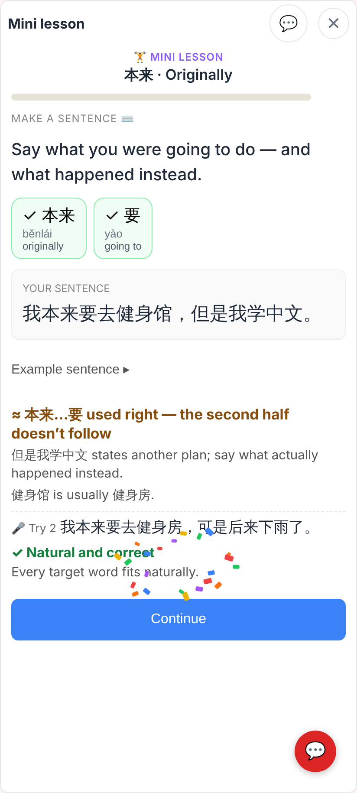

# Sentence-making verdict on the one result state

Phone viewport (412×915, 2×), light theme, the E2E stand-in's grades.

Needs work: the headline is in the result state's close ink (≈, `--result-close-ink`), the same as every other "close" result.

Try again → right: the right ink (✓, `--result-right-ink`).
