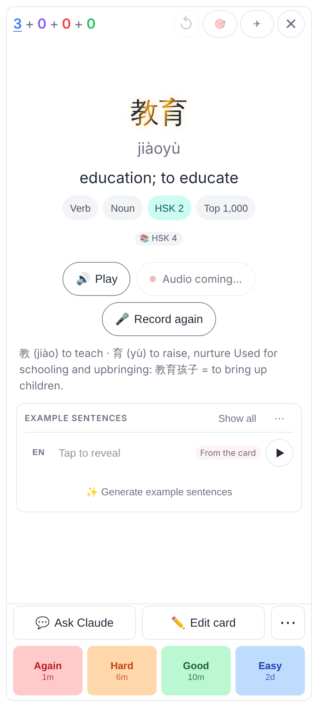
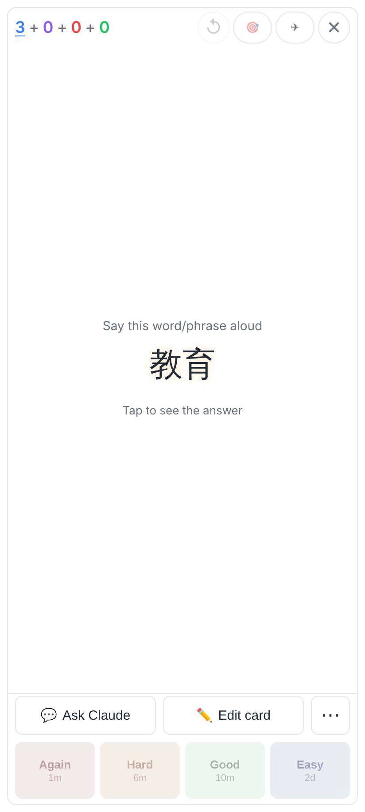
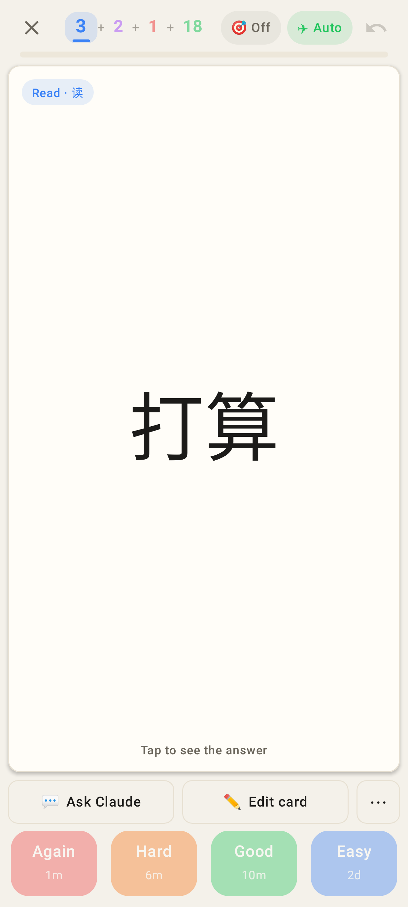
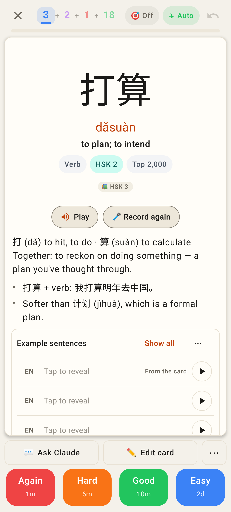

# No rating while the card is turned back to its question

Web, 412×915 @2x (a read card for 教育):

The answer side: Again / Hard / Good / Easy at full colour and they rate as before.

Tapped back to the question: the ratings stay in place with their intervals but dimmed. A tap on one rates nothing and turns the card back to the answer.

Lab app (Roborazzi, 412×915):

The same state in the Lab app: dimmed, a tap turns back to the answer.

Back on the answer side after that tap: the ratings work again at once.
