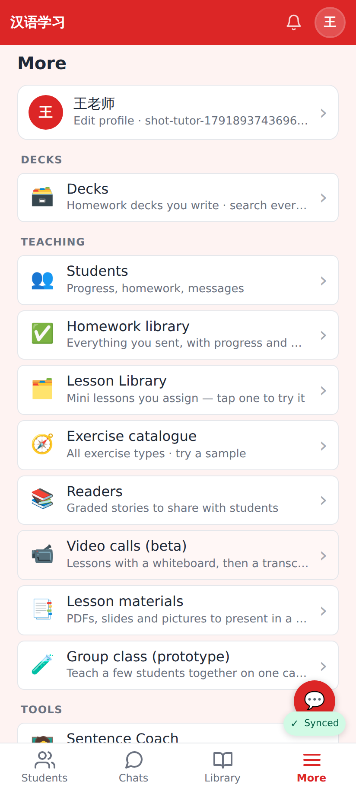
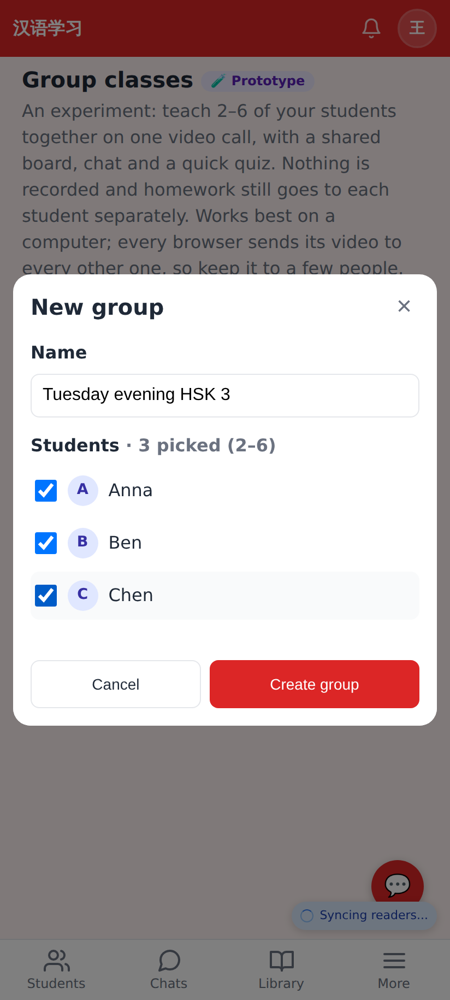
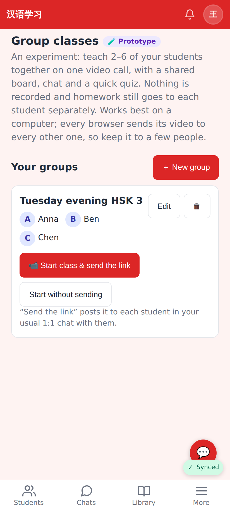
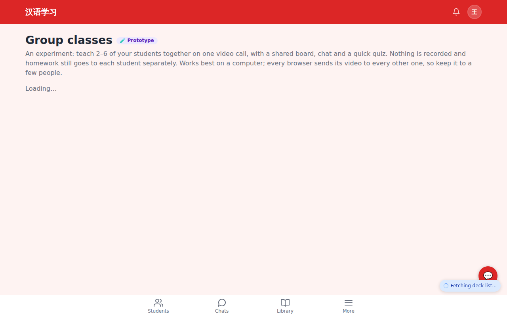
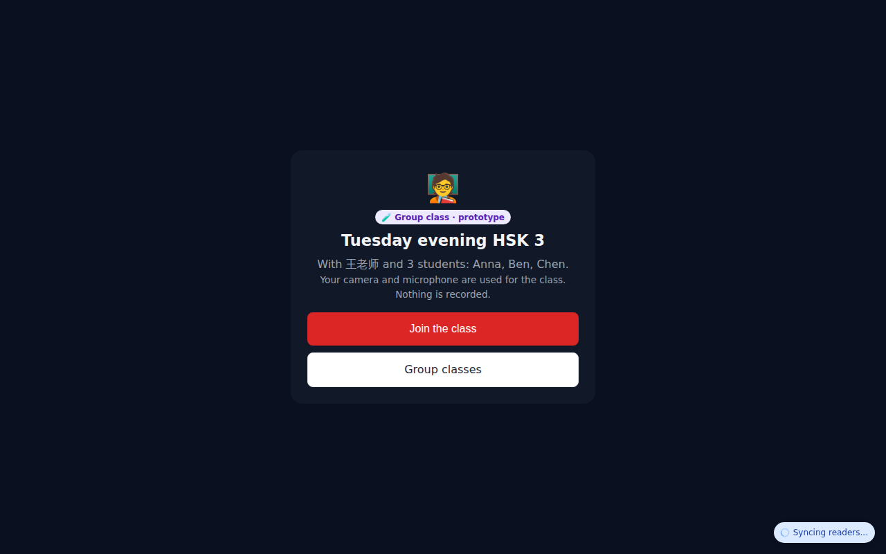
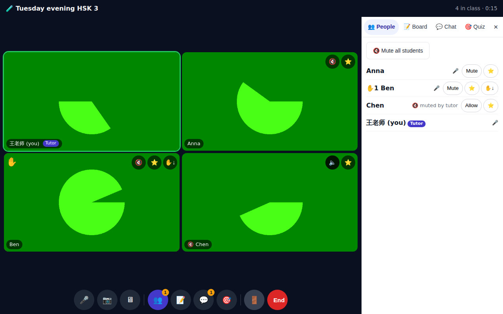
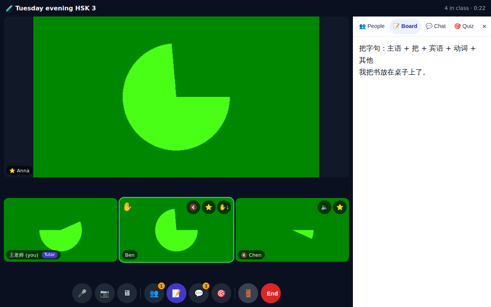
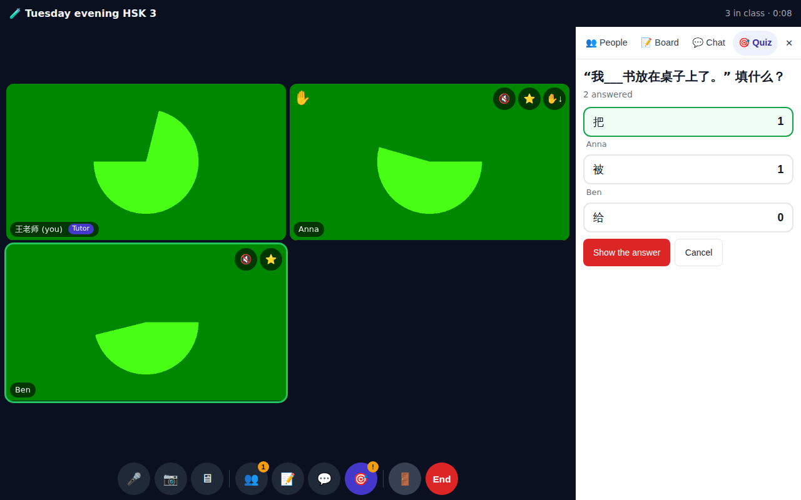
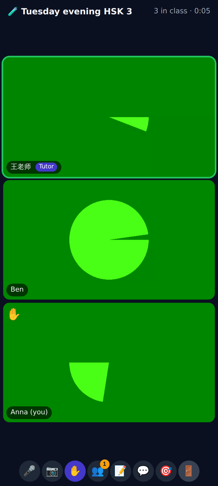
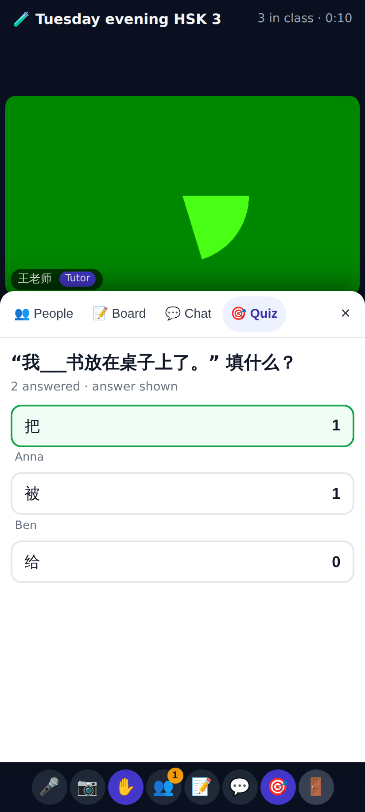

# 🧪 Group classes prototype: screenshots

Local build with Chromium's fake camera. The green "pac-man" in each tile is the fake video, sent over the real mesh WebRTC links.

The entry point: More → Teaching → 🧪 Group class (prototype). Phone, 412×915 @2×.

A tutor makes a group from her active students: a name and 2–6 students.

The group card: members, "📹 Start class & send the link" (posts the link into each student's 1:1 chat), and "Start without sending".

The same page at 1280 px.

Before joining: who is in the class. Nothing is recorded.

Four people in one class (tutor + 3 students). The active speaker has a green ring. Ben's hand is up (✋, and a badge on 👥). The tutor has muted Chen (🔇 on the tile, "muted by tutor" in the list). Every student tile has the tutor's 🔇 / ⭐ / ✋↓ controls, and the panel has Mute all.

The tutor spotlights Anna, who goes big on top for everyone. The shared board (the 1:1 call's CRDT board) is open in the side panel.

Quick quiz, tutor view: she sees who answered what live, then "Show the answer".

A student on a phone: the gallery, ✋ raised, and one control row (mic, camera, hand, people, board, chat, quiz, leave).

After the reveal, the student sees the right answer, the counts and who chose what. Before it, students see only "N answered". The sheet sits above the control row.
