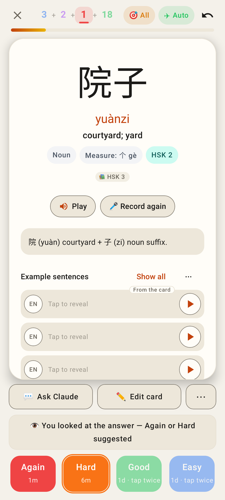

# Hard keeps its time when it's the suggested rating

Lab app, Hard mode after giving up: Hard is ringed (suggested) and shows its interval, "6m", instead of the word "suggested". The web shows its interval the same way; "suggested" stays only for screen readers.
