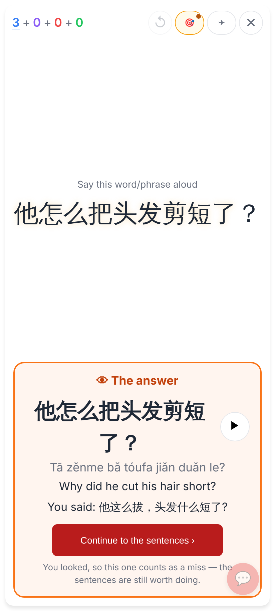
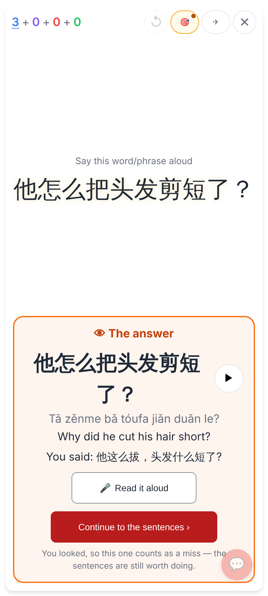
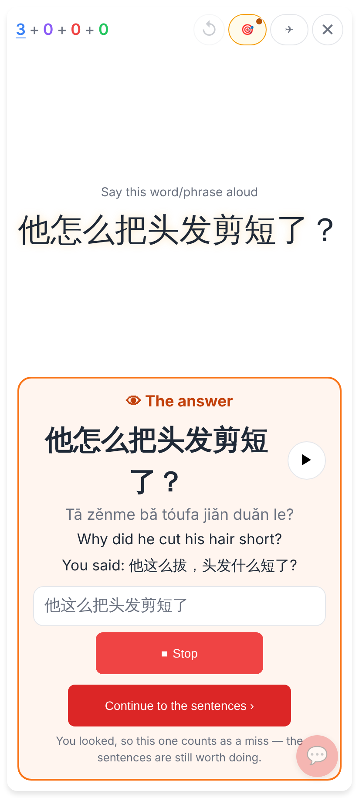
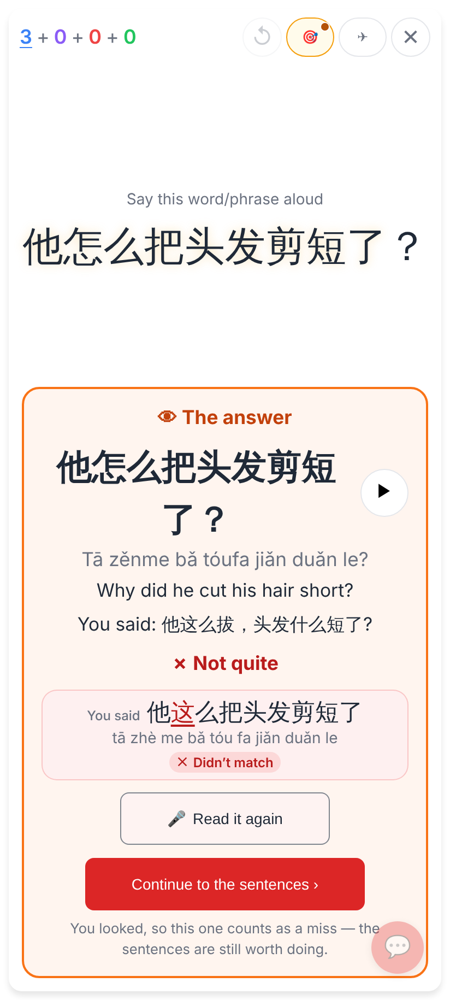
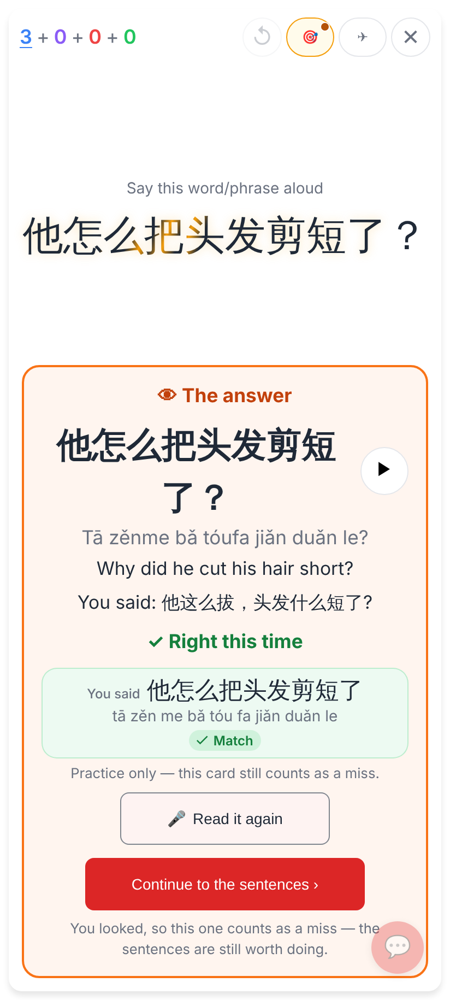
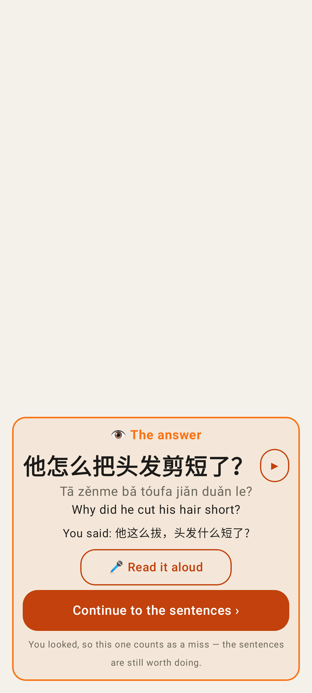
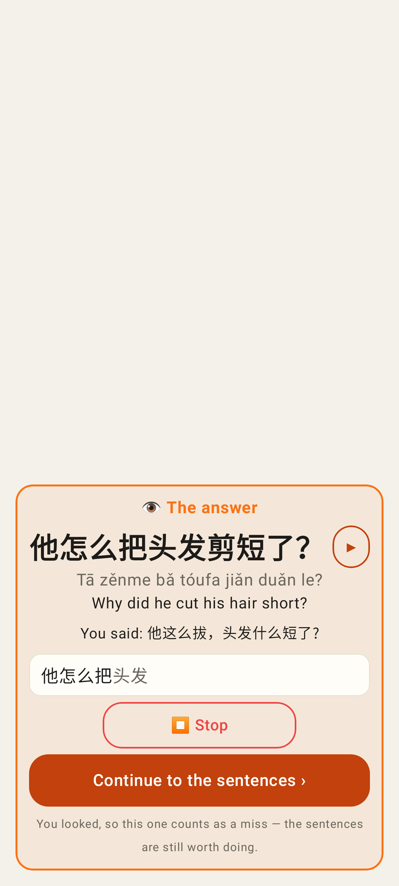
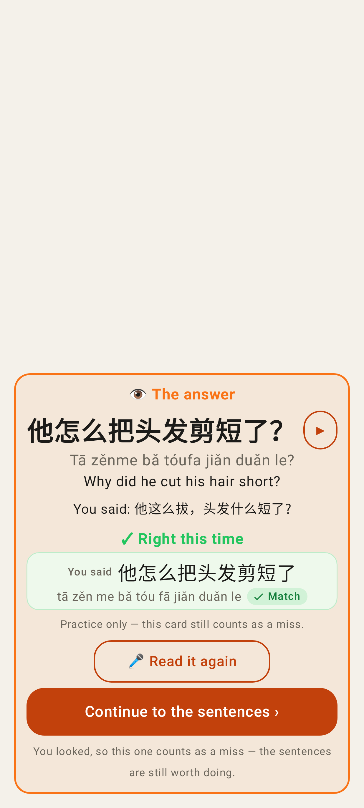
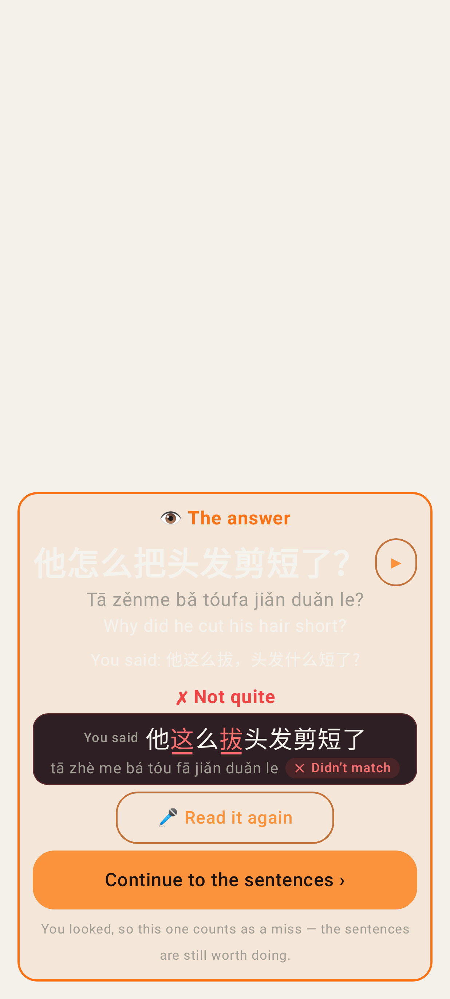

# 🎤 Read it again in Hard mode's answer in place

Web, phone viewport 412×915 at 2× (taken by `e2e/tests/study-sentence-gate.spec.ts` with `SHOTS_DIR`).

**Before**: the panel after 👁 Show answer, with no way to read it again. (Same build with the new block hidden; nothing else in the panel changed.)

**After**: 🎤 Read it aloud under "You said". Continue to the sentences stays the primary button.

**Recording**: the live words while he reads, ⏹ Stop.

**Still not right**: ✗ Not quite, with the "You said" row marking the misheard character (这).

**Right this time**: ✓ Right this time + Match. Practice only: the card still counts as a miss.

## Lab app (Roborazzi, `HardModeUiTest`)

