# Hard mode: feel, soft lock, listening round, in-place reveal, intentional stop

Web (412×915 at 2×, from `e2e/tests/study-sentence-gate.spec.ts` with `SHOTS_DIR`) and the Lab app (Roborazzi,
`HardModeUiTest`).

## Web

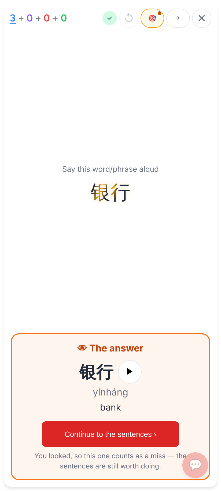
👁 Show answer before a right answer: the answer shows in place on the question, then "Continue to the sentences ›".

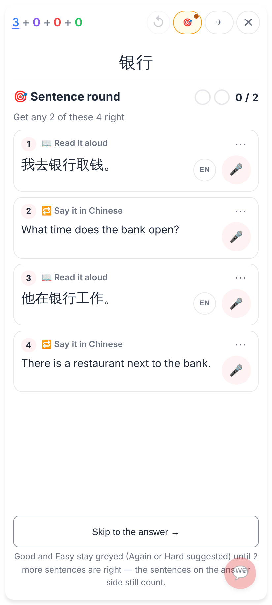
The Sentence round: Skip says Good / Easy stay greyed (Again or Hard suggested), not locked.

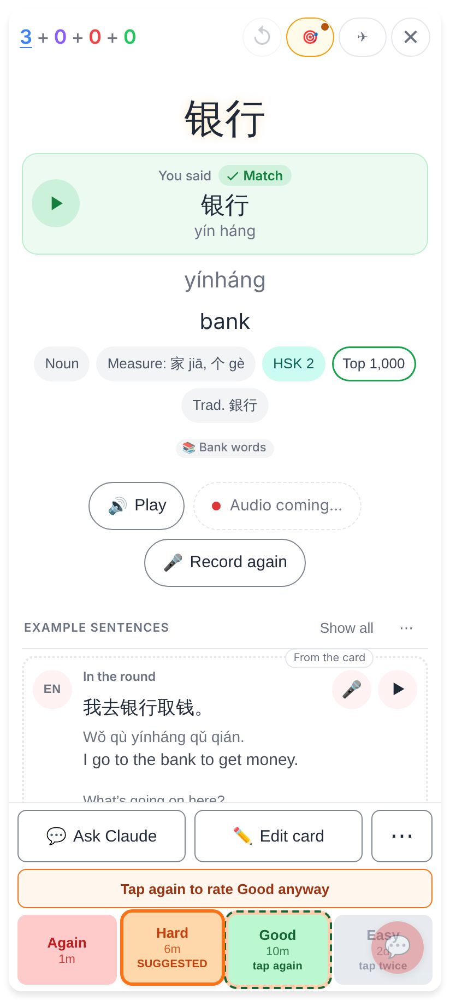
Good / Easy greyed with "tap twice", Hard suggested; the first tap on Good arms it — "Tap again to rate Good anyway".

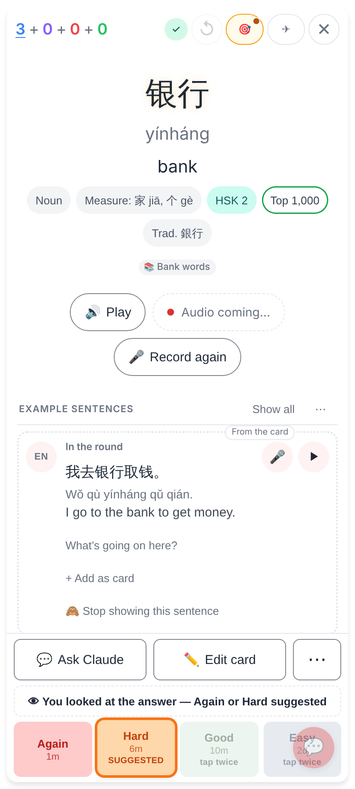
After giving up: "👁 You looked at the answer — Again or Hard suggested"; a second tap still rates Good.

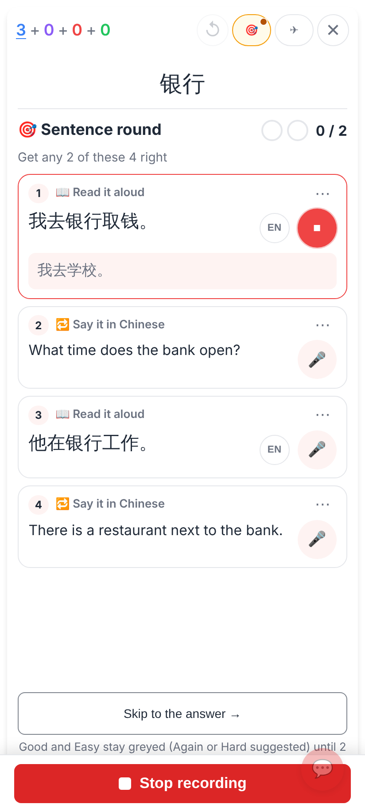
A sentence take under way: taps and scrolls elsewhere don't stop it; one big "■ Stop recording" pinned at the bottom.

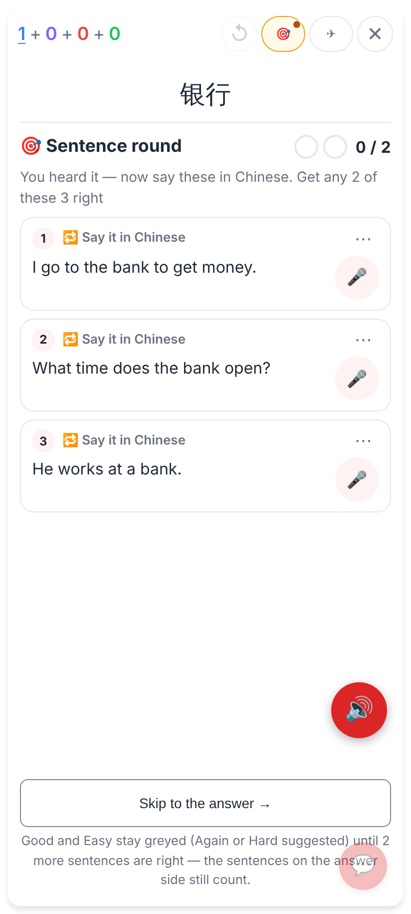
The listening card in Hard mode: after its check, three "Say it in Chinese" sentences that carry the word.

## Lab app

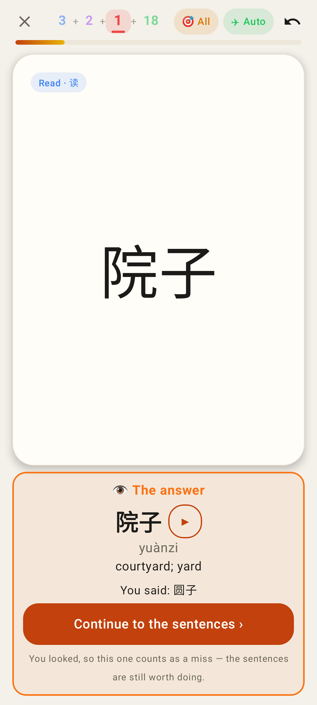
The answer in place after 👁 Show answer (light).

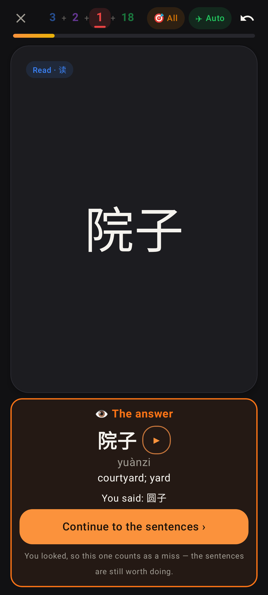
The same in dark mode.

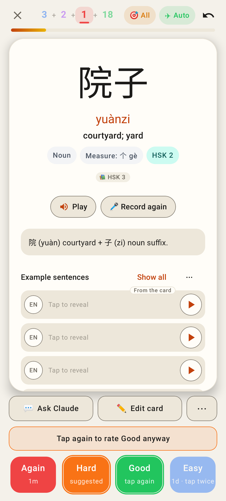
Greyed Good / Easy, Hard suggested, Good armed: "Tap again to rate Good anyway".

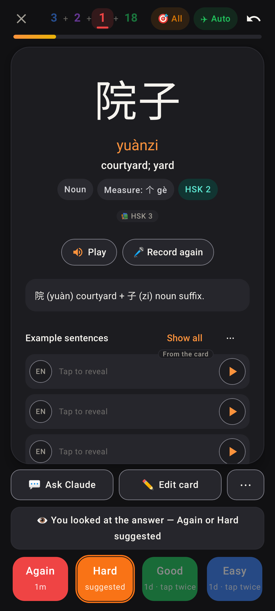
Greyed after giving up, dark mode.

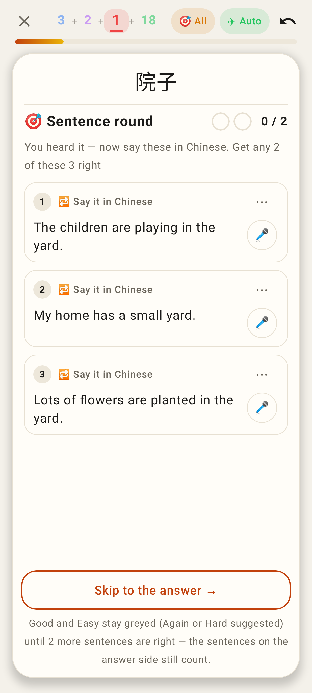
The listening card's "Say it in Chinese" round.

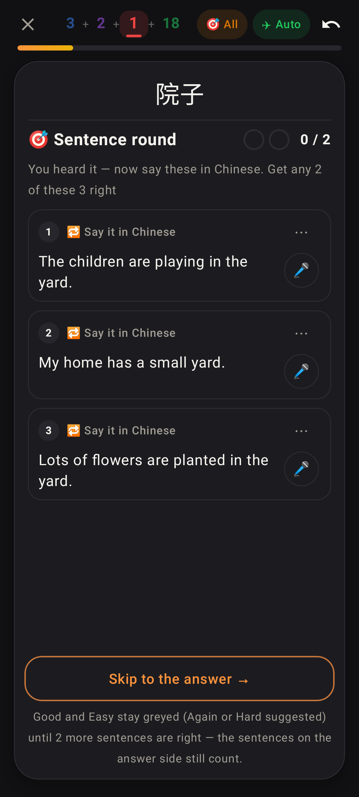
The same in dark mode.

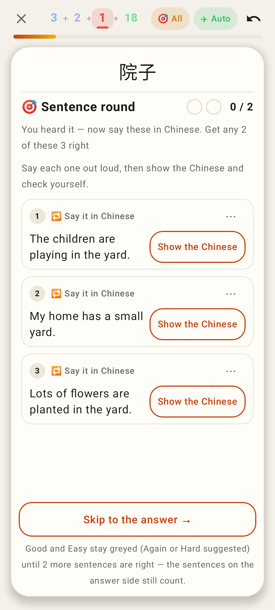
Offline: say it aloud, "Show the Chinese", then check yourself.

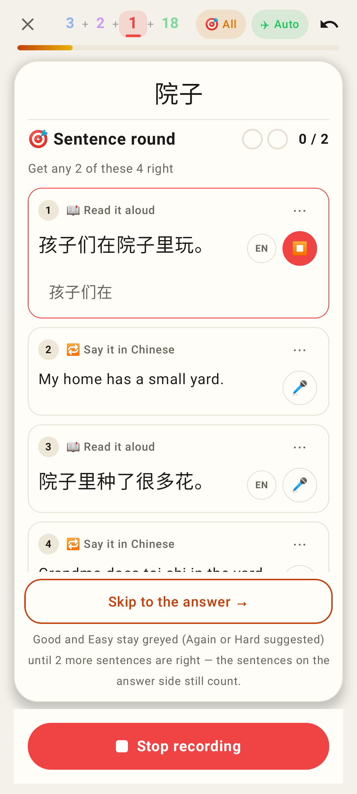
Recording in the round: the pinned "■ Stop recording" in the controls' slot.
