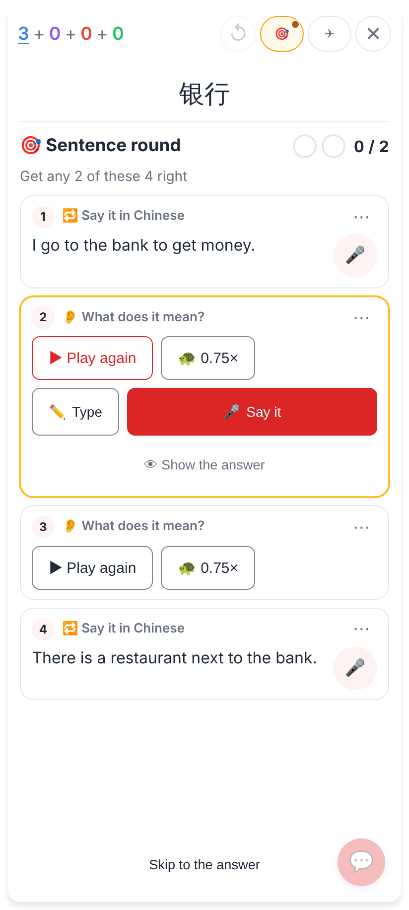
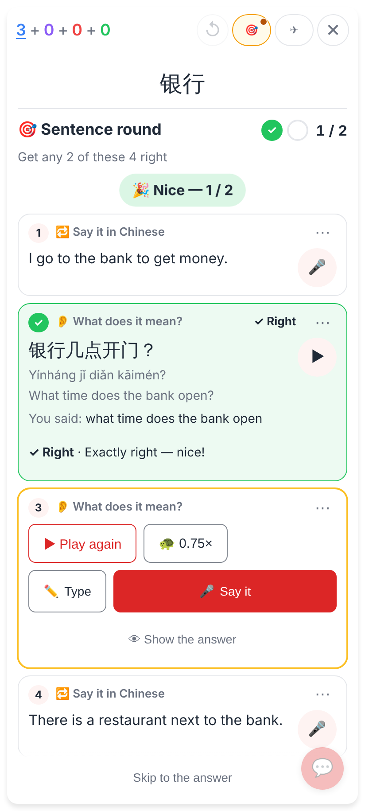
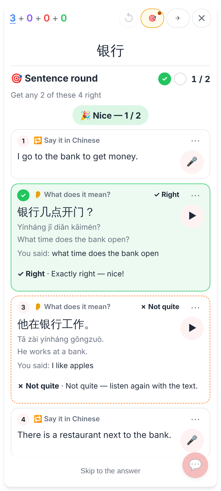
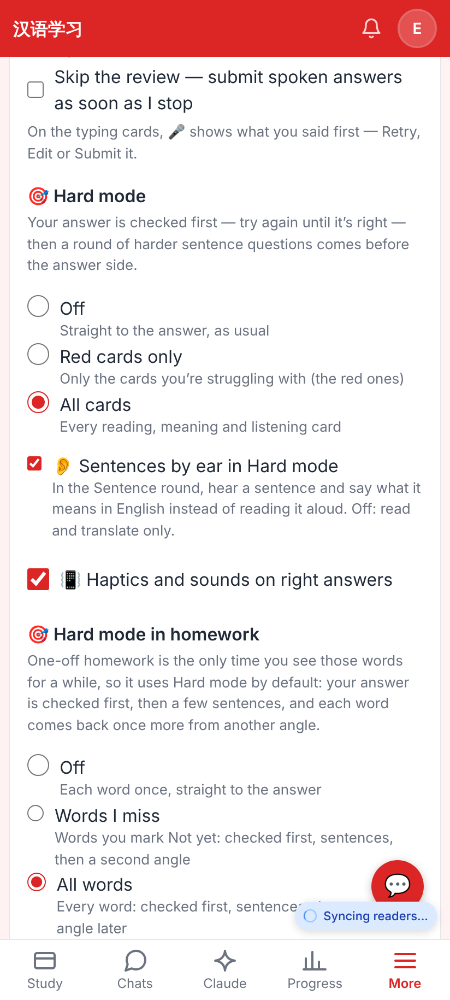
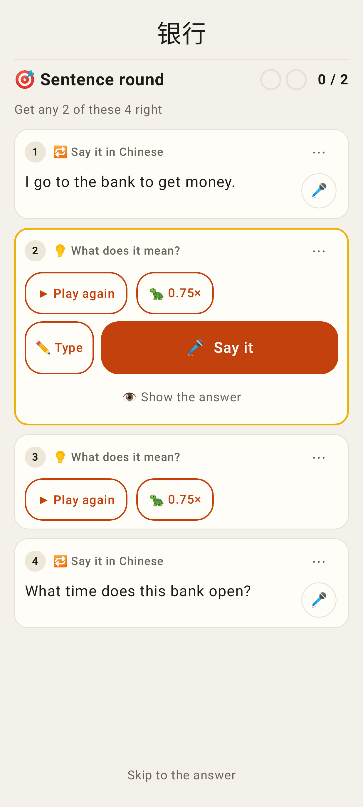
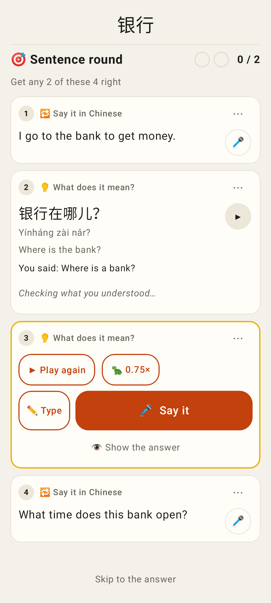
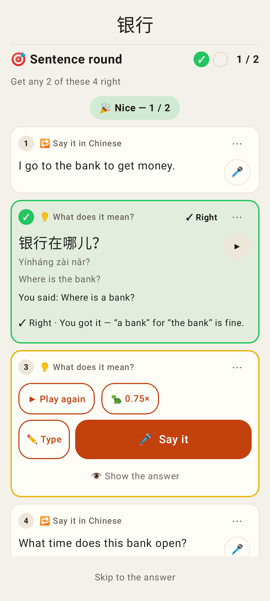
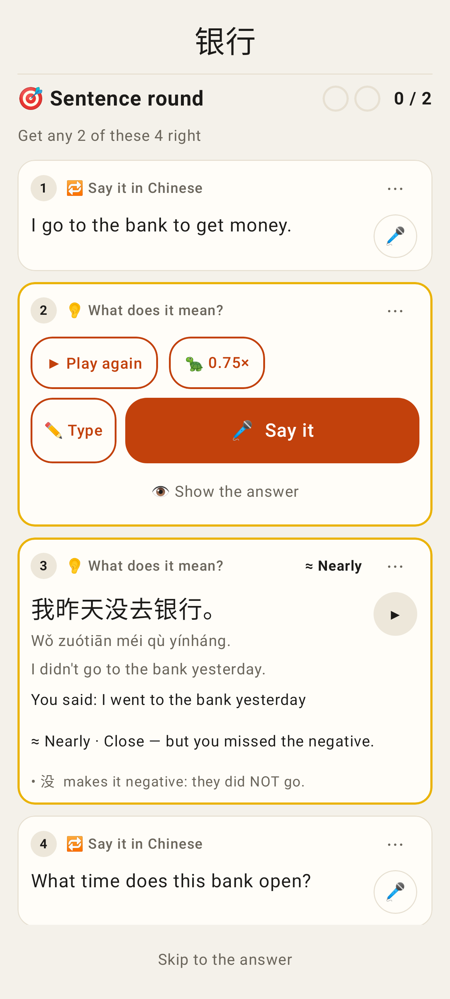
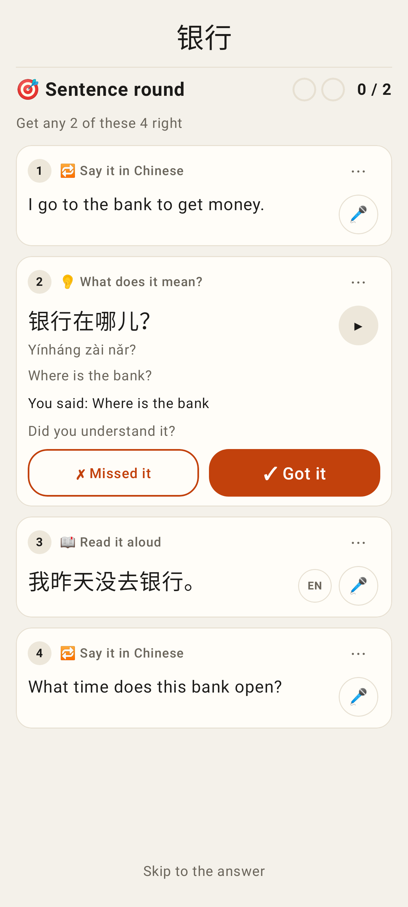
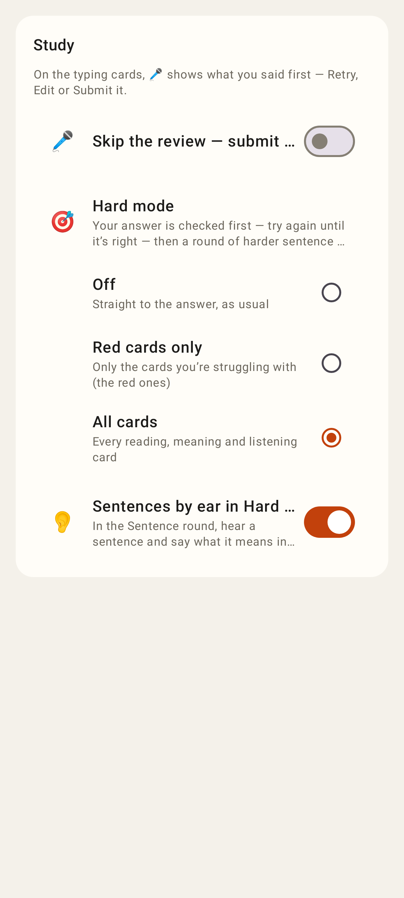

# Hard mode: Sentences by ear

The Sentence round's read slots become 👂 listen exercises when the sentence has a clip: the clip plays with no
text, the meaning is given in English (voice-first), Claude checks the meaning online (a self-check offline), and
the reveal shows at once with the verdict in a slim row below it.

## Web (412×915 @2×)

The question: autoplay, no Chinese or English on screen, ▶ Play again and 🐢 0.75×, 🎤 Say it / ✏️ Type, 👁 Show the answer.

His English is the sentence's English: ✓ Right with no model call; Chinese, pinyin, English and ▶ revealed.

A second listen exercise answered by voice and judged by the meaning check (E2E stand-in): ✗ Not quite.

The switch sits right under Hard mode; on by default.

## Lab app (Roborazzi)

The same round in the Lab app: the first listen exercise has the floor (its box open), the next one waits.

The reveal at once; the verdict row says it is checking.

Claude's verdict lands in the same row — nothing inside the exercise moves; the next listen exercise gets the floor.

≈ Nearly with the tip quoting the Chinese he missed (没).

Offline: "Did you understand it?" ✗ Missed it / ✓ Got it.

Settings → Study → Sentences by ear in Hard mode.
