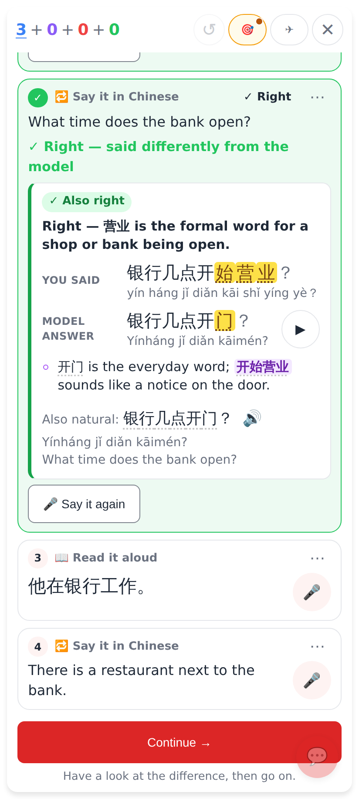
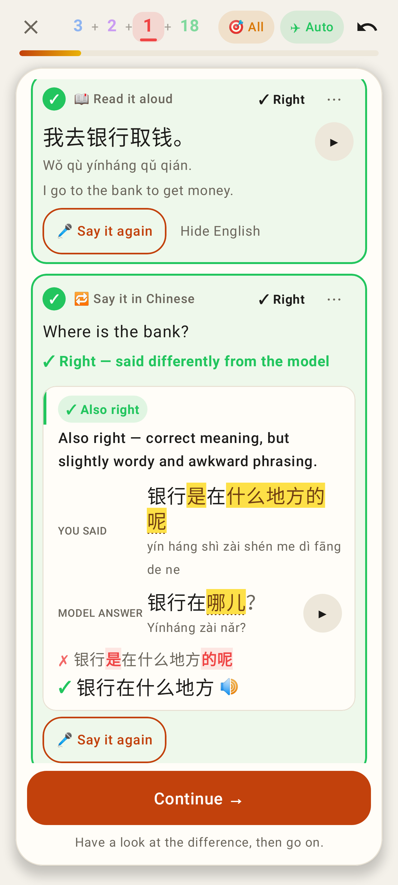

# Hard mode: right, but said differently — hold it and show the difference

Web, 412×915: the translate take that finished the Sentence round was right in other words — the round stays on it with "✓ Right — said differently from the model", You said vs Model answer (differences marked, pinyin of both, ▶), Claude's tip and alternative, and Continue →.

Lab app: the same held exercise (Roborazzi).

Lab app: Hard mode's question answered aloud with a homophone (愿子 for 院子) — "✓ Sounded right — written differently", You said vs The card, and no going on by itself until Next.

Web: 🎤 Say it again on an accepted ("✓ Right") translate exercise — a new take is judged the same way and replaces the shown result; the ✓ and the round's count stay, and the round never goes on by itself after a retake.

Lab app: Say it again on both accepted exercises (read and translate), here under Claude's "Also right — correct meaning, but slightly wordy and awkward phrasing".
