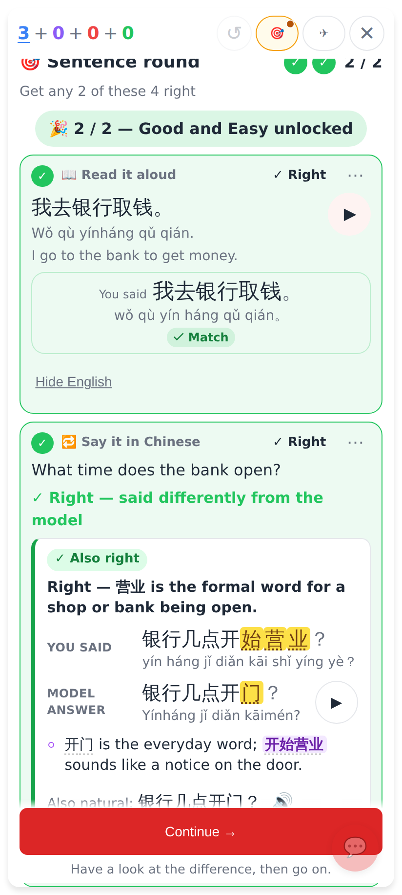
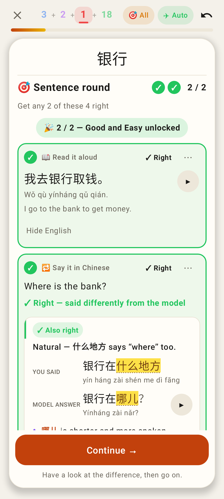
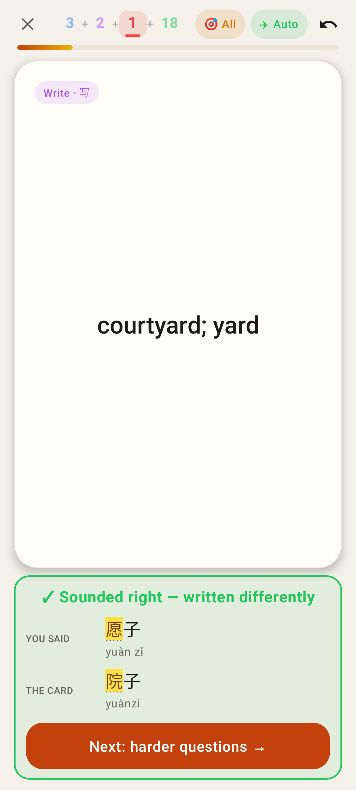

# Hard mode: right, but said differently — hold it and show the difference

Web, 412×915: the translate take that finished the Sentence round was right in other words — the round stays on it with "✓ Right — said differently from the model", You said vs Model answer (differences marked, pinyin of both, ▶), Claude's tip and alternative, and Continue →.

Lab app: the same held exercise (Roborazzi).

Lab app: Hard mode's question answered aloud with a homophone (愿子 for 院子) — "✓ Sounded right — written differently", You said vs The card, and no going on by itself until Next.
