# Hard mode — screenshots

Web (412×915 at 2×, from `e2e/tests/study-sentence-gate.spec.ts` with `SHOTS_DIR`):

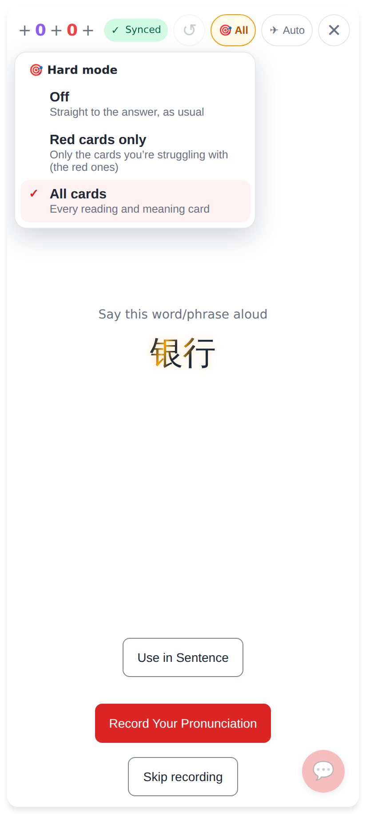
The 🎯 chip in the session header: Off · Red cards only · All cards.

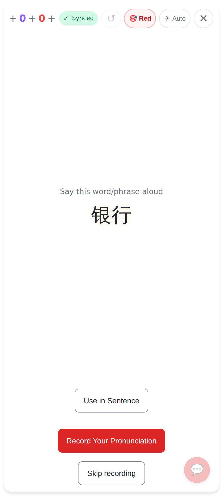
"Red cards only" on a new card: straight to the answer, no lock.

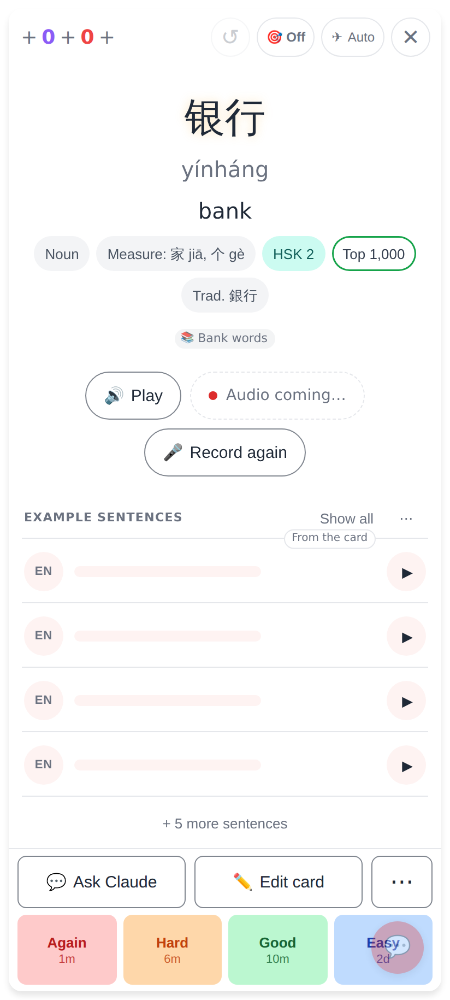
Off from the header.

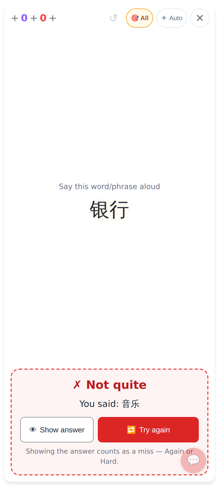
The question's own answer checked at once: ✗ Not quite, what he said, 🔁 Try again / 👁 Show answer.

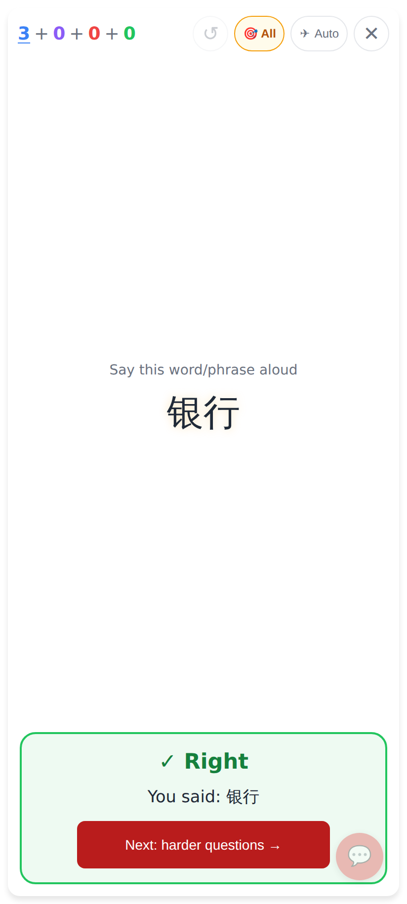
✓ Right → "Next: harder questions" (goes on by itself after a beat).

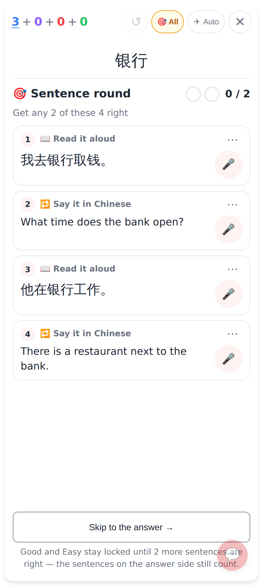
The Sentence round (4 sentences → 4 exercises, each sentence once).

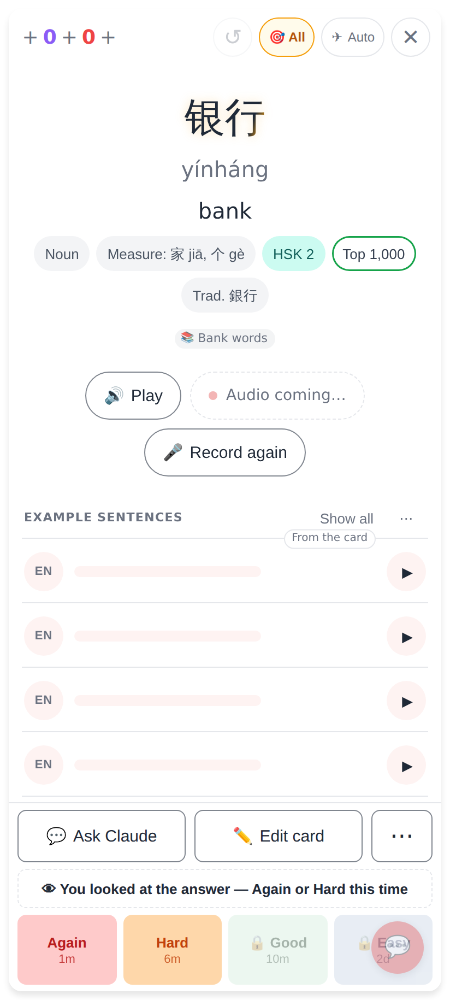
Show answer before a right answer: the answer at once, no round, Good / Easy locked ("You looked at the answer — Again or Hard this time").

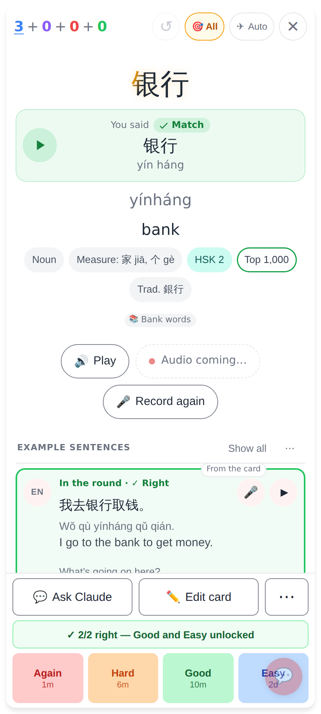
The round's sentences lead the answer side's list, opened, outlined with how each went ("In the round · ✓ Right").

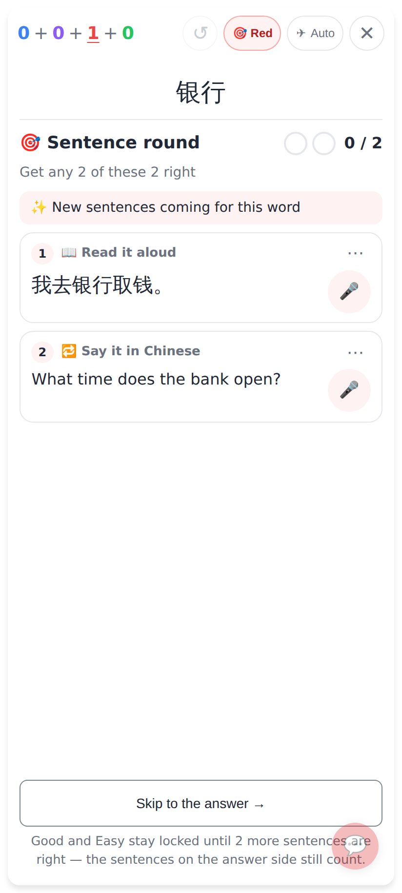
Two sentences → two exercises (one read, one translate), "Get any 2 of these 2 right"; more sentences are asked for.

Lab app (Roborazzi, `HardModeUiTest`):

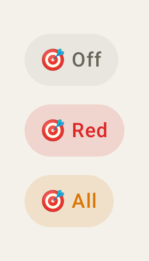
The header chip: Off / Red / All.

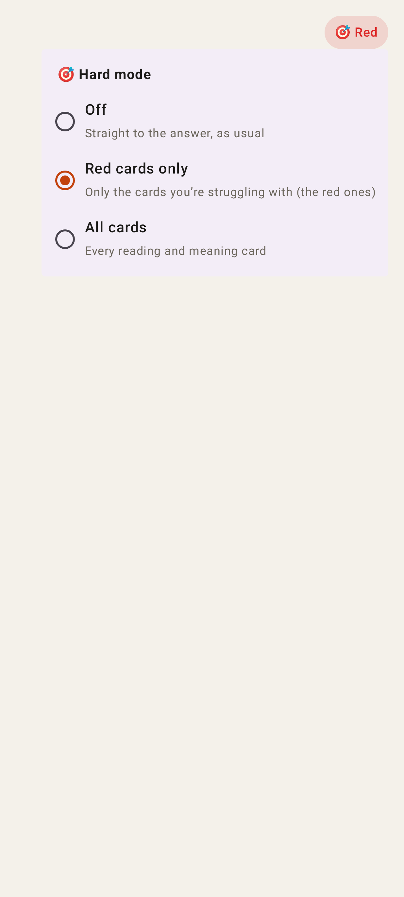
The three choices.

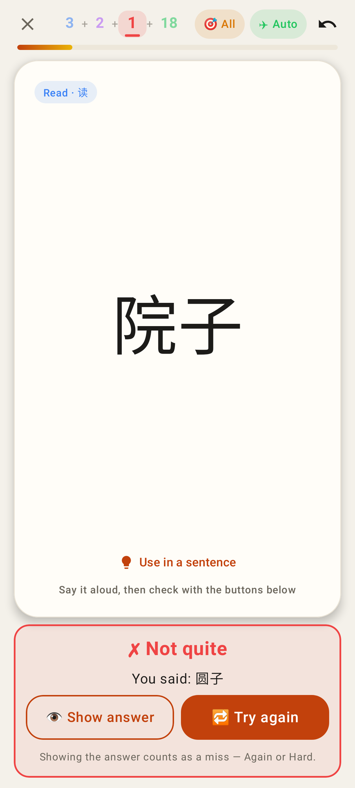
✗ Not quite on the question.

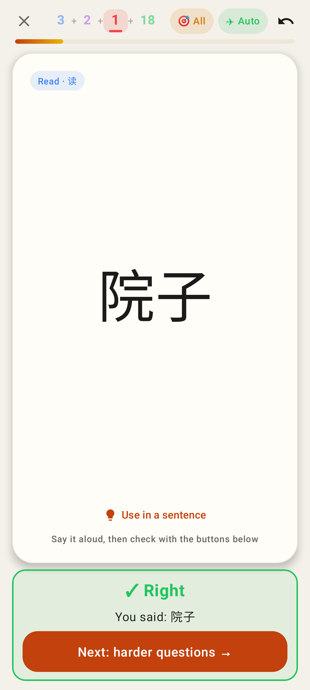
✓ Right → Next: harder questions.

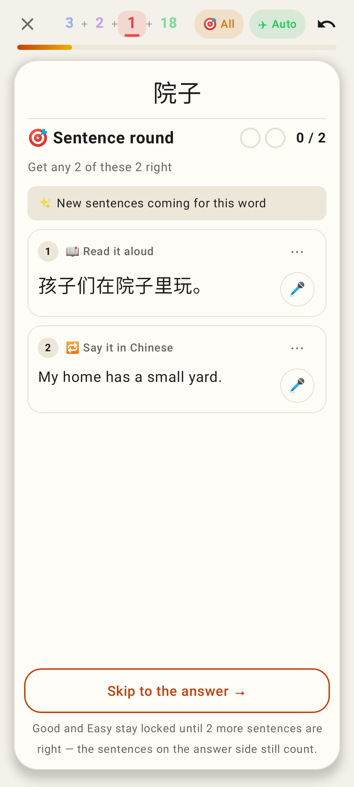
Two sentences, two exercises.

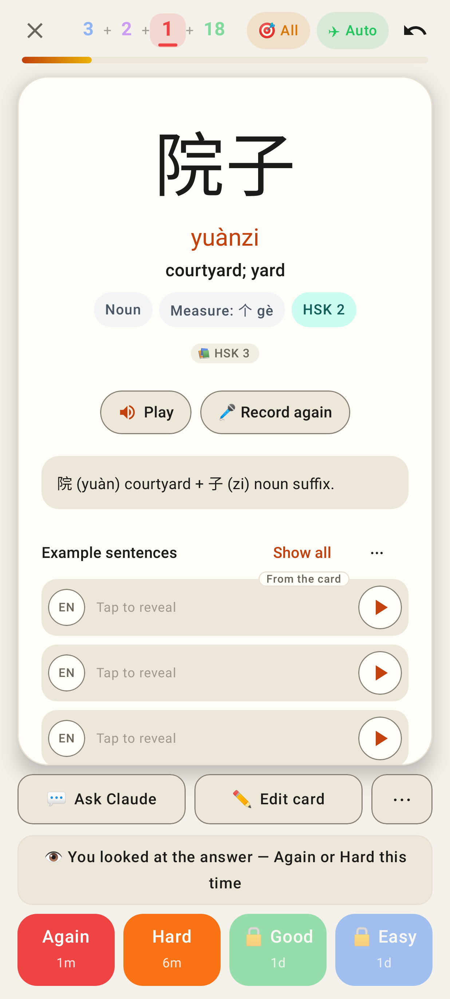
Gave up: Good / Easy locked.

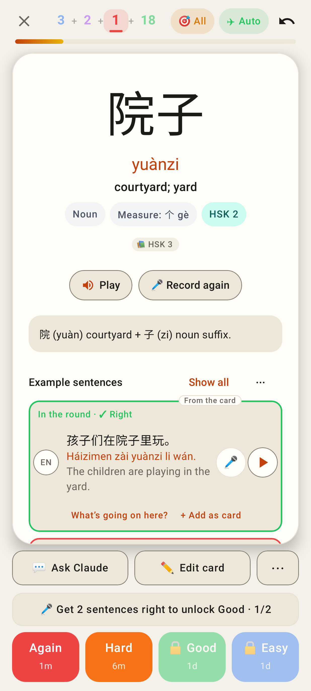
The round's sentences on top, outlined and opened.
