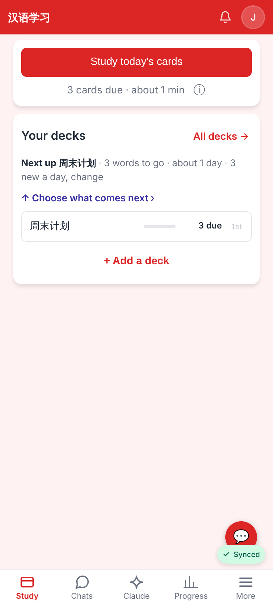
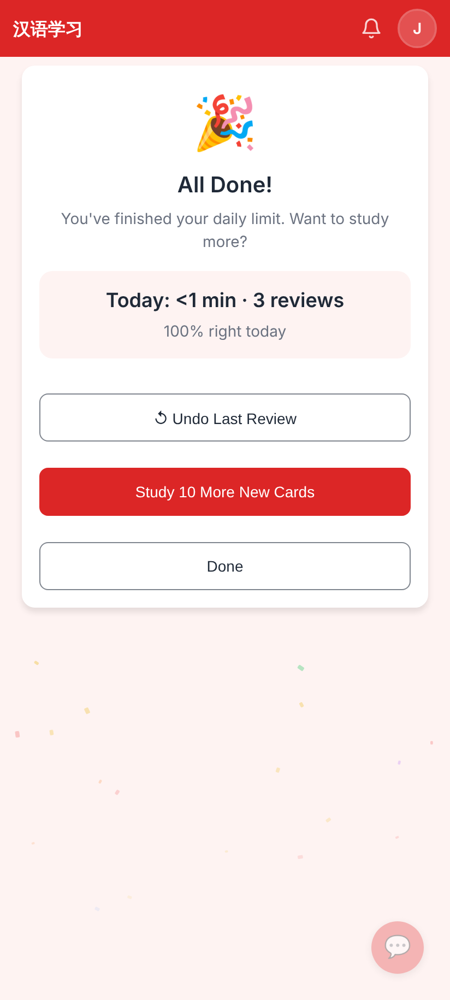
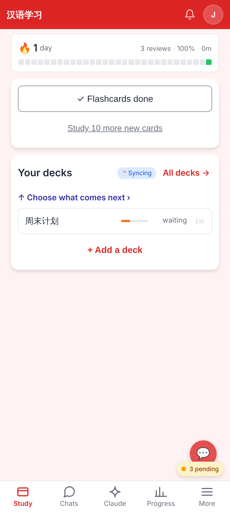
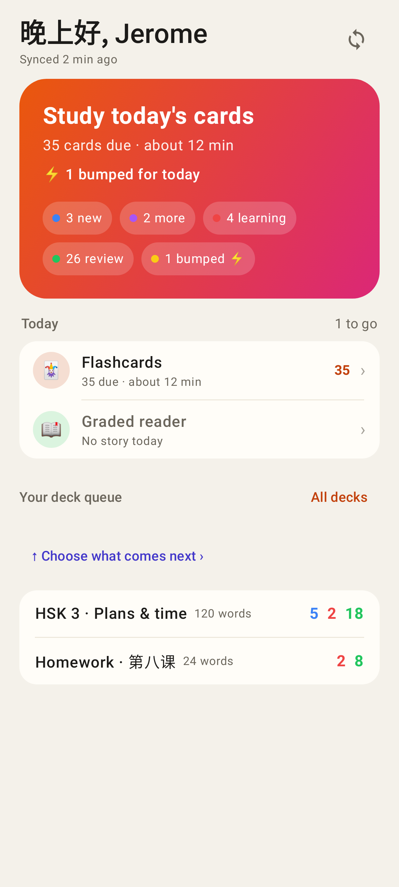
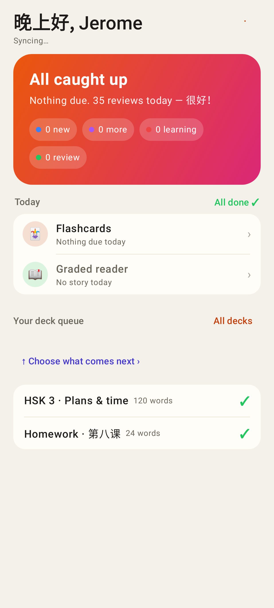

# Home counts right after a study session

Phone viewport (412×915 @2x). The sync routes were made to hang from the moment Study opened,
so everything Home shows comes from the device.

## Web

Before: 3 cards due.

The session's "All Done!" screen.

60 ms after **Done**: "✓ Flashcards done" on the first paint (the 3 reviews are still waiting to
upload — "3 pending"). Before this change Home painted "3 cards due" here until its recount finished.

## Lab app (Roborazzi)

Before: 35 cards due.

Right after "All done" → Done, while the upload sync runs: "All caught up" (it used to stay on the
old count until the sync finished, then say "Getting your cards…" while it ran).
