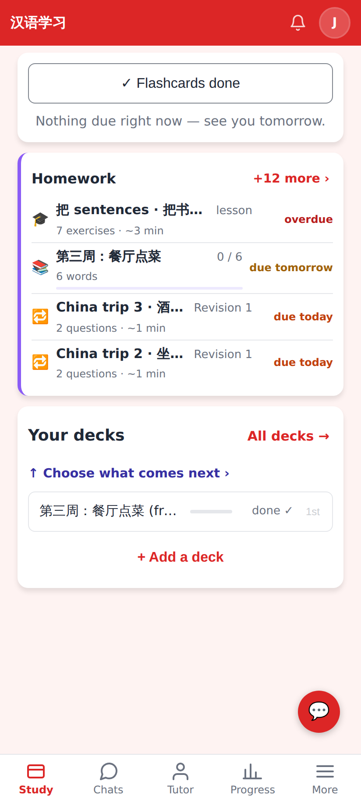
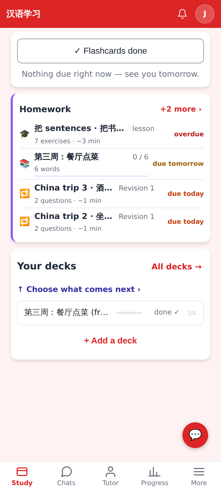
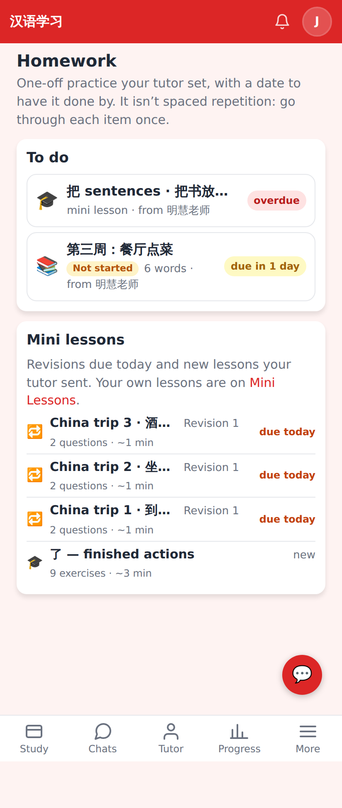

# Home homework card: only real to-dos

Seeded like Jerome's account: 2 open one-off items from 明慧老师, 3 of his own lessons with a revision due,
1 lesson she sent for long-term review, 2 lessons she assigned and then cancelled, 8 of his own
agent-made lessons ("China trip 5–12") never started. Phone viewport 412×915 @2×.

Before: "+12 more" — the cancelled lessons and his own never-started lessons were counted.

After: "+2 more" — open homework + revisions due + the tutor's long-term lesson only.

"+2 more" opens /homework, which now lists the same extra rows under "Mini lessons"
(his own never-started lessons stay on the Mini Lessons page).
