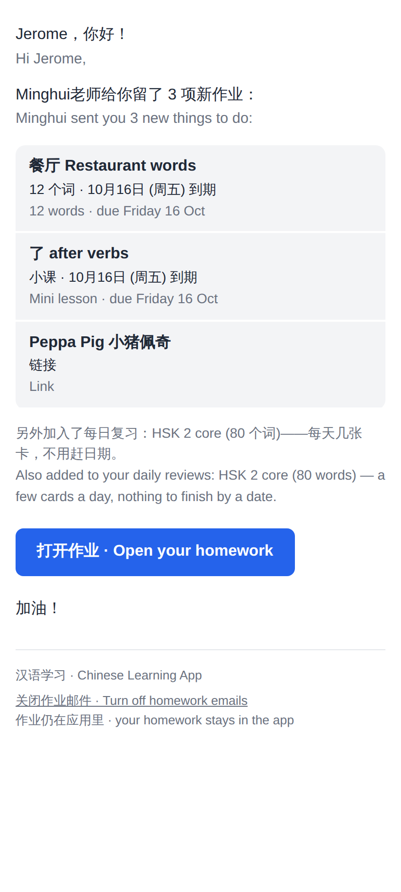
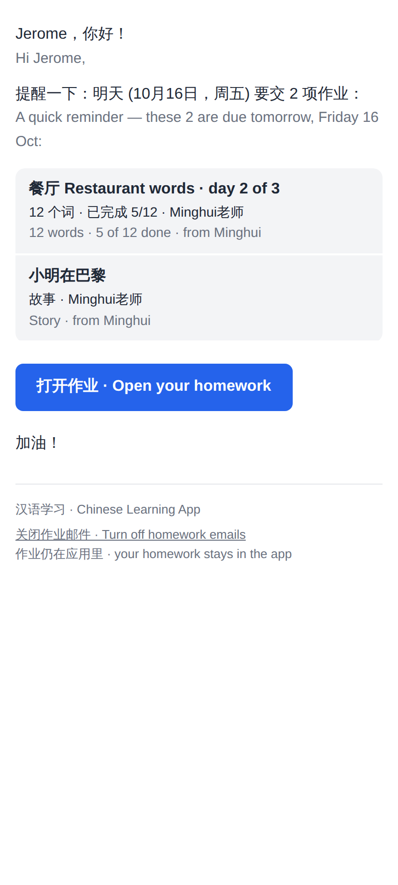
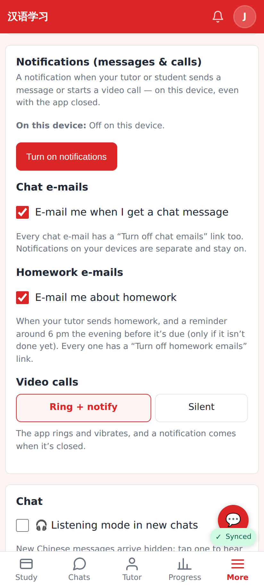
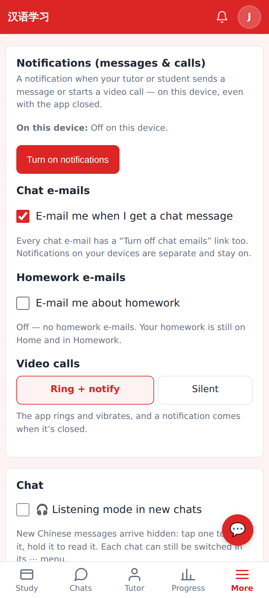

# Homework e-mails — screenshots

Phone width (412 px, 2×). The e-mails are the committed template snapshots
(`worker/src/services/__tests__/__snapshots__/homework-email-*.html`) rendered in Chromium.

"Minghui sent you homework": one line per item with its due date, the long-term deck as a quiet line, one button, "Turn off homework emails".

"Due tomorrow": the evening before (from 18:00 local), open one-off items only, with progress.

Web Settings → Notifications → the new **Homework e-mails** toggle (on, the default).

Turned off.

Lab app: Settings → Homework e-mails is the same `SettingsSection` + `ToggleRow` as Chat e-mails right above it (`HomeworkEmailsScreenshots` renders it on / off-dark; compiled and run by CI, the local container ran out of memory for the Kotlin compiler).
