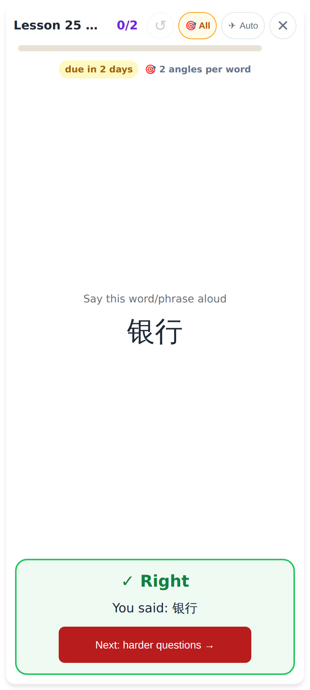
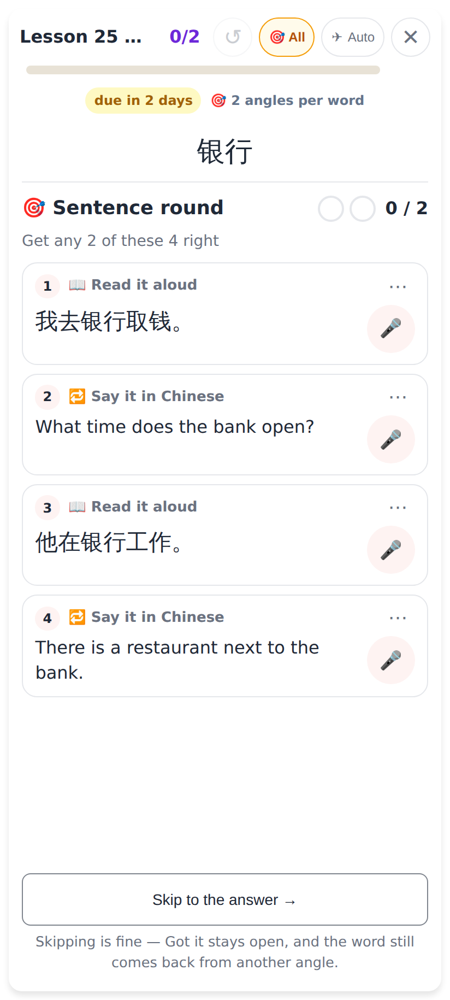
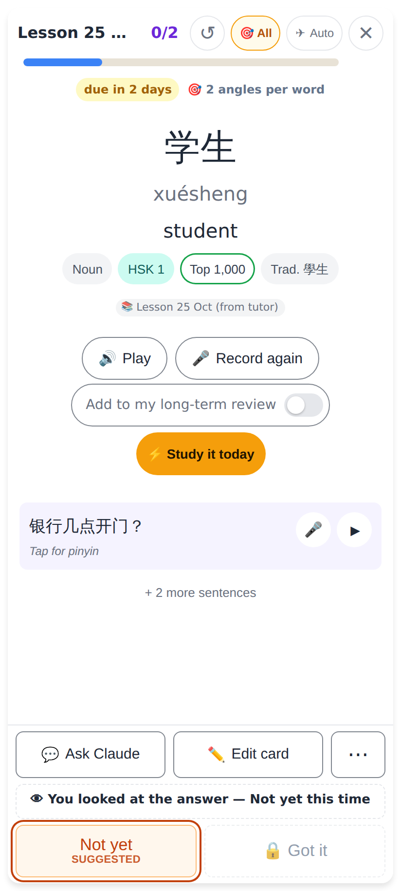
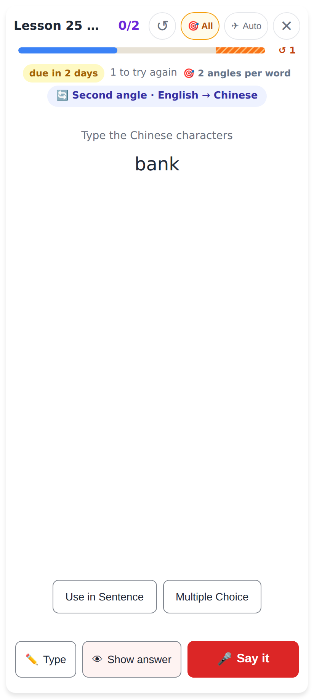
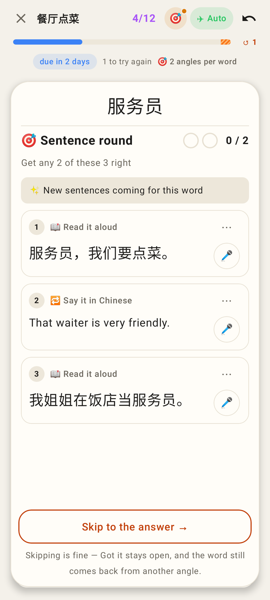
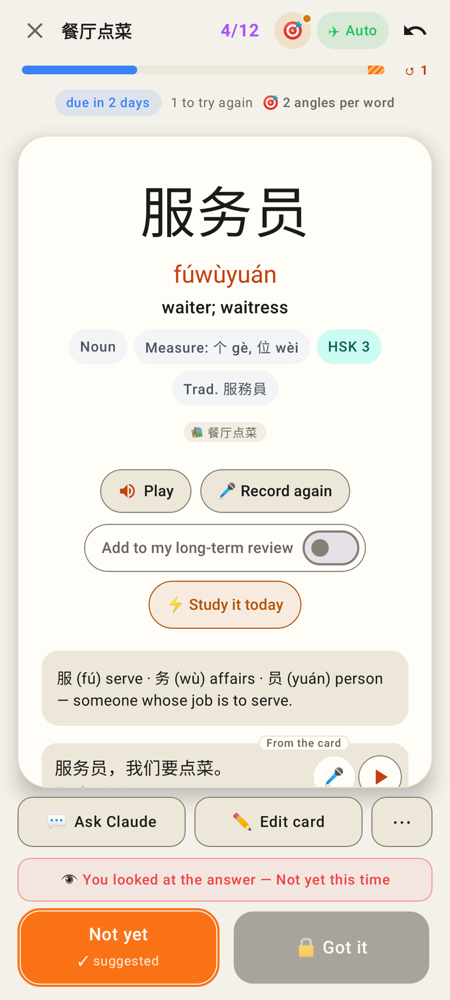
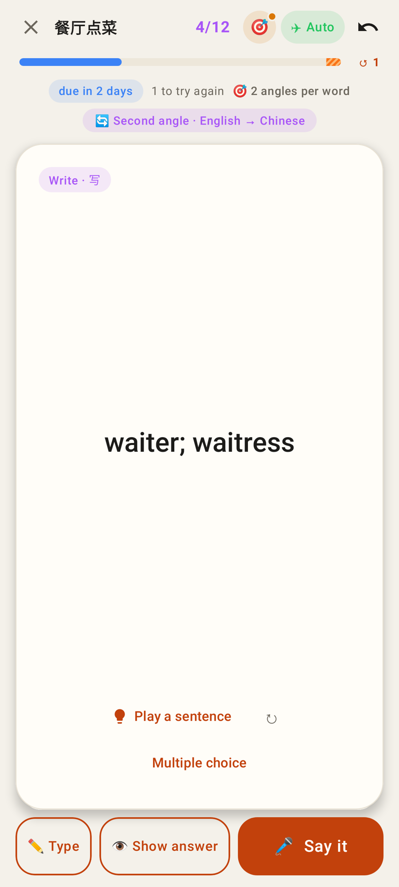

# Hard mode in the homework pass

Web at 412×915 (2×), from `e2e/tests/homework-pass-hard-mode.spec.ts`; Lab from Roborazzi (`PassHardModeScreenshots`).

The read card's take is checked on the question: ✓ Right. The pass header has its own 🎯 chip (All by default) and "🎯 2 angles per word".

Then the Sentence round — skipping is fine in the pass (Got it stays open).

Skip recording / Show answer before a right answer: Got it locked, Not yet suggested.

A word got right comes back once more later on its meaning card ("🔄 Second angle · English → Chinese"); the bar counts the owed angle.

Lab app: the round in the pass.

Lab app: Got it locked after giving up.

Lab app: the second angle.
