# Homework pass on the study card

The one-off homework pass (`/homework/:id`) now shows each word as the normal study card's read
card — 🎤 Record with the live transcription, "You said", Record again, Skip recording, the back with
its explorer chips, word tags, sentences, Ask Claude / Edit / ⋯ — with the pass's own Not yet / Got it
where the ratings are, and no review event. Phone shots at 412×915 (2×).

## Web

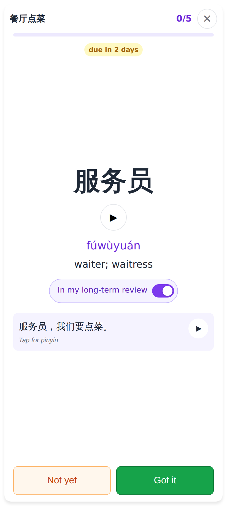
Before: the pass's own card (no recording, no "You said").

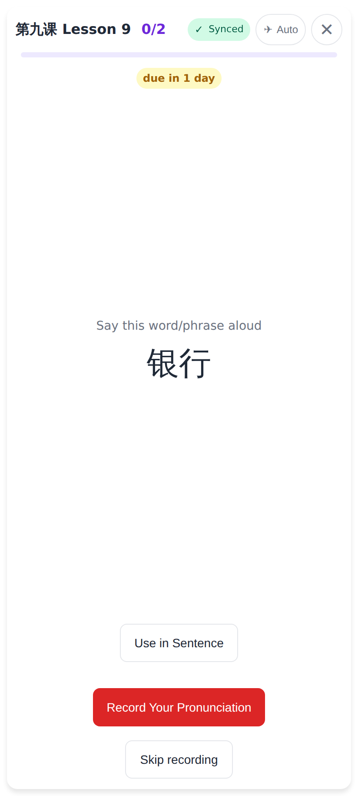
The read card, with the pass's title, counter and due line instead of the queue counts (no undo).

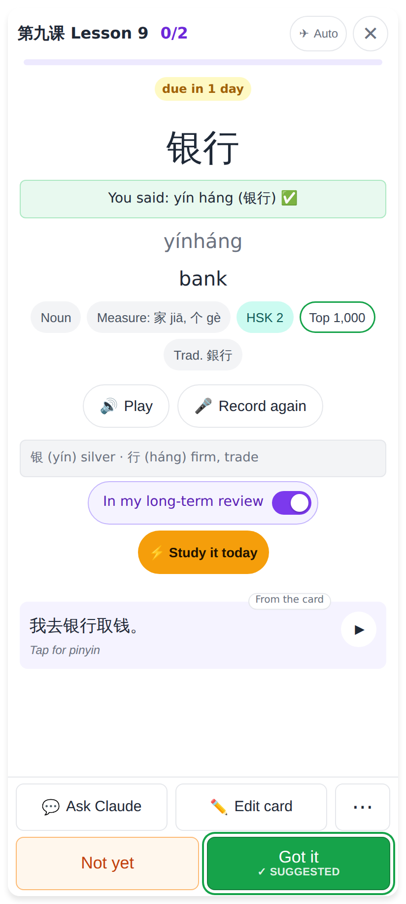
After Record → Check Answer: "You said" matched, so Got it is ringed "✓ suggested" — Not yet still works.
"Add to my long-term review" and ⚡ Study it today sit under the meaning.

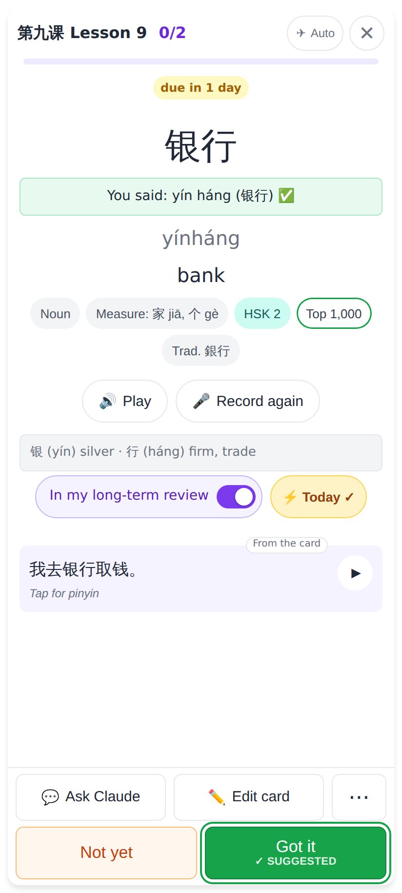
⚡ toggled on: "⚡ Today ✓" (the word is first in today's study); a second tap takes it out.

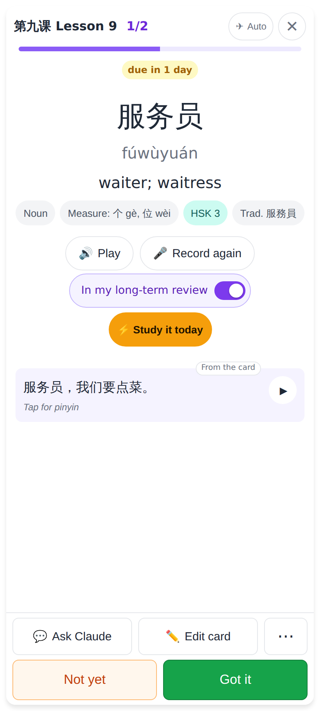
Skip recording: no suggestion, both buttons plain.

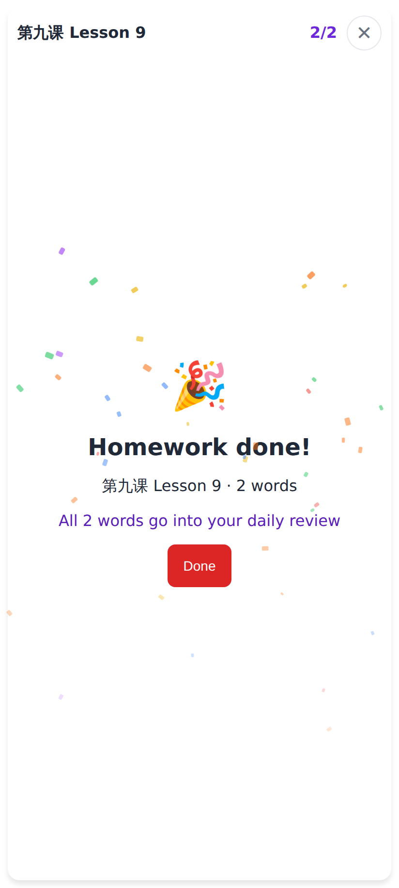
The finish screen, unchanged.

## Lab app

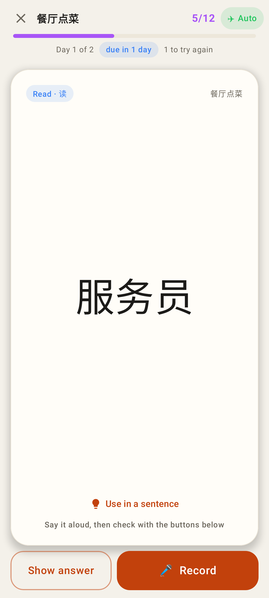
The read card in the pass (title · 5/12 · progress · due line).

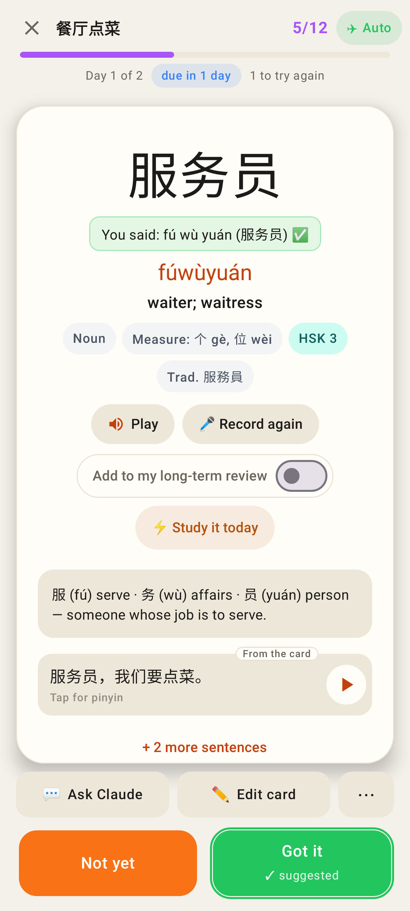
"You said" matched → Got it ringed "✓ suggested"; the long-term switch and ⚡ under Play.

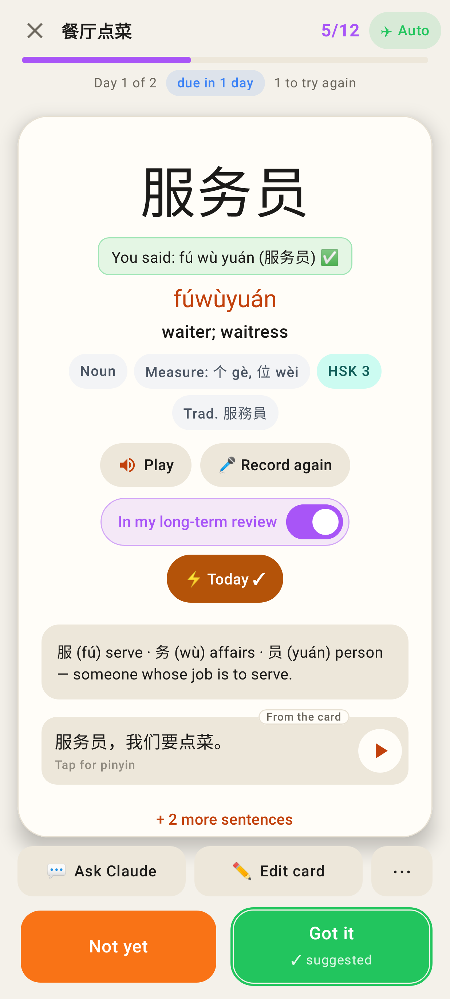
⚡ Today ✓ and "In my long-term review".

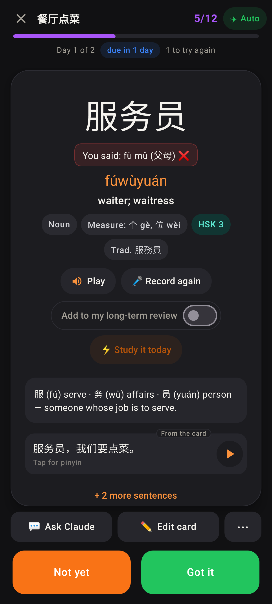
A take the recogniser missed suggests nothing (dark theme).

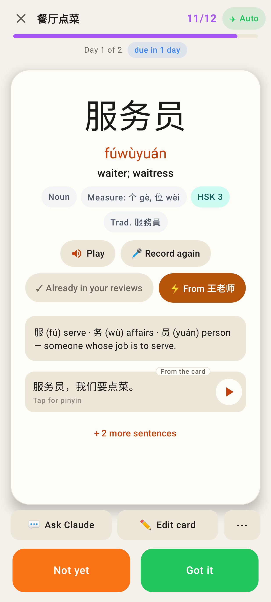
A word already in the reviews; bumped by the tutor ("⚡ From 王老师").

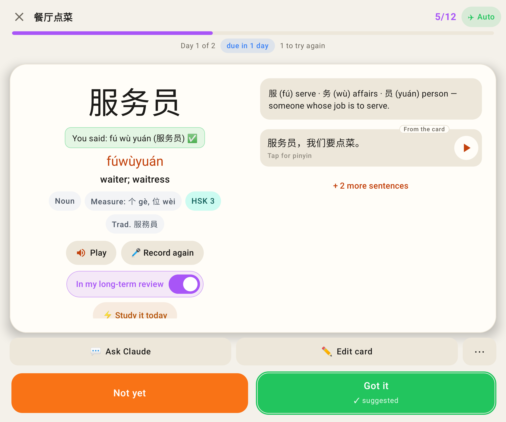
The unfolded Fold.
