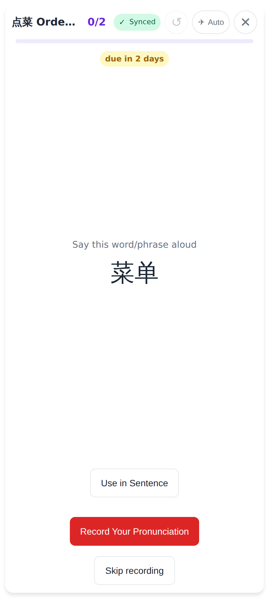
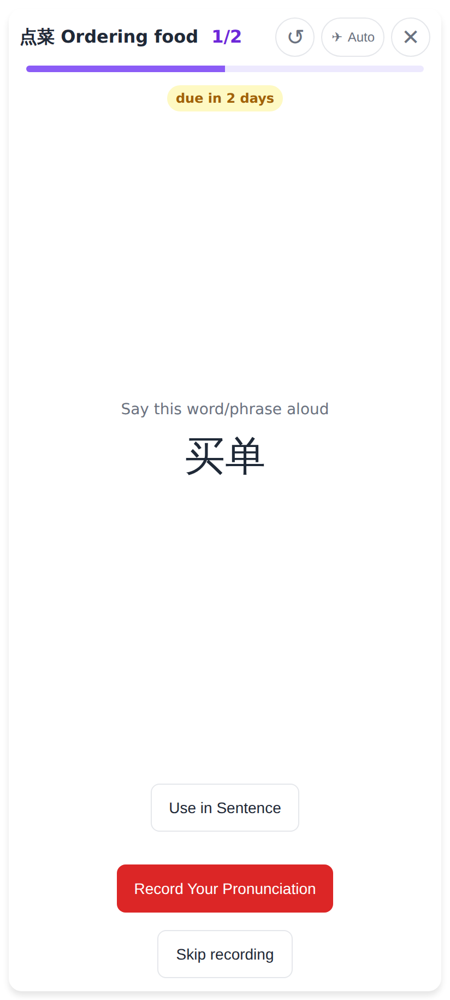
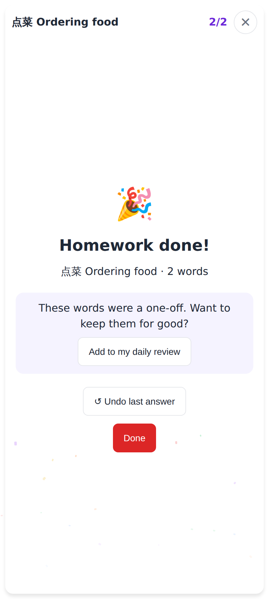
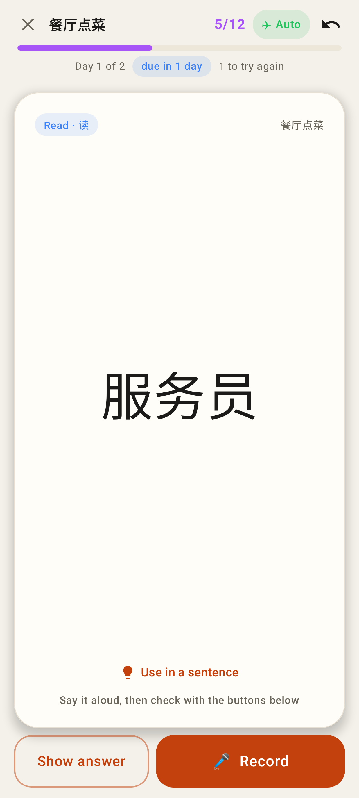
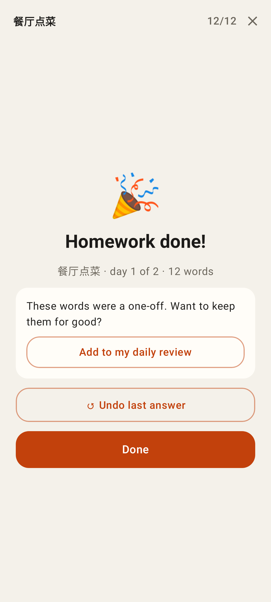

# Homework pass: ↺ Undo the last Got it / Not yet

Phone viewport (412×915 @2×) for the web app; Lab app shots from Roborazzi.

Web — the pass's first word: Study's ↺ now sits in the pass's top bar, greyed while there is nothing to take back.

Web — after a Got it (1/2) ↺ is live. Pressing it brings 菜单 back as a fresh card at 0/2; after undoing the last Got it from the finish screen the pass looks exactly like this again (1/2, 买单).

Web — the last Got it finished the pass by mistake: "↺ Undo last answer" reopens it (the tutor's view goes back to active).

Lab app — the pass on the study card, with Study's Undo icon at the end of the top bar.

Lab app — "↺ Undo last answer" on the finish.
