# Homework rows: retry bars, the row menu, Skip handwriting

Web (412×915, 2×):

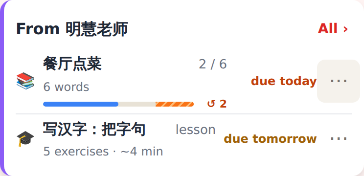
Home's homework card: the started deck pass has the retry bar (blue answered, orange "Not yet" owed, ↺ 2); the lesson not started has no bar.

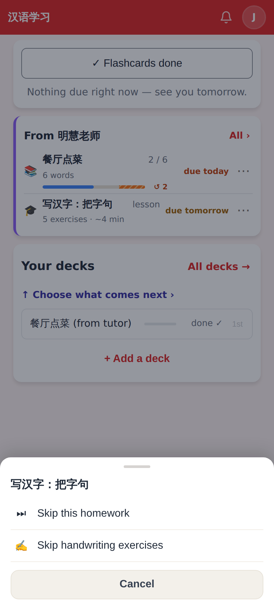
⋯ / long-press on the tutor's lesson: Skip this homework · Skip handwriting exercises.

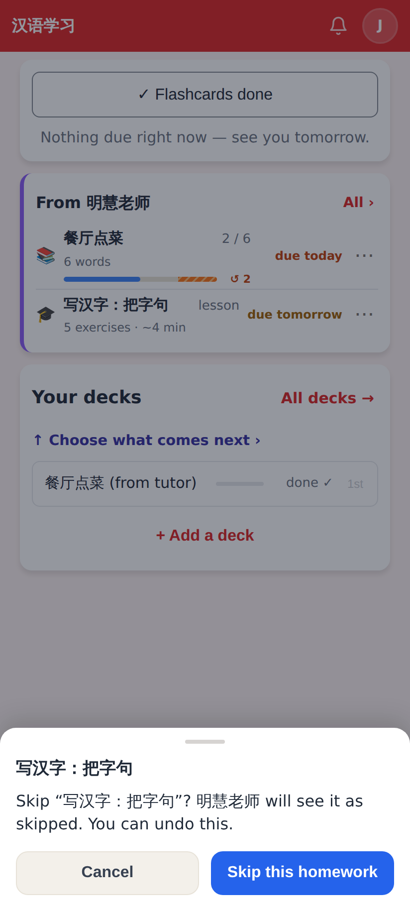
The confirm says the tutor will see it.

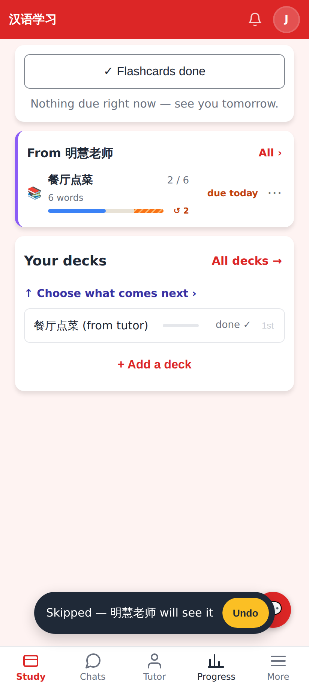
Skipped — the row leaves Home; the toast offers Undo.

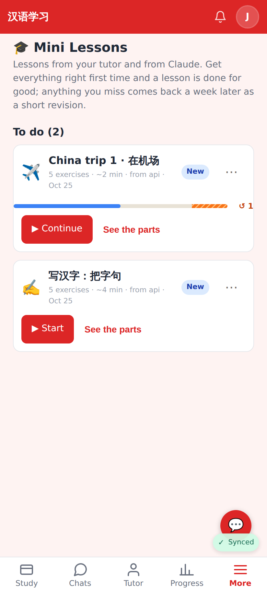
Mini Lessons' To do: a started lesson shows its run's retry bar; ⋯ on every card.

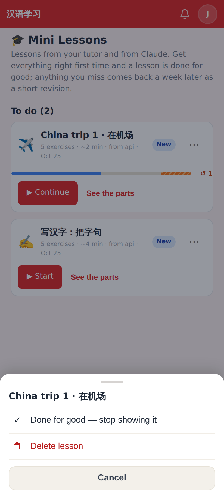
His own lesson: Done for good · Delete lesson.

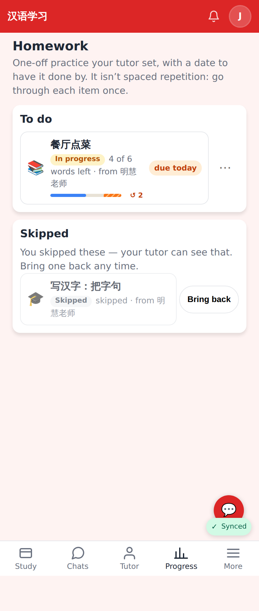
/homework: the skipped item under Skipped with Bring back.

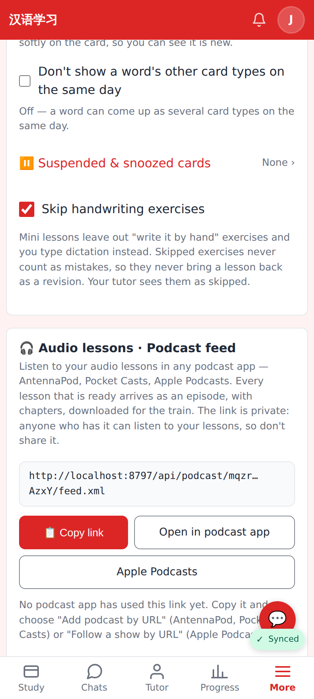
Settings → Study → Skip handwriting exercises.

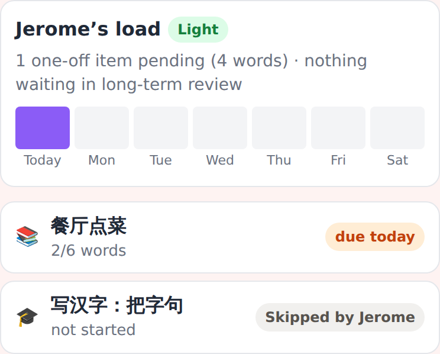
The tutor's student page: "Skipped by Jerome".

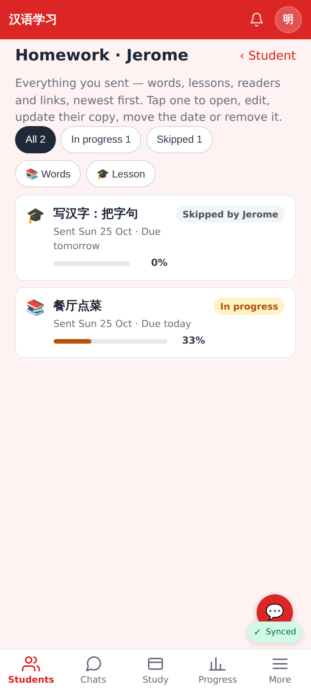
The tutor's homework library: status Skipped by Jerome, with a Skipped filter chip.

Jerome's path, Home → the homework list → long-press a revision:

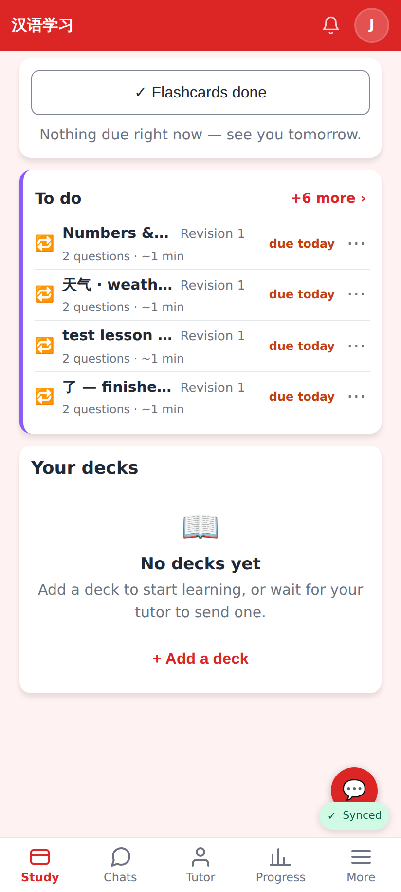
Home's card with revisions due (his own old test lessons among them).

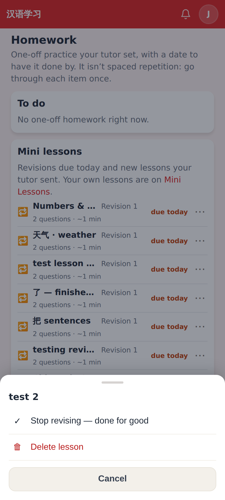
"All ›" → /homework; long-press a revision row: Stop revising — done for good · Delete lesson.

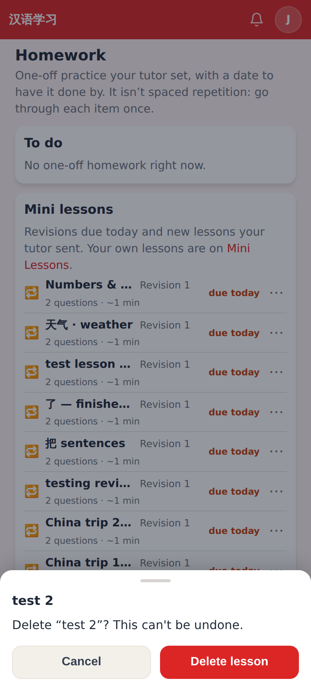
Delete asks first.

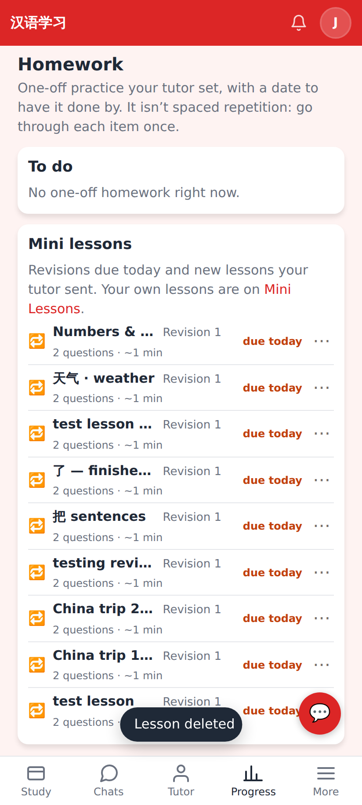
Gone at once (offline-first; the server gets the DELETE now or on the next sync) — it never comes back as a revision.

Lab app (Roborazzi):

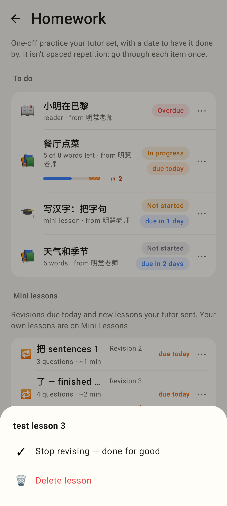
/homework from Home with ~10 revisions; long-press one → Stop revising — done for good · Delete lesson.

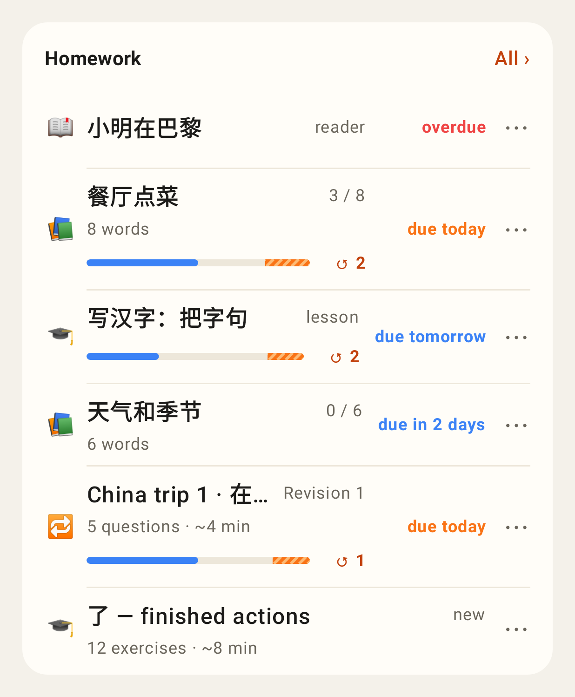
Home's card: bars only on started rows (deck pass, lesson homework, revision), ⋯ on every row.

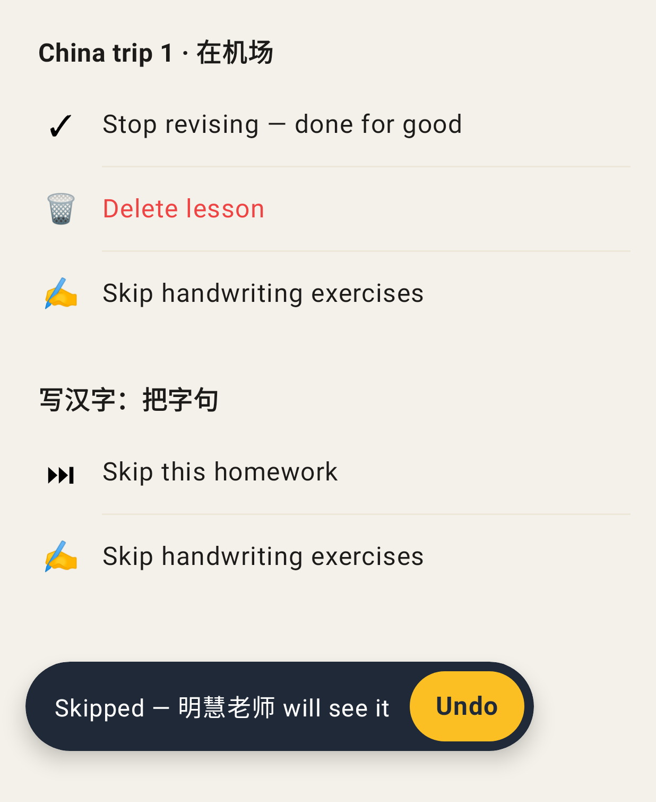
The menu for a revision and for a tutor's lesson, and the Undo toast.

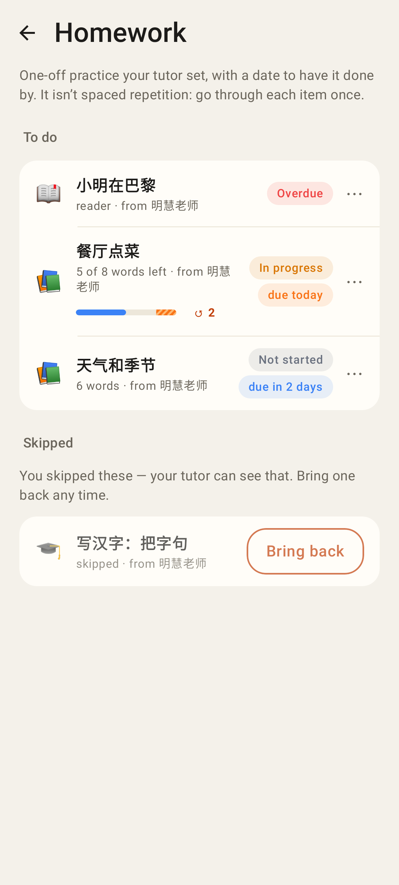
/homework: bars on started rows, Skipped with Bring back.

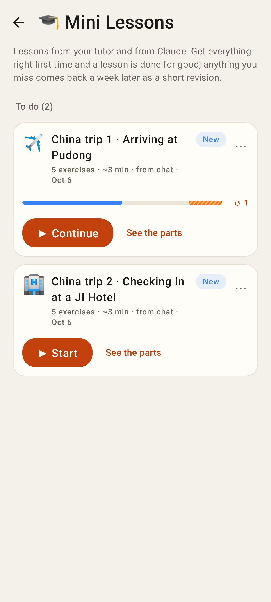
Mini Lessons: the started lesson's bar.

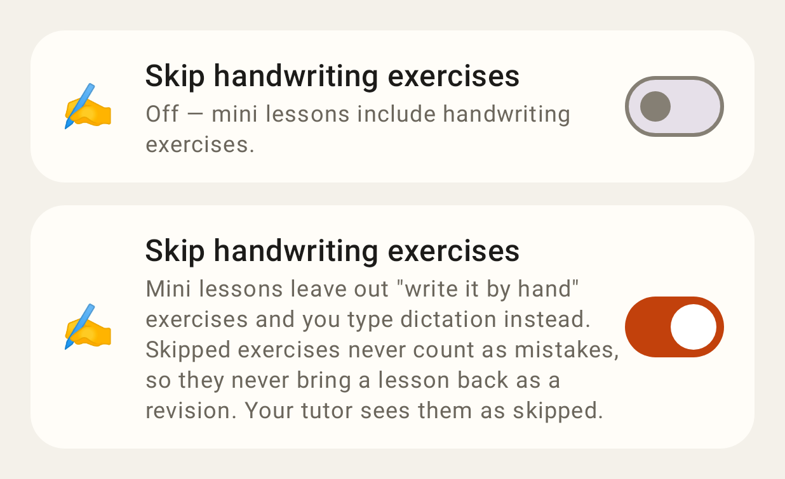
Settings → Skip handwriting exercises, off and on.
