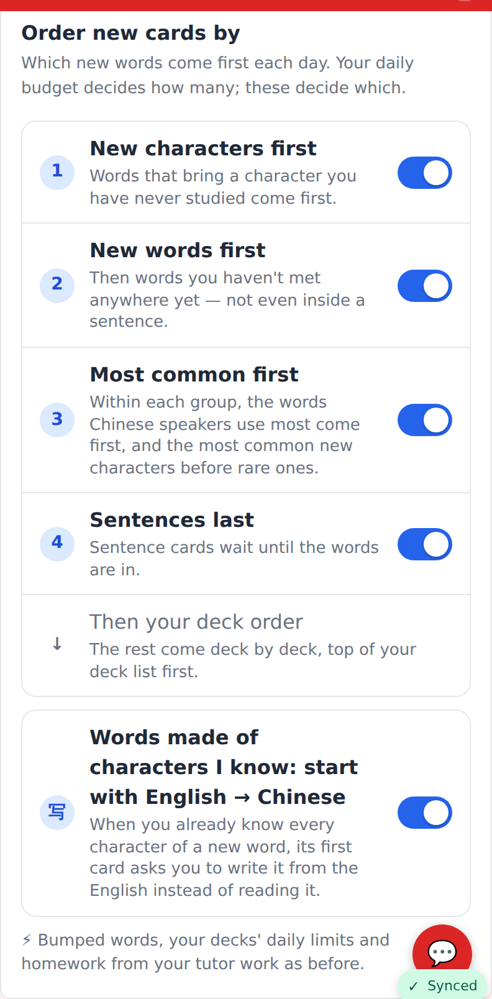
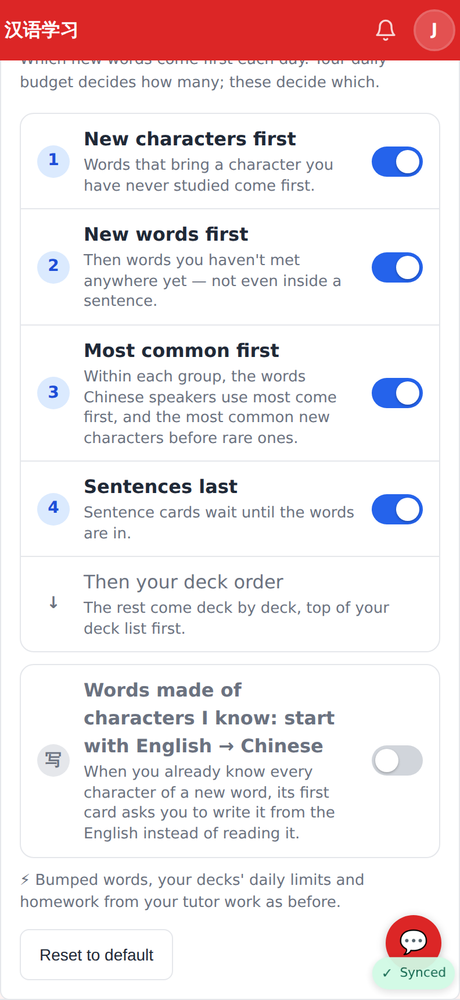
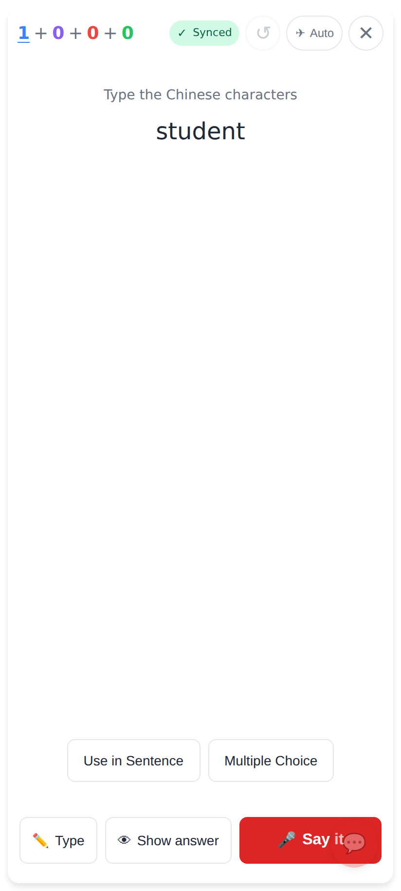
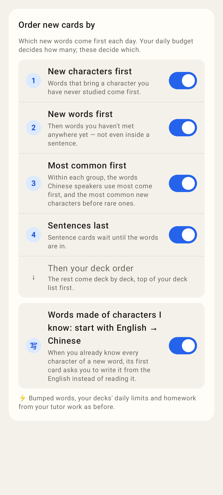
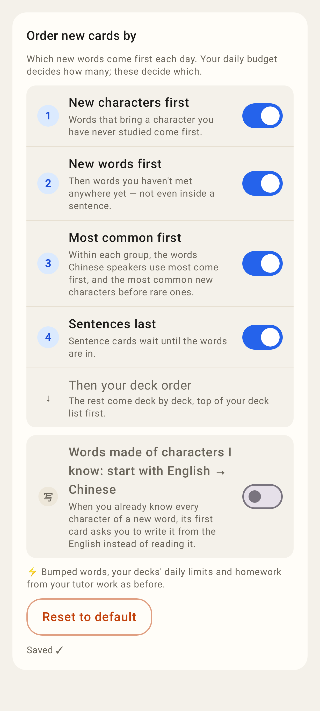
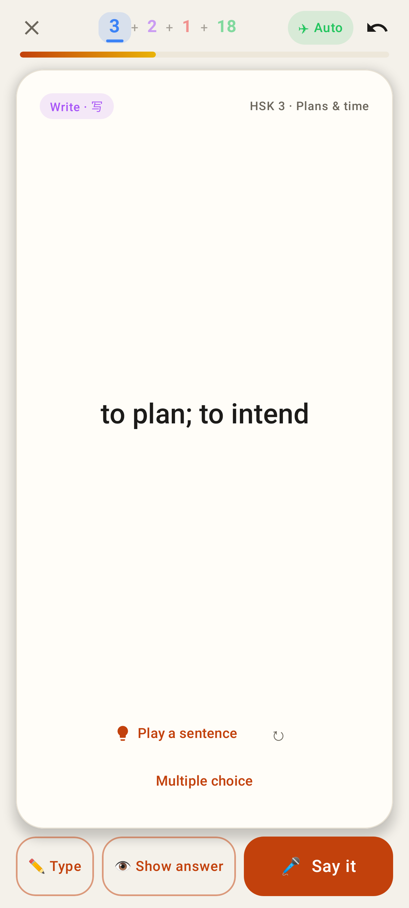

# Words made of characters I know: start with English → Chinese

Web (412×915 @2×)

Settings → New cards: the new switch under the order, on by default.

Turned off (saved at once; "Reset to default" appears).

学生 is new but 学 (大学) and 生 (生活) are known, so its first card is meaning → hanzi.

Lab app

Settings → New cards in the Lab app, same words.

Turned off.

The Lab study card for a new word of known characters: the Write · 写 card first.
