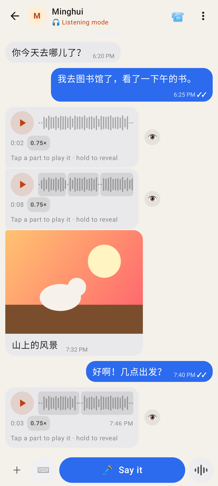
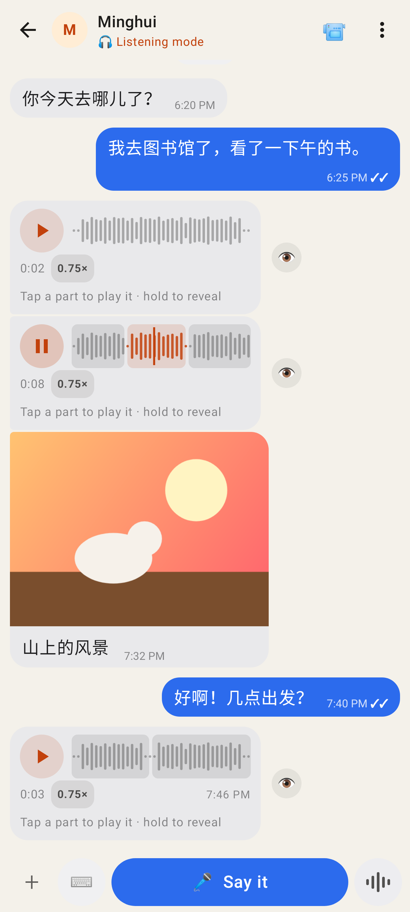
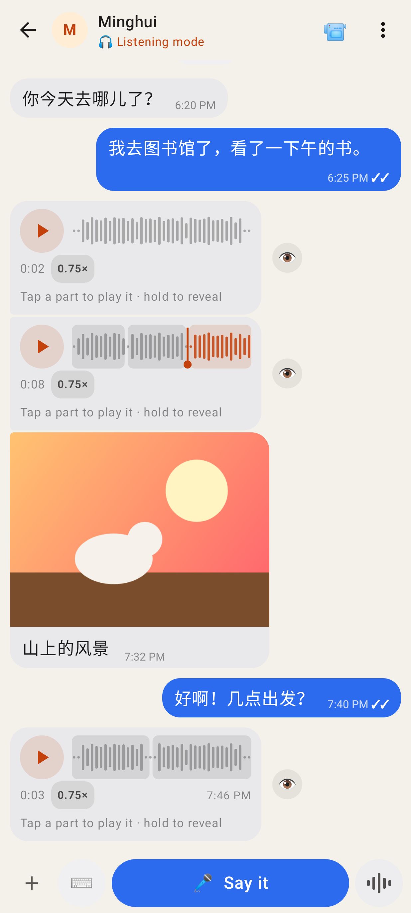
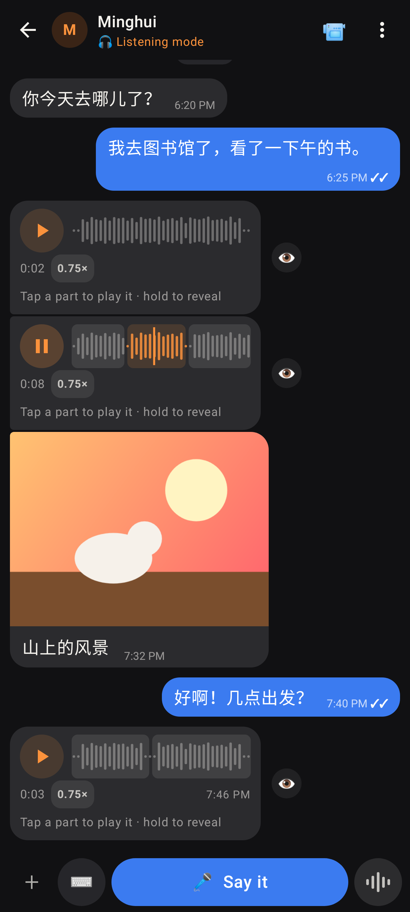

# Lab chat: a listening-mode message split into parts

Shot with Roborazzi at the folded Pixel's size (412dp wide).

Each hidden message shows its waveform split into parts at the pauses. "Tap a part to play it · hold to reveal".

The second part is playing: it is lit with the head moving through it, and ▶ has turned into ⏸.

Paused in part 3: ▶ replays that part, or the part before if he paused within the first second of part 3.

The same in dark mode.
