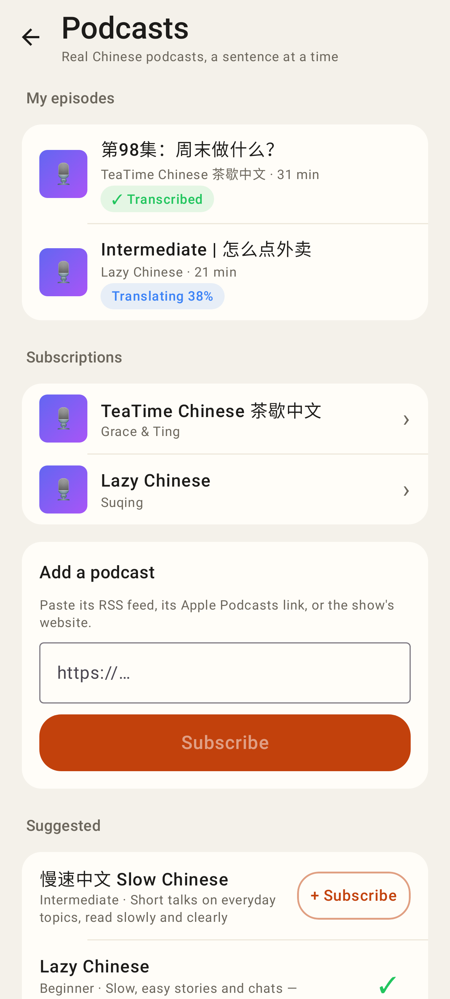
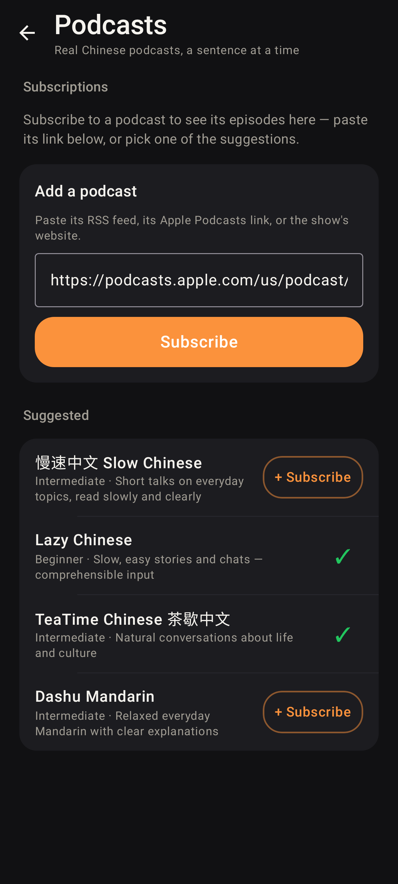
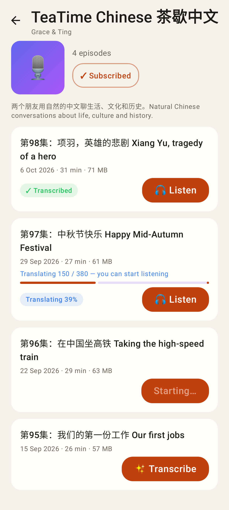
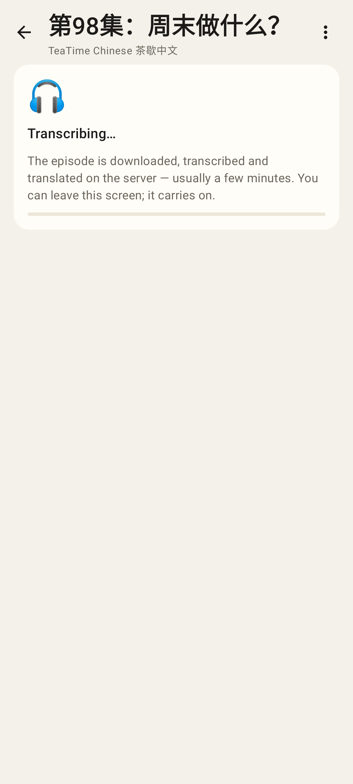
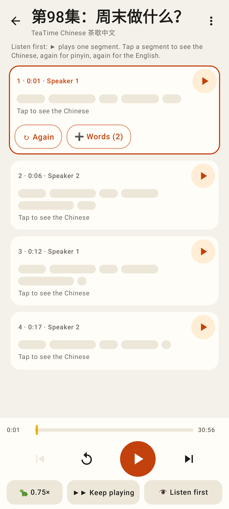
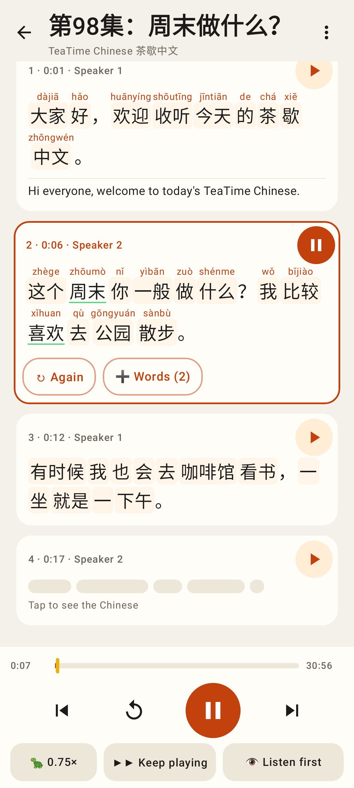
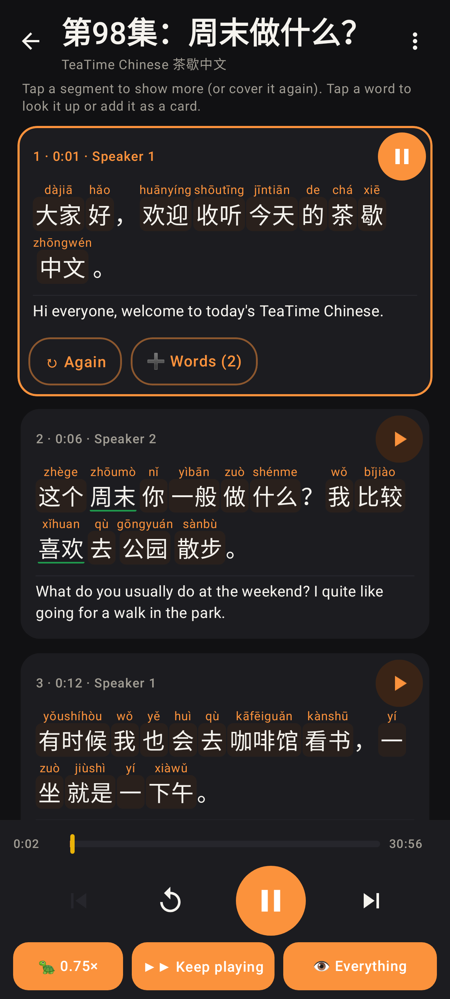
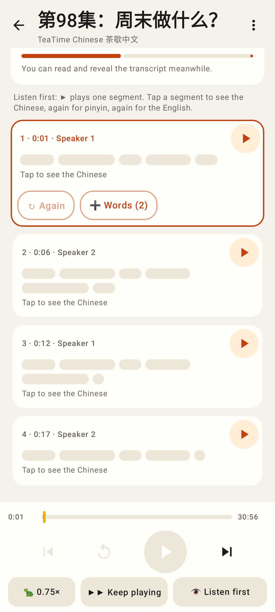
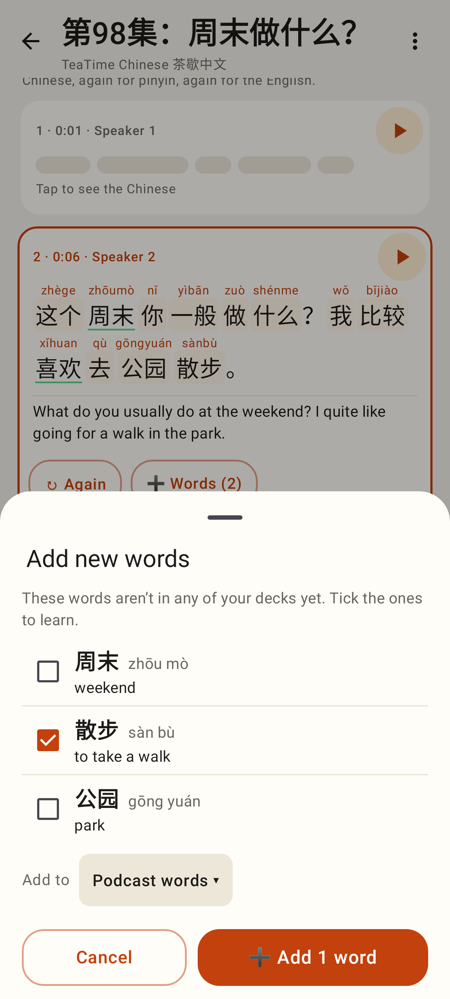
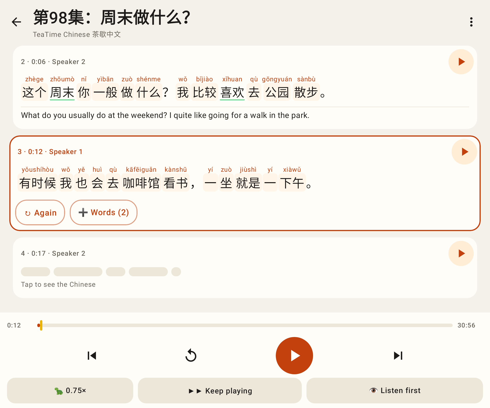

# 🎙 Podcasts — Lab app (Pixel Fold, 412 dp)

Roborazzi renders of `ui/podcasts/` (`PodcastsScreenshots`). Covers show the 🎙 placeholder (no network in tests).

My episodes with their status, subscriptions, add by link, suggested podcasts.

No subscriptions yet (dark mode), an Apple Podcasts link pasted.

A podcast's feed: transcribed (🎧 Listen), translating (listen already), starting, ✨ Transcribe.

The player while the server is still transcribing.

Every segment covered: ▶ plays one segment, ↻ Again, ➕ Words, the timeline, 0.75× / Keep playing / reveal mode.

Segment 1 fully open (Chinese + pinyin + English), 2 playing with pinyin, 3 with the Chinese only; words in a deck are underlined.

Reveal mode "Everything", 0.75× and Keep playing on.

The audio downloading on open while the English is still being translated.

➕ Words: the segment's words not in any deck (the Coach's picker), meanings filled in.

The unfolded inner screen.
