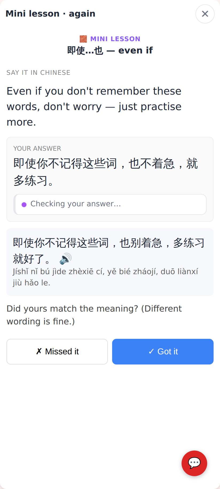
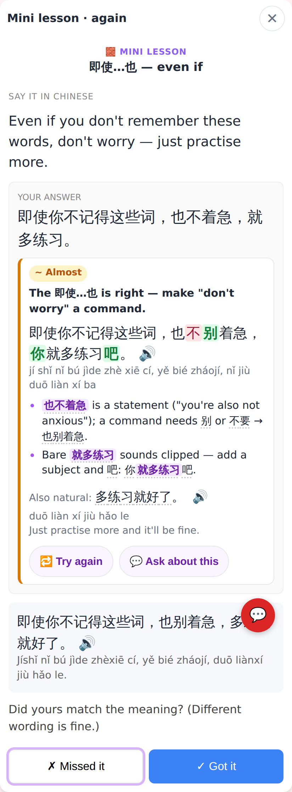
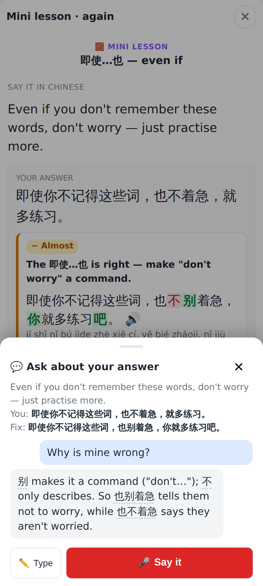
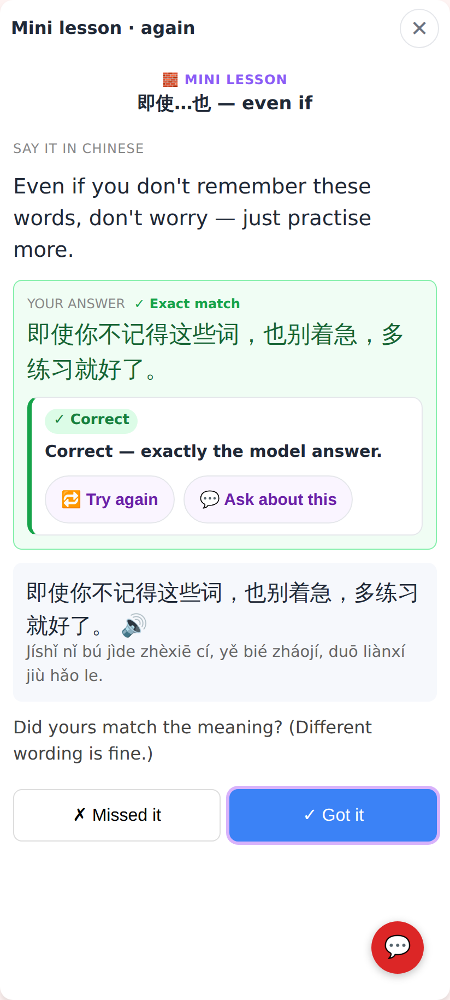
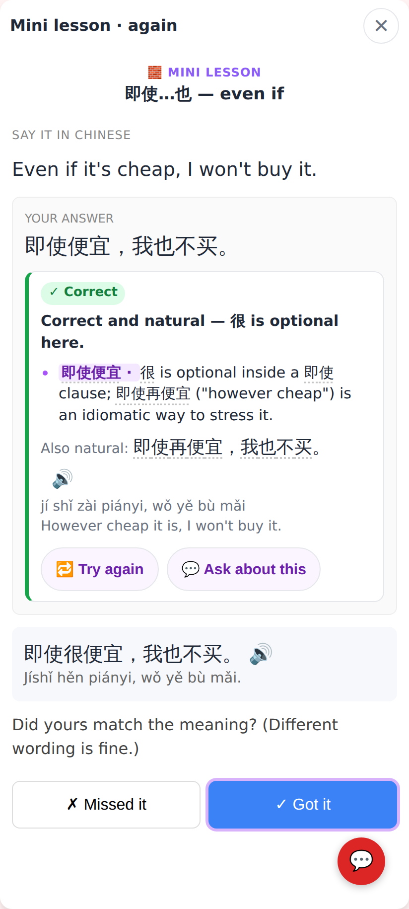
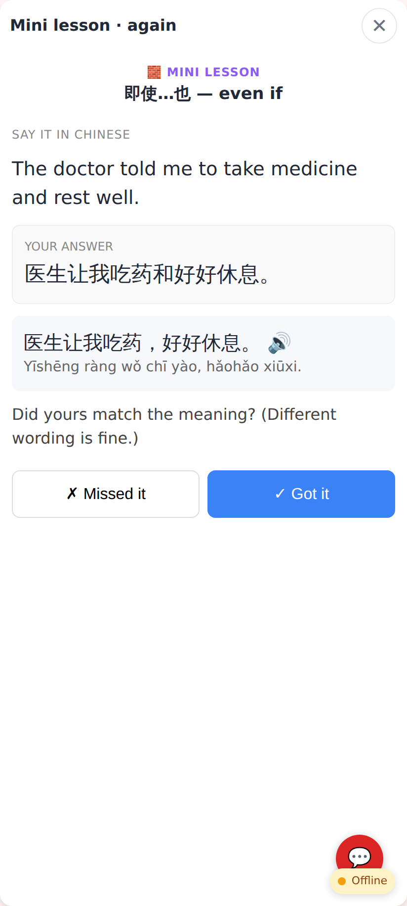
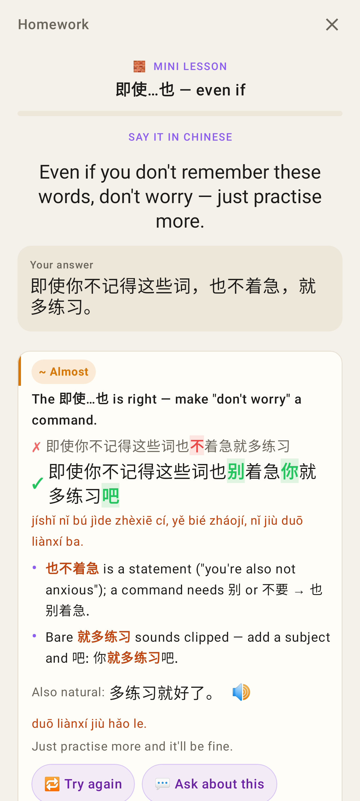
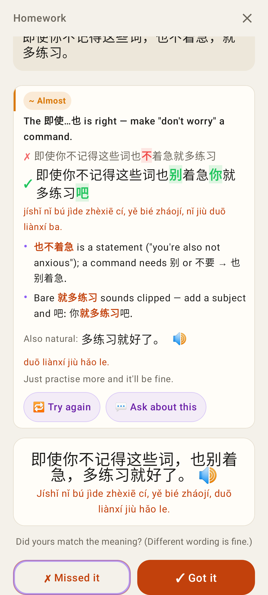
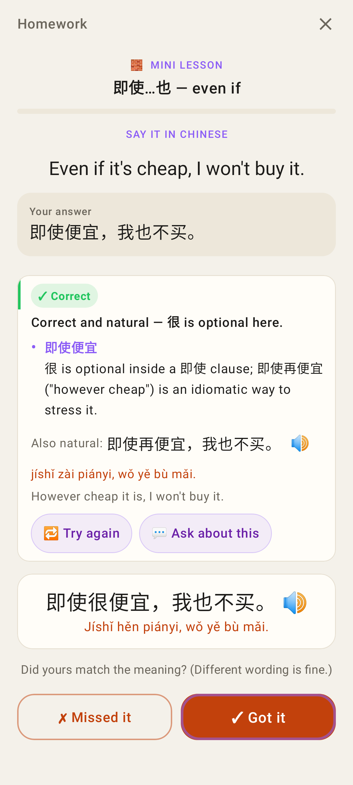
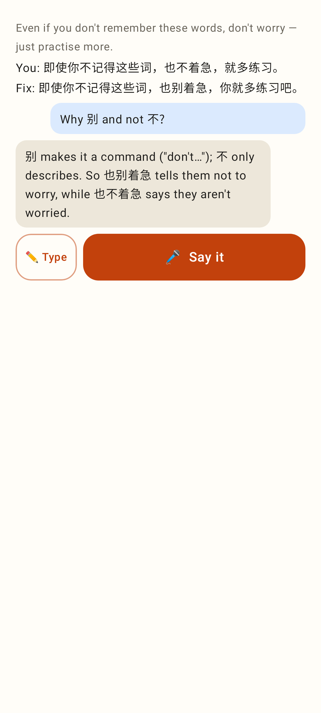

# Claude checks your answer — mini lessons

Web, 412×915 @2× (E2E_TEST_MODE, the fake model answering Jerome's three real answers):

The answer is final → a slim "Checking…" row under "Your answer"; the buttons stay usable.

~ Almost: the red-pen fix of HIS sentence (不→别, +你, +吧), the app's pinyin, tips quoting 也不着急 / 就多练习 (tappable), "Also natural: 多练习就好了。", Missed it ringed.

💬 Ask about this: a short chat inside the lesson, with the exercise and the check as context.

🔁 Try again → the new answer is checked again (✓ Correct), Got it ringed; the first try stays in the attempt.

即使便宜，我也不买。 → ✓ Correct, 很 is optional, 即使再便宜 as the idiomatic alternative.

Offline: no card — the self-assessment exactly as before.

Lab app (Roborazzi):

