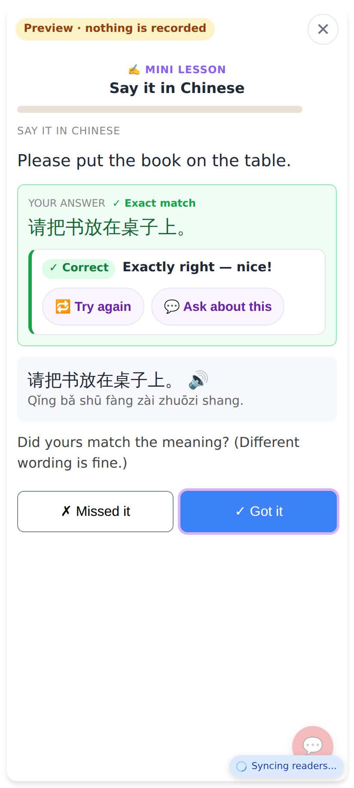
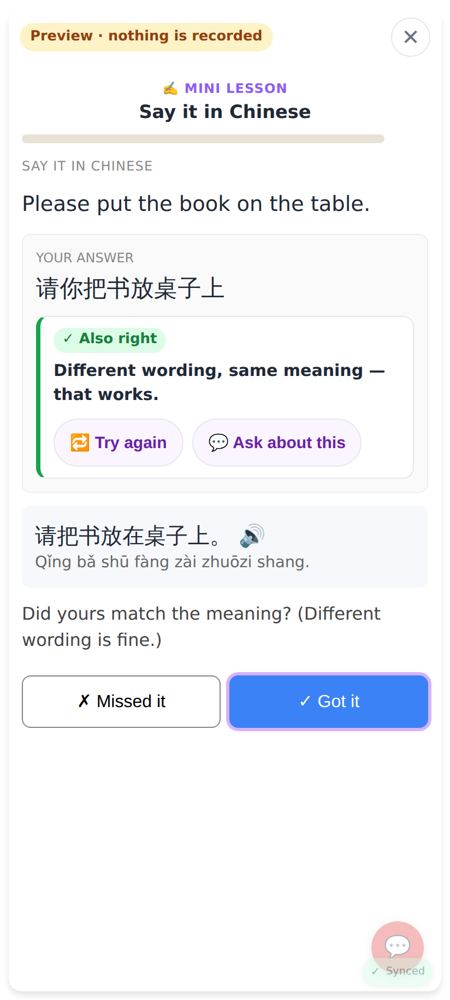
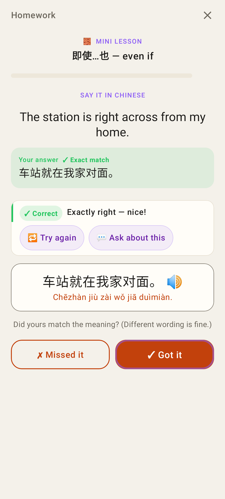

# Lesson answer check: exact match = no model call

Phone viewport 412×915 @2×, the "Say it in Chinese" sample from the exercise catalogue.

The answer IS the model answer ("✓ Exact match"): the card shows **✓ Correct · Exactly right — nice!** at once — no "Checking your answer…", no call to `/api/lessons/answer-check`, works offline. Got it is ringed; 🔁 Try again and 💬 Ask about this stay.

Other wording (here after 🔁 Try again) is still sent to Claude as before (E2E fake model shown).

Lab app, same rule (core `LessonAnswerCheck.exact`): Jerome's 车站就在我家对面。, no call.
