# Judge each sentence / Choose the word — screenshots

Web (412×915 @2×, the catalogue's Try it — the real lesson player):

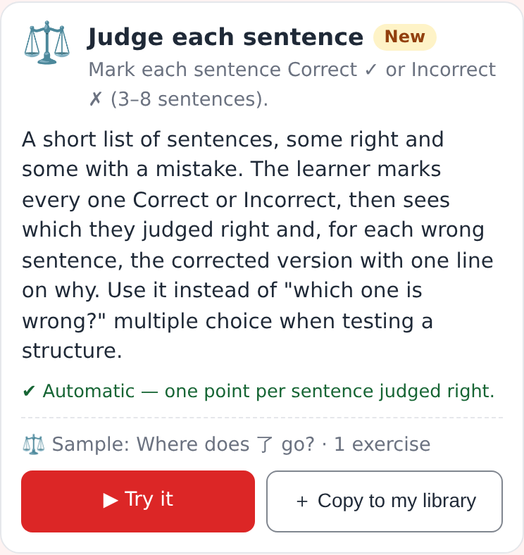 — the new type in the exercise catalogue ("New").

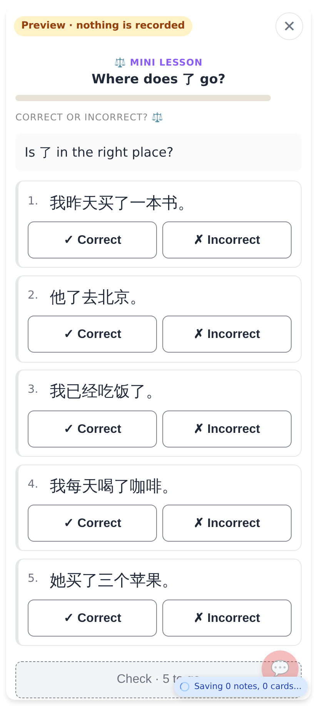 — every sentence gets ✓ Correct / ✗ Incorrect; Check waits ("Check · 5 to go").

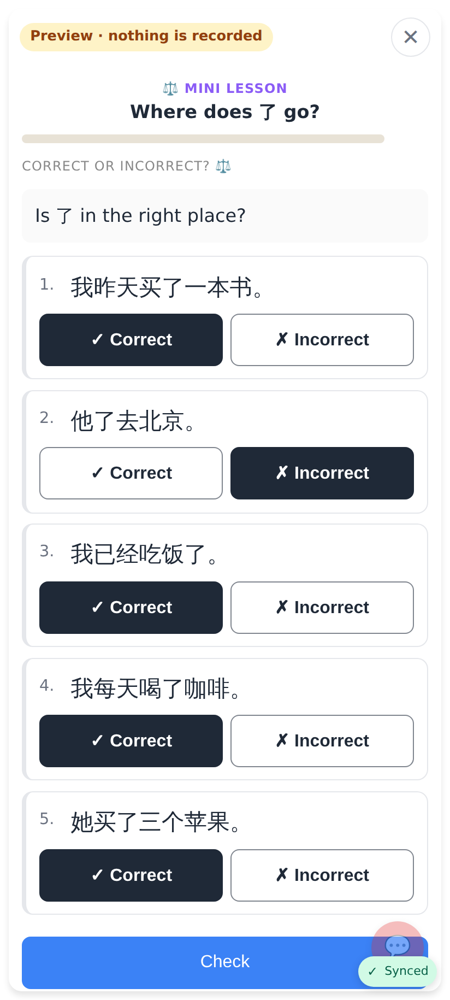 — the chosen side is filled dark (not colour alone).

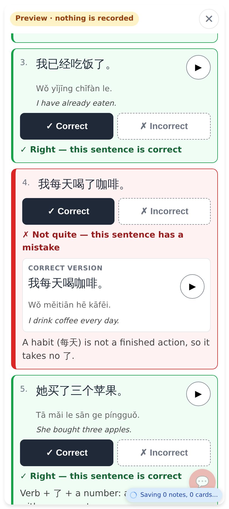 — "✗ Not quite — this sentence has a mistake", the correct version with pinyin + ▶ and the why; a missed row has a thick left bar.

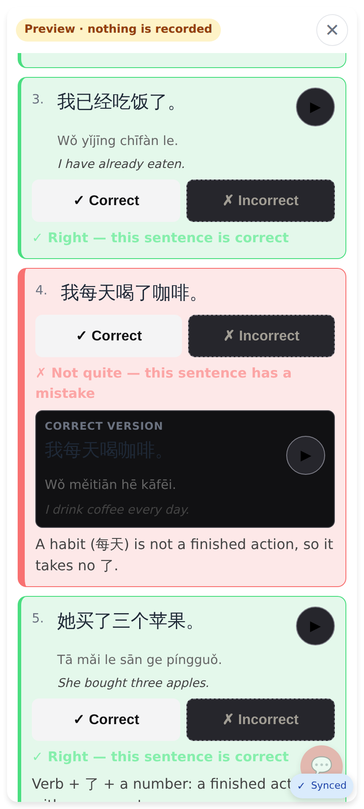 — under `data-theme="dark"` (the web is light-only today; the dark rules are in place).

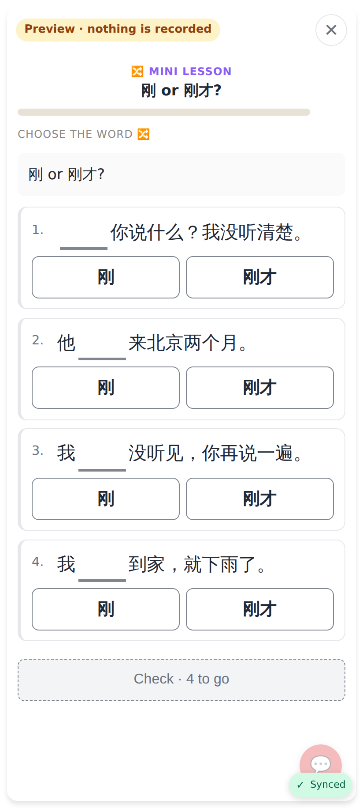 — one gap per sentence, the words to choose from as a toggle.

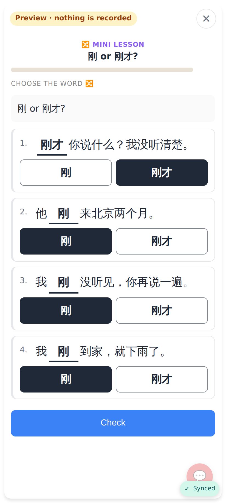 — a pick fills the gap in place.

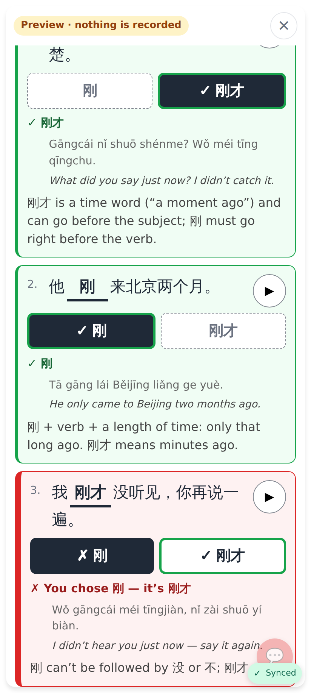 — "✓ 刚才" / "✗ 刚", "✗ You chose 刚 — it's 刚才", the full sentence's pinyin, English, ▶ and explanation.

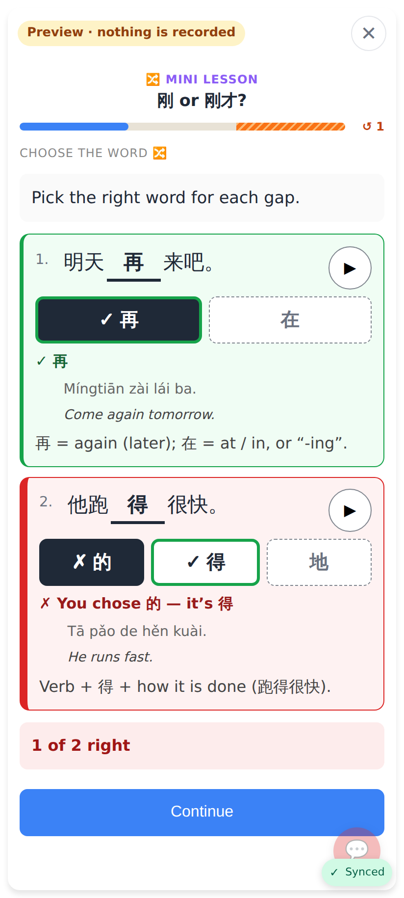 — options given per sentence (再 / 在, 的 / 得 / 地).

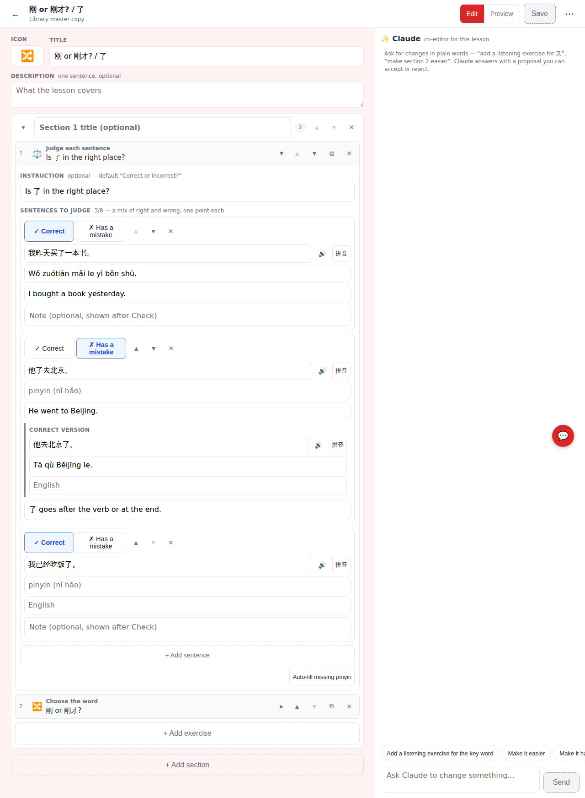 — Correct / Has a mistake per sentence, the correction + why for a wrong one.

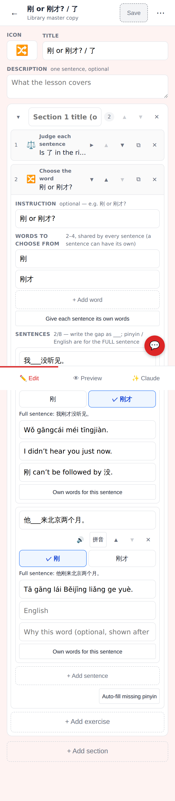 — shared words (or per sentence), the gap `___`, the answer picked from the words, "Full sentence: …", 拼音 from the full sentence.

Lab app (Roborazzi):

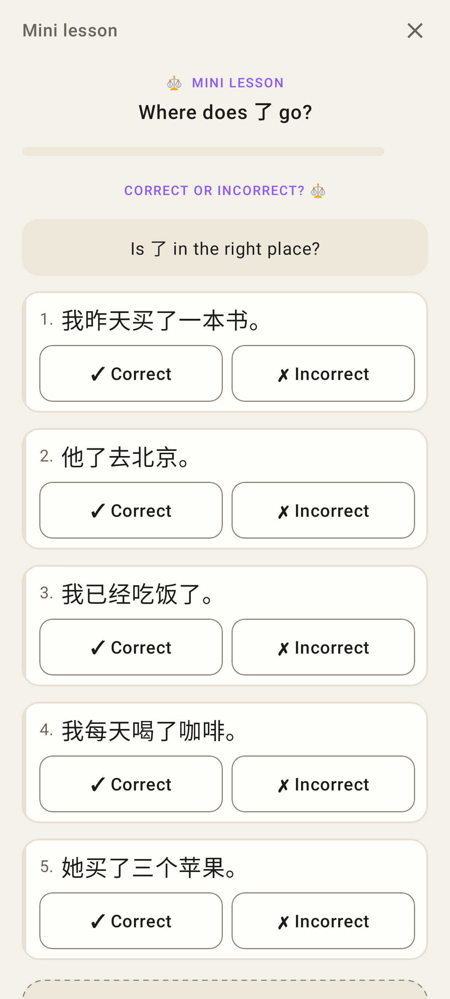 — unanswered.

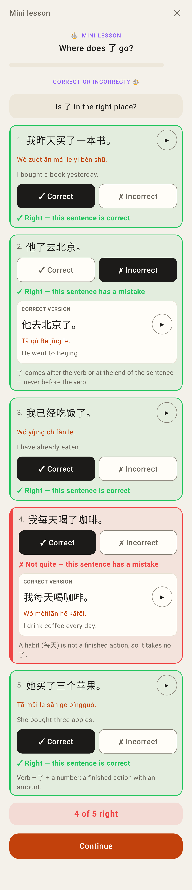 — checked, sentence 4 judged wrongly.

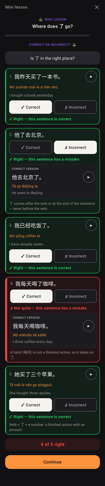 — dark theme.

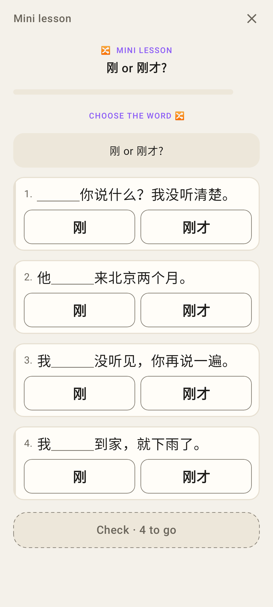 — unanswered.

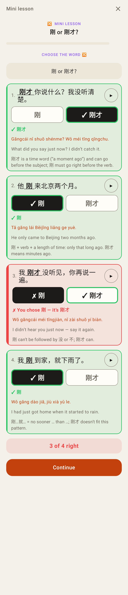 — checked, sentence 3 wrong.

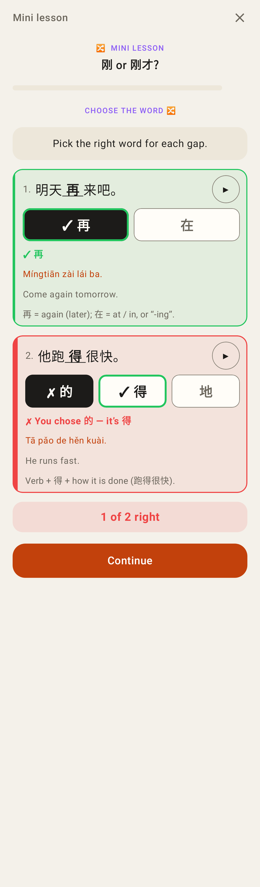 — per-sentence options.

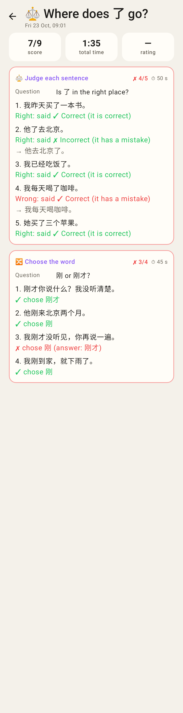 — "My answers" / the tutor's review: what was said / chosen per sentence.

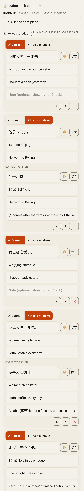 — editor form, judge.

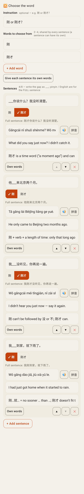 — editor form, gap_choice.
