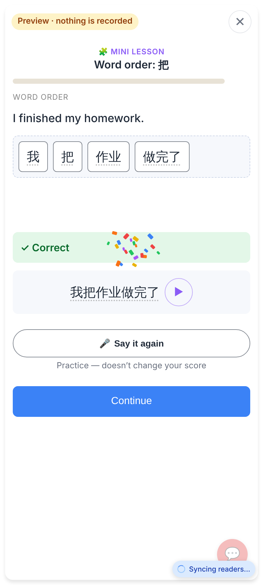
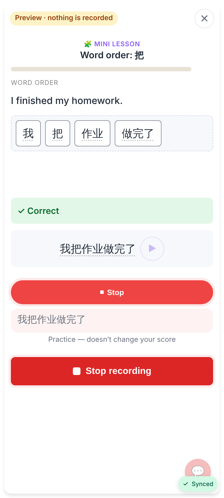
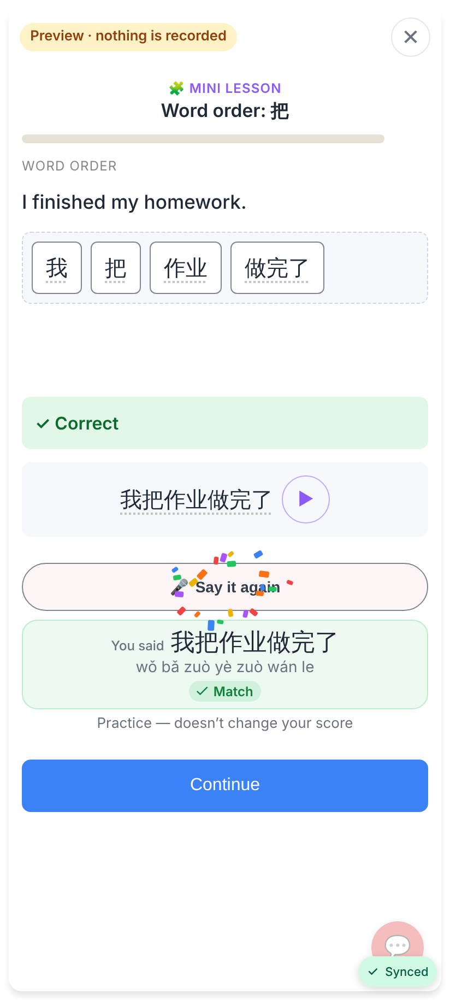
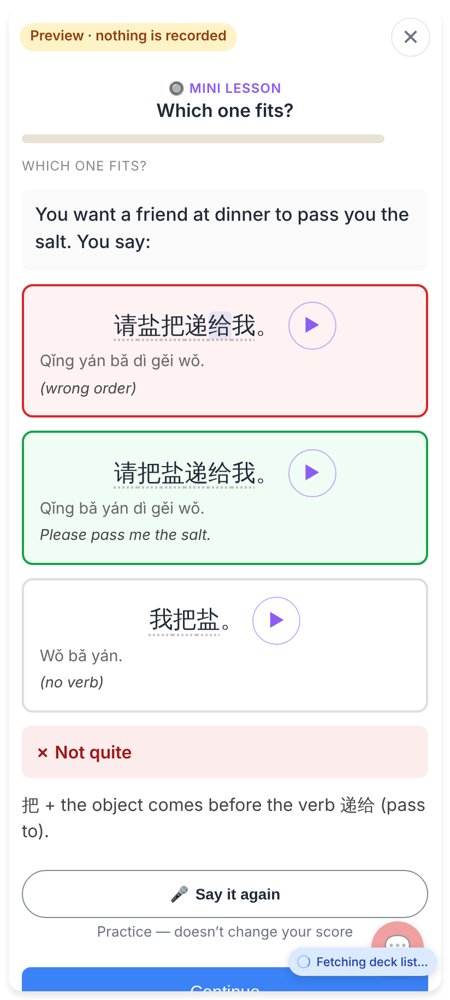

# Mini lessons: a take never skips the exercise · explore + replay on the answer screen

Phone viewport 412×915 @2×, the catalogue's word-order and choice samples (Try it).

Word order, checked: the right sentence is words to explore (dotted underline) with ▶ to hear the clip again; his blocks are words to explore too.

🎤 Say it again recording: the Continue button is now the big red "■ Stop recording" (same place, same size); ▶ waits.

Stopped: the take is checked ("You said … ✓ Match") and the lesson stays on the exercise; only now does Continue come back.

Multiple choice, answered: every option's Chinese is words to explore, each with ▶.
