# Structure cards — screenshots

Phone viewport 412×915 @2x. The lesson is Jerome's real "天冷起来了：除了…还… · 好＋V · 概数（多）· 起来了" (4 Nov),
seeded exactly as it was written — no change to the stored lesson.

## Web — before / after

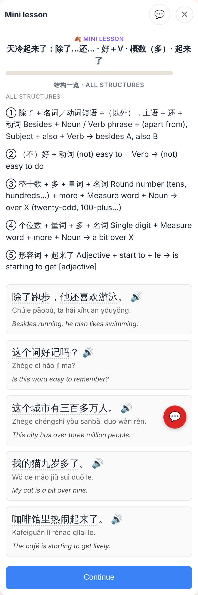
**Before** — the opening "All structures" note: five structures as a wall of text, the examples underneath (the first one auto-played).

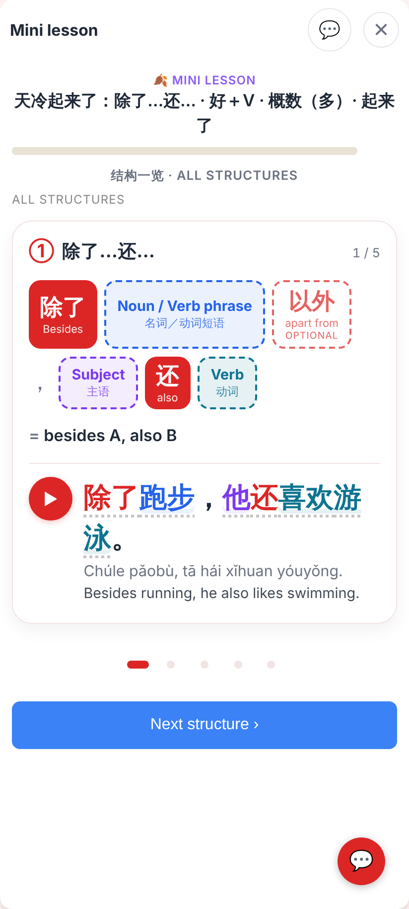
**After** — the same note, parsed: one structure per screen. Fixed words as solid chips (with the English gloss from the
lesson's own English line), slots as dashed labelled boxes, 以外 marked optional, the meaning, the example big and
coloured like the pieces. Dots, Next structure ›. Nothing plays until ▶.

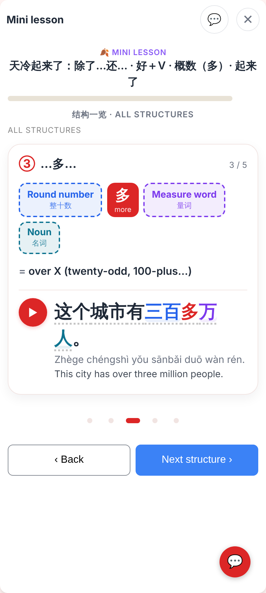
Structure ③ 整十数 + 多 + 量词 + 名词 — 三百 as the round number, 万 / 人 after 多.

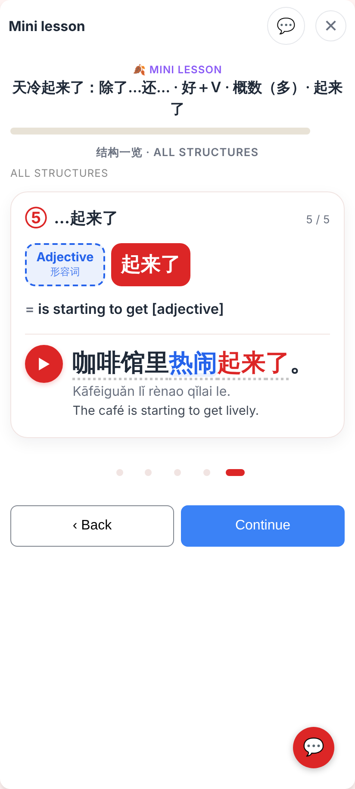
Structure ⑤ 形容词 + 起来了 — the adjective is 热闹, not the subject 咖啡馆里. Continue on the last card.

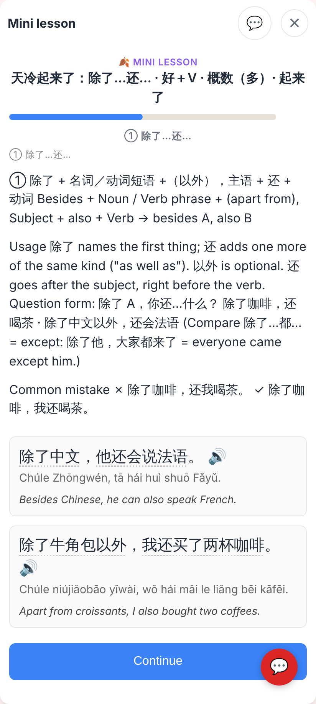
**Before** — the note that opens section ①: pattern, usage and the common mistake as plain text.

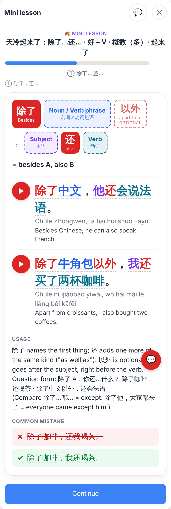
**After** — the same note: the card with both examples coloured, "Usage" / "Common mistake" as headings, ✗ / ✓ rows.

## Web — a lesson written with `patterns` (the catalogue's 把 sample)

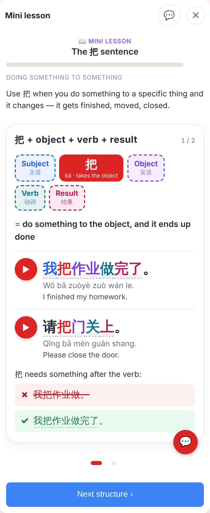
Pieces with pinyin + gloss, examples cut by the author's `parts`, the ✗ / ✓ note.

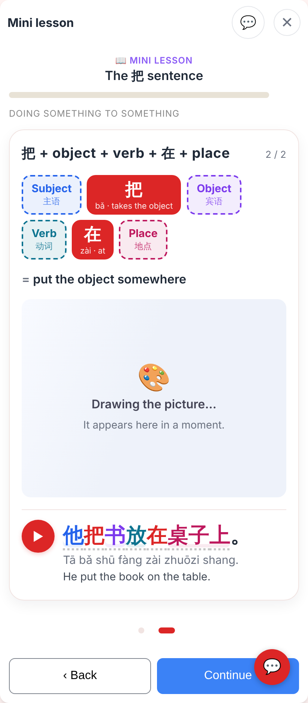
The second structure with its picture (`image_prompt`, "Drawing the picture…" until drawn), ‹ Back / Continue.

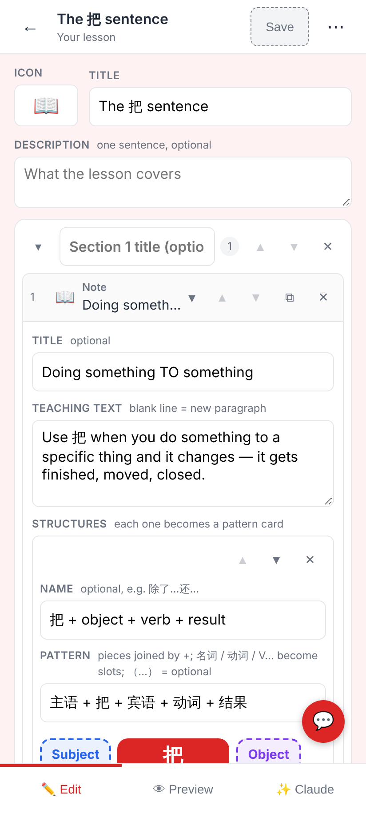
The lesson editor's note form → Structures: the pattern typed as one line in the same "+" syntax, a live chip preview.

## Dark tokens (web)

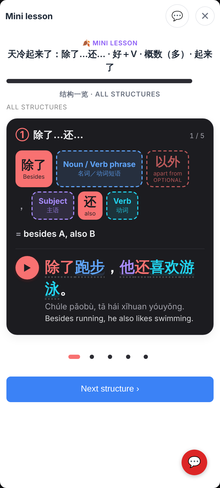 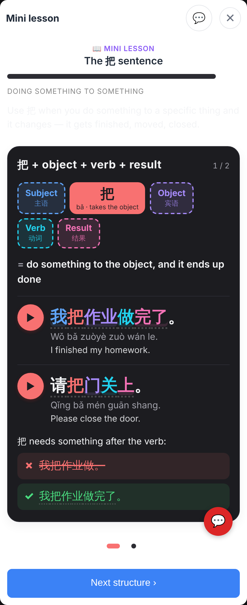
The card's dark token set under `data-theme="dark"` (the web app itself is still light-only, so only the card is dark).

## Lab app (Roborazzi)

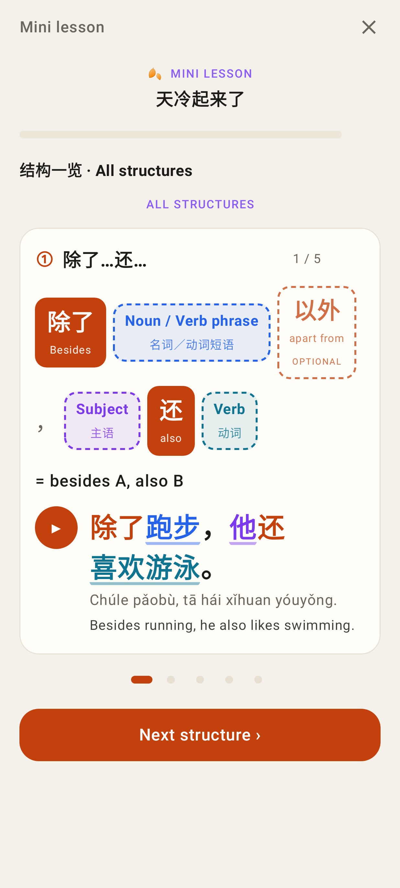 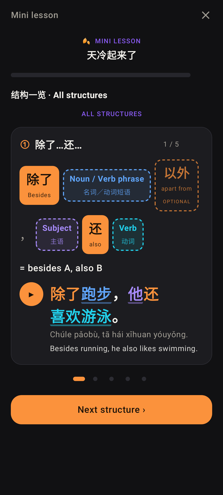
The parsed lesson in the Lab app, light and dark.

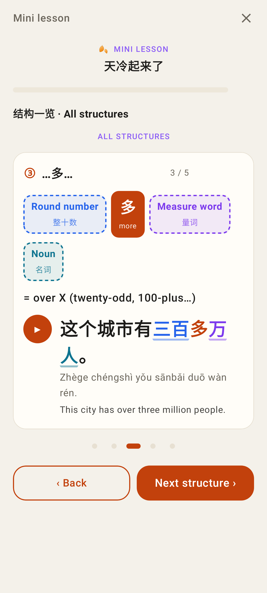 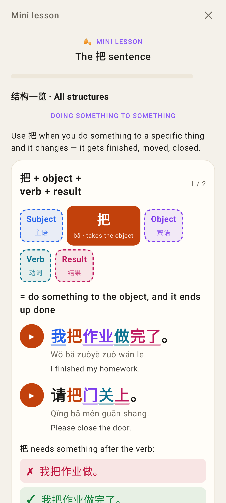 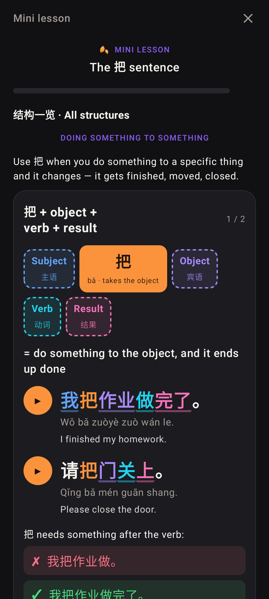
Structure ③ after two Nexts; the 把 sample, light and dark.
