# Structure intro — "▶ Watch the intro"

Phone viewport (412×915 @2×). Web shots come from the real app (E2E mode, TTS answered with silence of a realistic
length so the clock runs as it would). Lab shots are Roborazzi frames of the same catalogue sample (the 把 sentence).
The intro uses the 🎬 Clips "paper" theme in light and dark mode alike, so there are no separate dark shots.

## Web

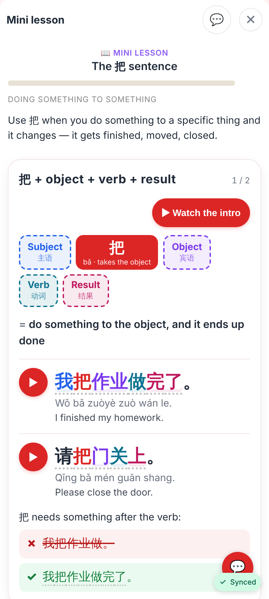
The structure card now has **▶ Watch the intro**. Nothing plays until it is tapped.

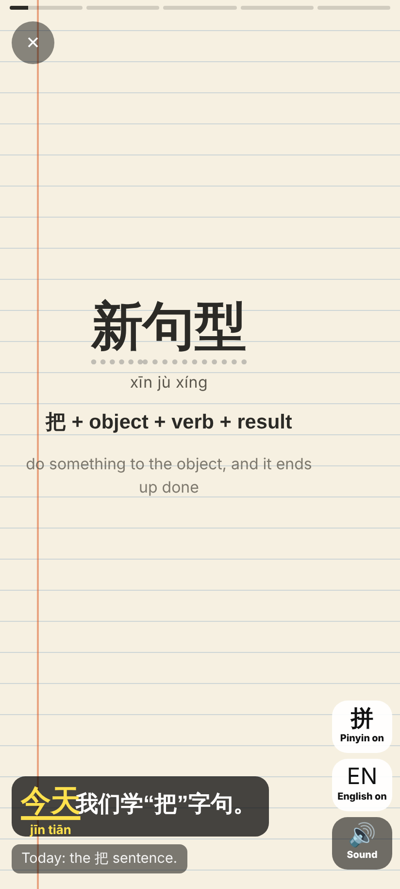
The title scene, 新句型, with the structure's name and meaning. The first line of the voice-over is captioned with karaoke and pinyin, and the English line sits under it.

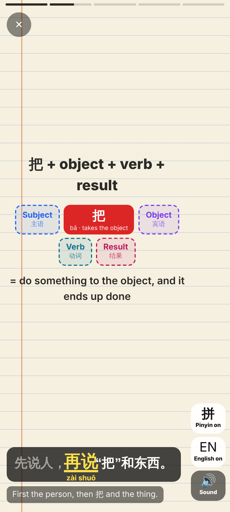
The pattern builds up chip by chip while the voice says "先说人，再说“把”和东西。".

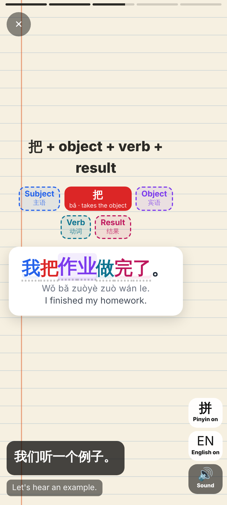
An example, big and coloured like the pieces. The part being read lights up (作业 = the Object slot).

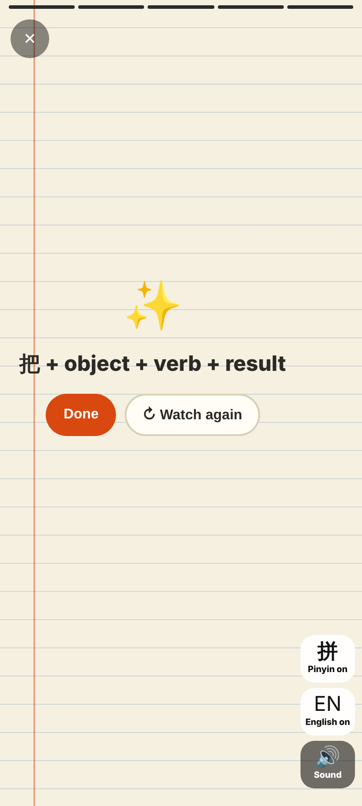
The end card: **Done · ↻ Watch again**.

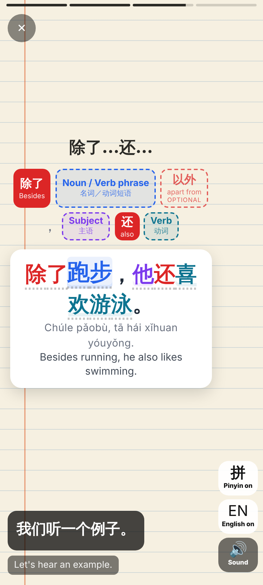
An older lesson's parsed structure (除了…还…) gets the template voice-over ("我们听一个例子。") and its matched example.

## Lab app

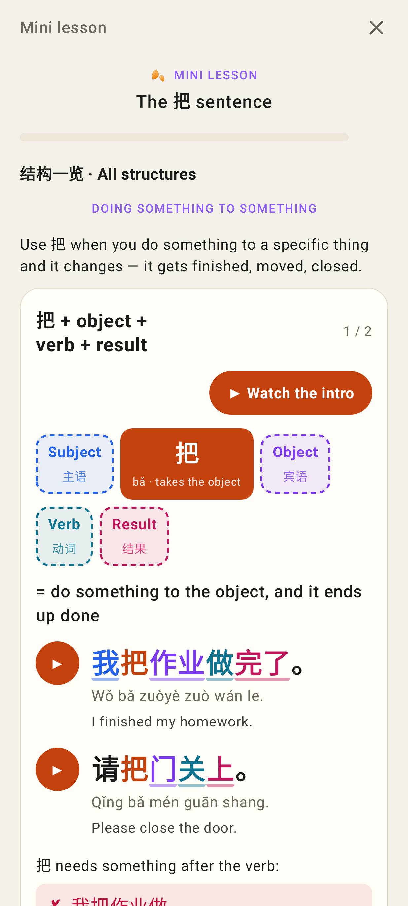
The Lab structure card with **▶ Watch the intro**.

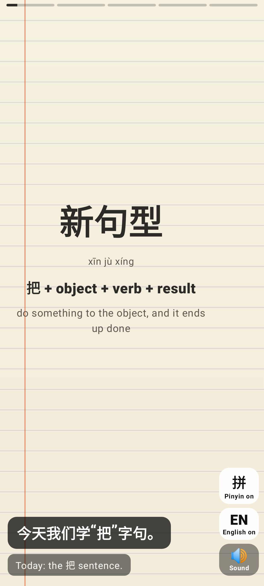
The Lab title scene.

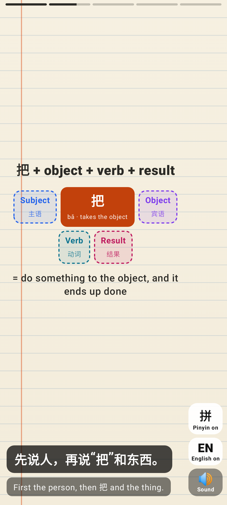
The Lab pattern scene.

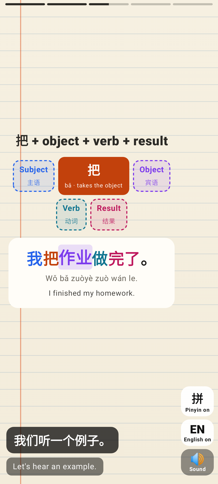
The Lab example scene, with 作业 lit as it is read.

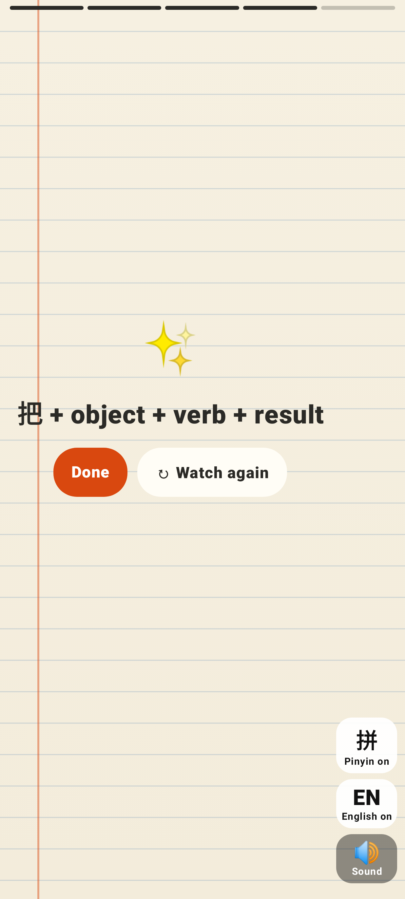
The Lab end card: Done · ↻ Watch again.
