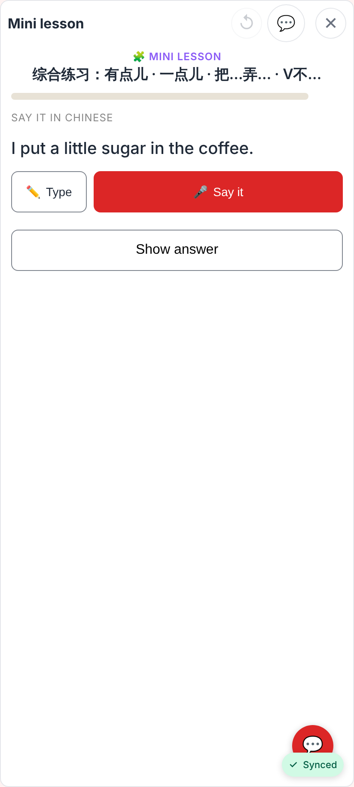
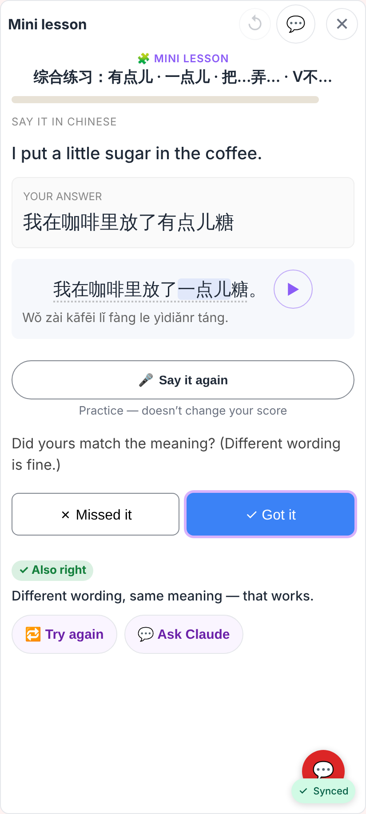
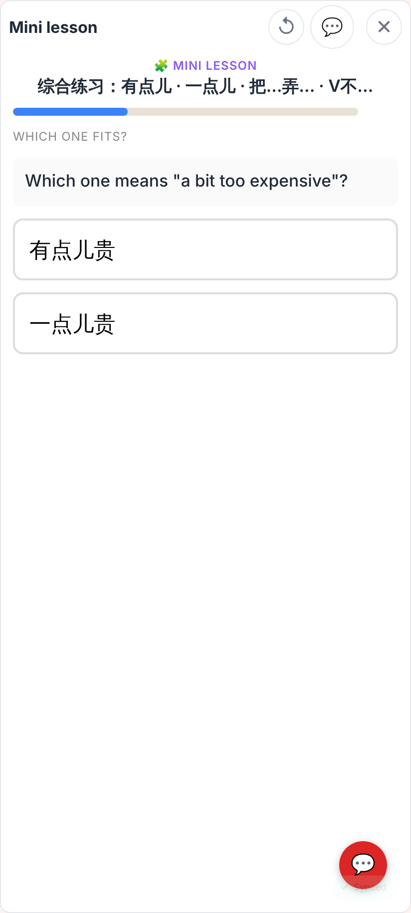
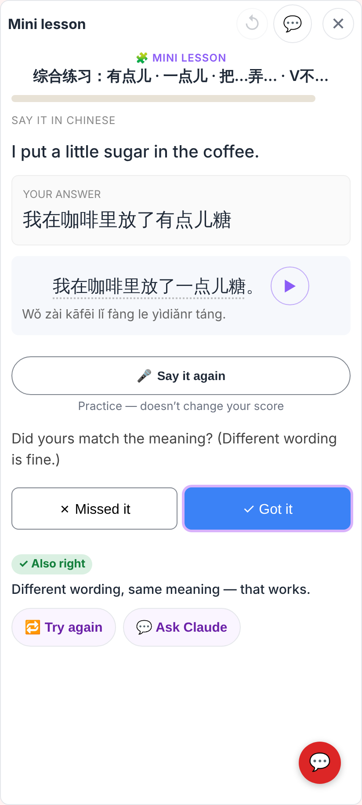
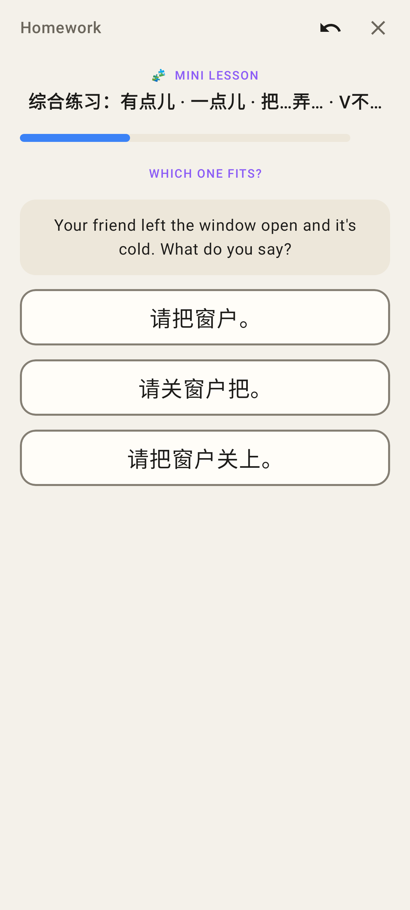
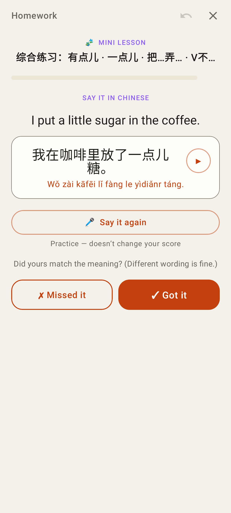
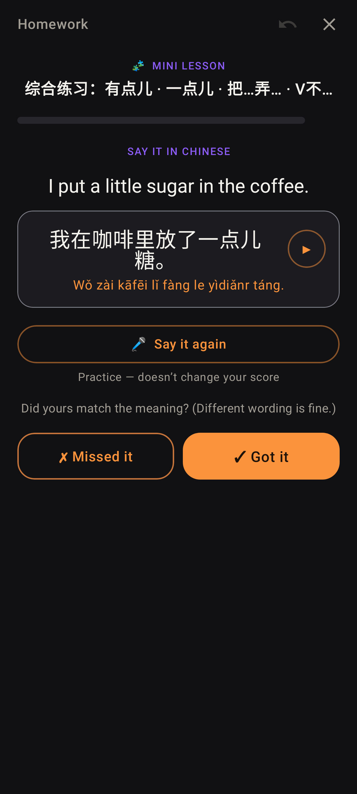

# ↺ Undo in the mini lesson player

Web, phone viewport 412×915 @2x (a lesson with "Say it in Chinese", then a choice).

Nothing answered yet: ↺ is in the top bar (like the flashcards'), greyed.

A wrong answer on the answer side — the next tap is "✓ Got it" by mistake.

The next exercise: ↺ is now active.

After ↺: the translation is back on its answer side with what he typed — Got it / Missed it to tap again (the bar is back where it was).

## Lab app (Roborazzi, 412dp)

The next exercise after "✓ Got it", ↺ in the top bar.

After ↺: back on the translation's answer side.

The same in dark mode.
