# Mini lessons: never lost, a retry round, revise until right first time

Phone viewport (412×915). Web first, then the Lab app.

## Web

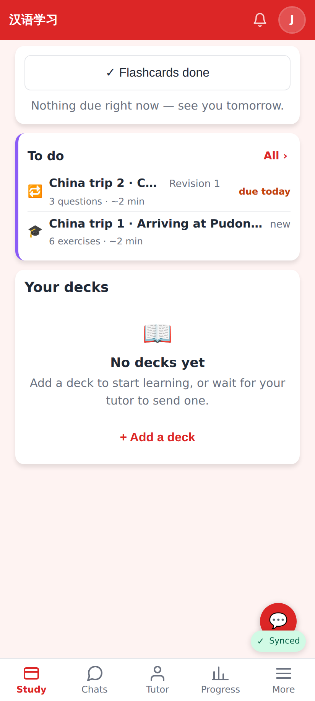
Home's card: a revision due ("Revision 1 · 3 questions · ~2 min · due today") and a new lesson with its size.

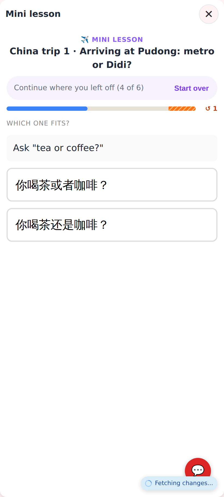
A half-done lesson reopened: "Continue where you left off (4 of 6)" · Start over (the e2e reopens it the next day).

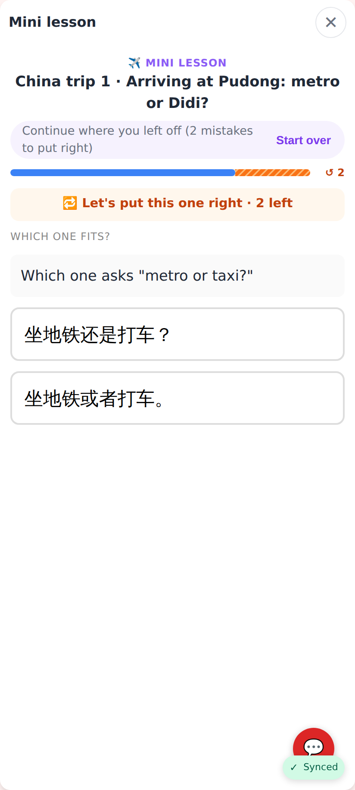
The retry round: the bar's orange "↺ 2" at the right end, "Let's put this one right · 2 left".

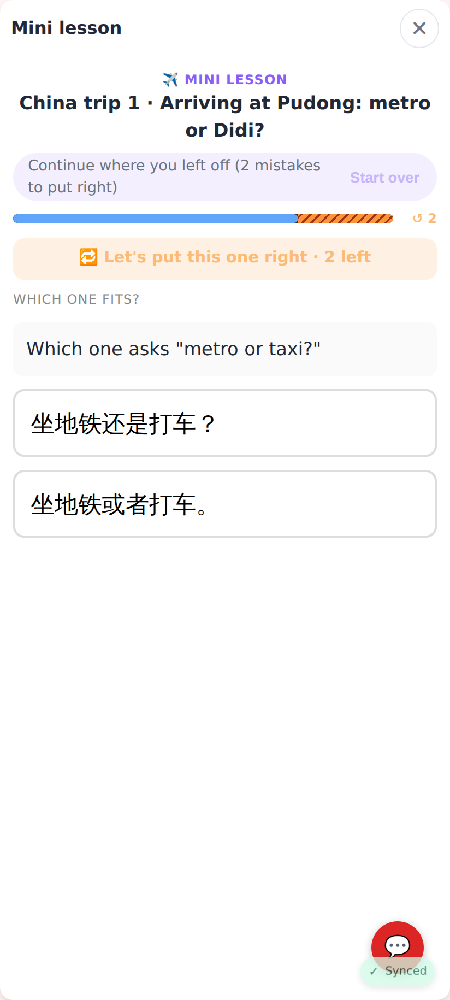
Same, dark theme.

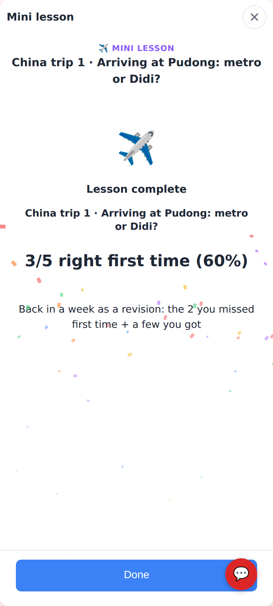
The end: no rating — "Back in a week as a revision: the 2 you missed first time + a few you got".

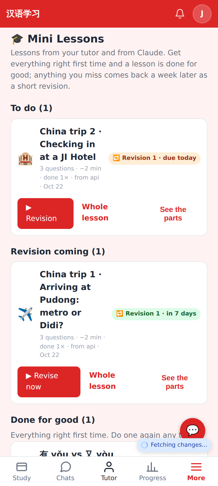
Mini Lessons: To do (▶ Continue / ▶ Revision / ▶ Start) with sizes.

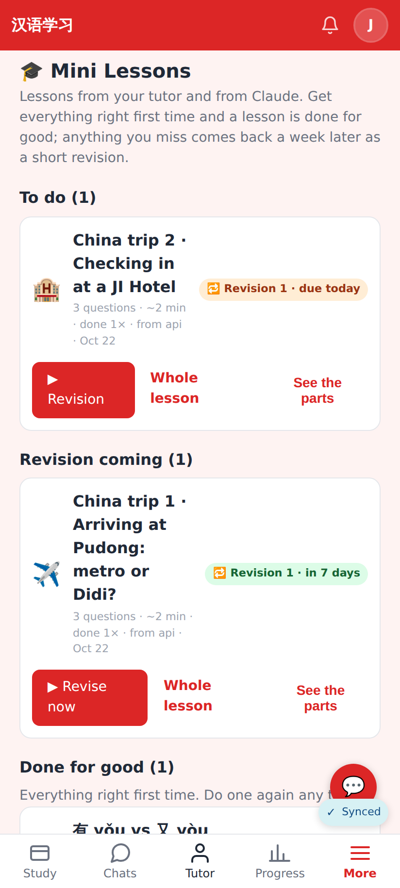
Revision coming / Done for good.

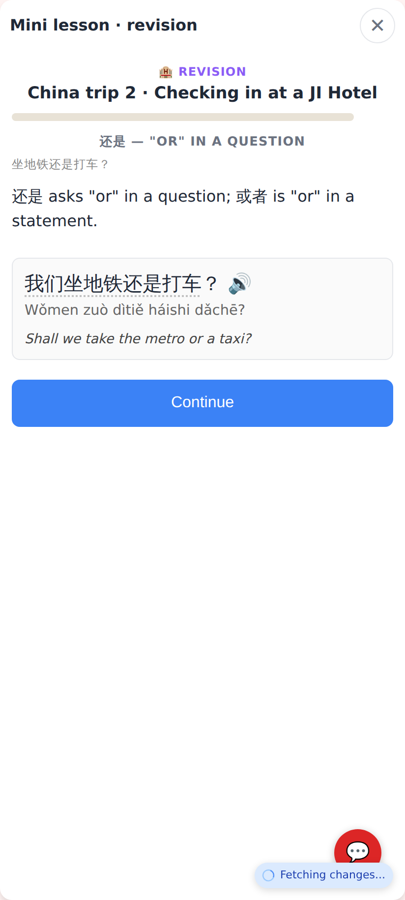
A revision run: "Mini lesson · revision", only what was missed + a few that were got.

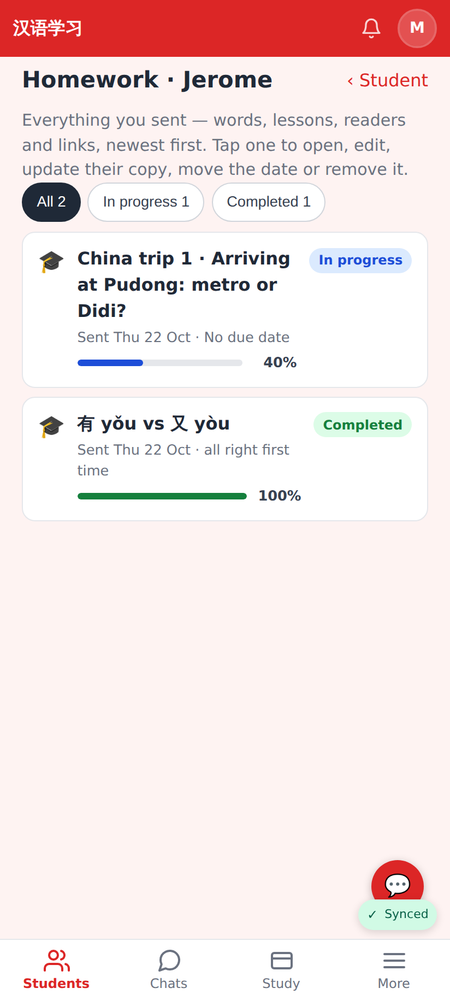
The tutor's homework library: a lesson being revised is In progress, one all right first time is Completed.

## Lab app

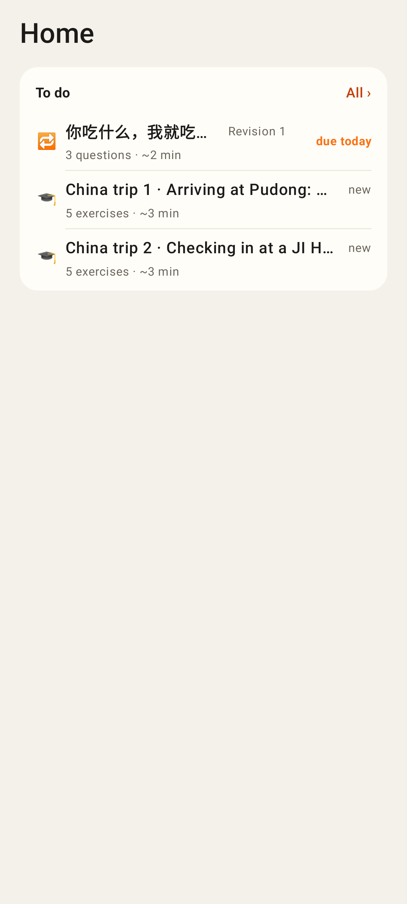
Home's card (Lab): revision due + new lessons with sizes.

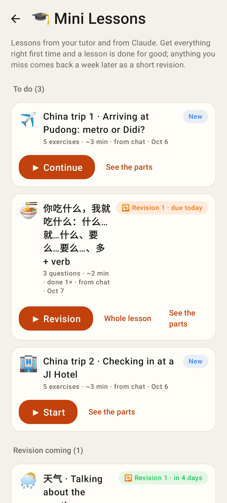
Mini Lessons (Lab).

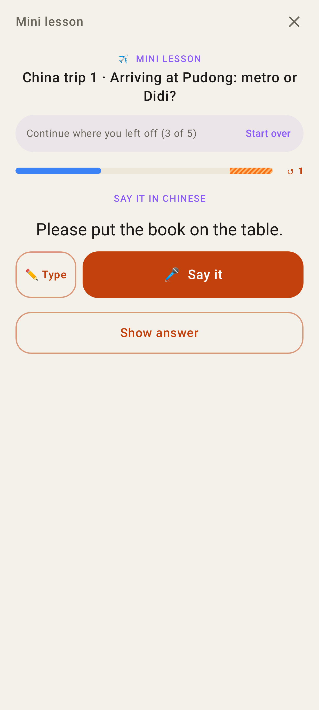
A run continued days later.

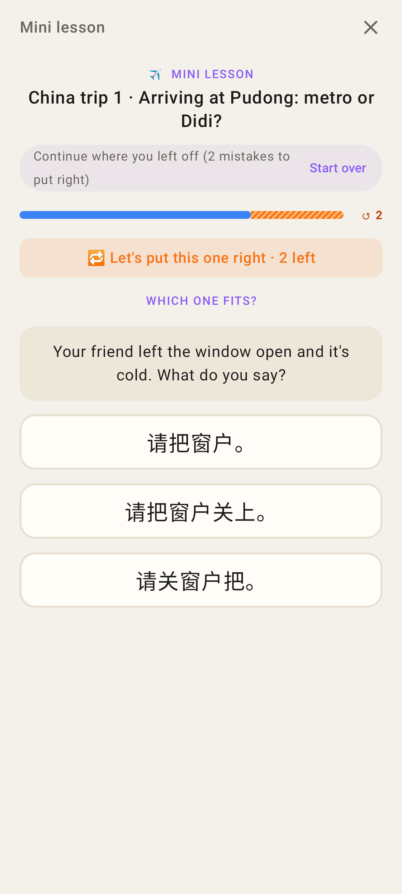
The retry round with the shared retry bar.

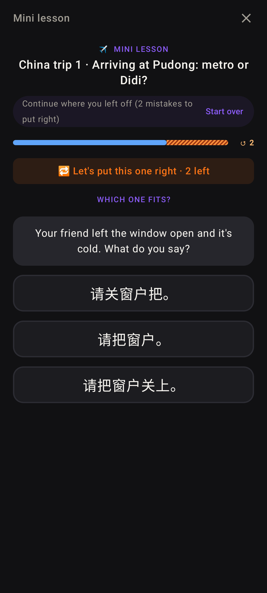
Same, dark.

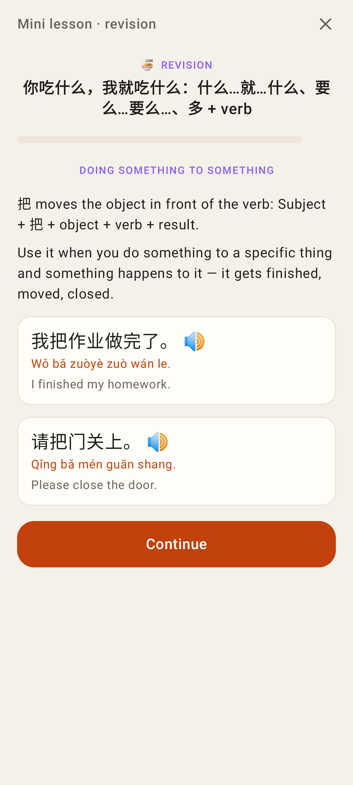
A revision run.

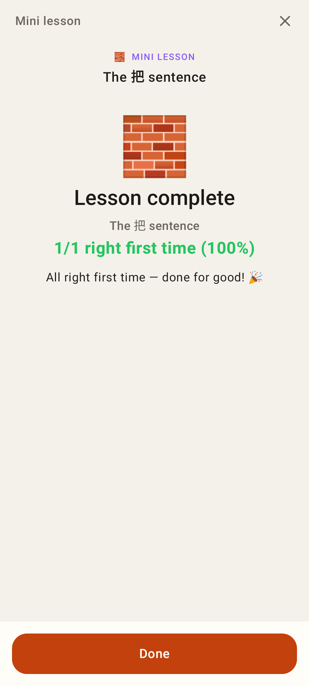
The end of a lesson: no rating, "All right first time — done for good! 🎉".
