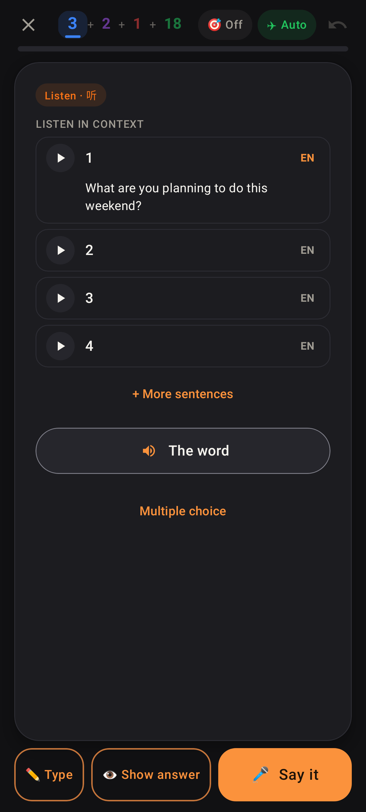

# Listen in context: EN on the card's own sentence

Row 1 is the card's own example sentence. When the note stores no English for it, EN now still shows and fetches the line (cached by text); before, row 1 had no EN at all. The web's `ListenContext` does the same.
