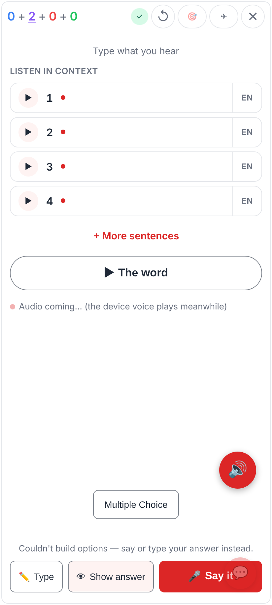
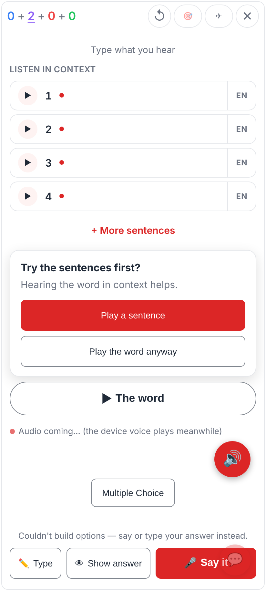

# Listen in context — fresh sentences every showing

Phone width (412 × 915, 2×). The rows are a fresh pick for this showing, in a shuffled order; the small dot marks a sentence never heard on this question before (it goes once played).

The listening card's question: four sentences picked for this showing, all new.

"▶ The word" before any sentence still asks "Try the sentences first?".
