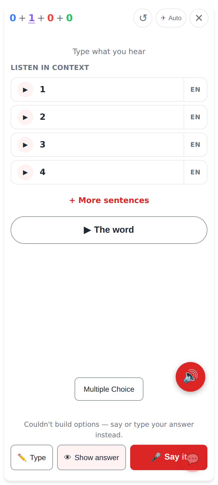
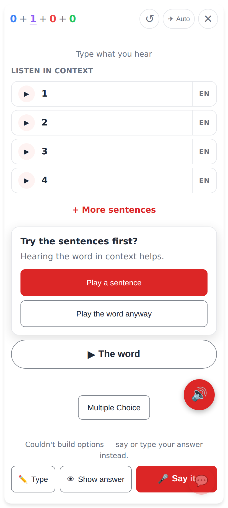
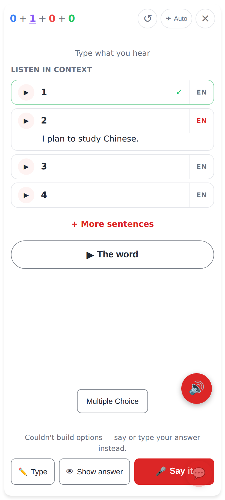
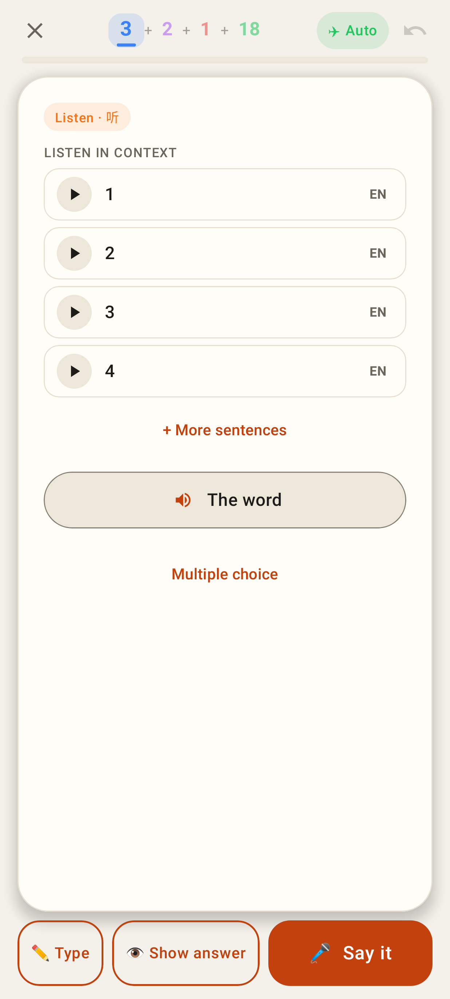
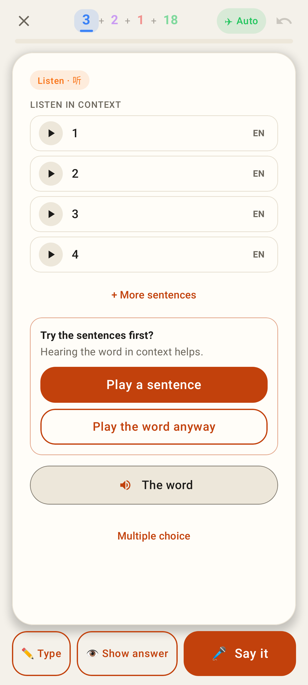
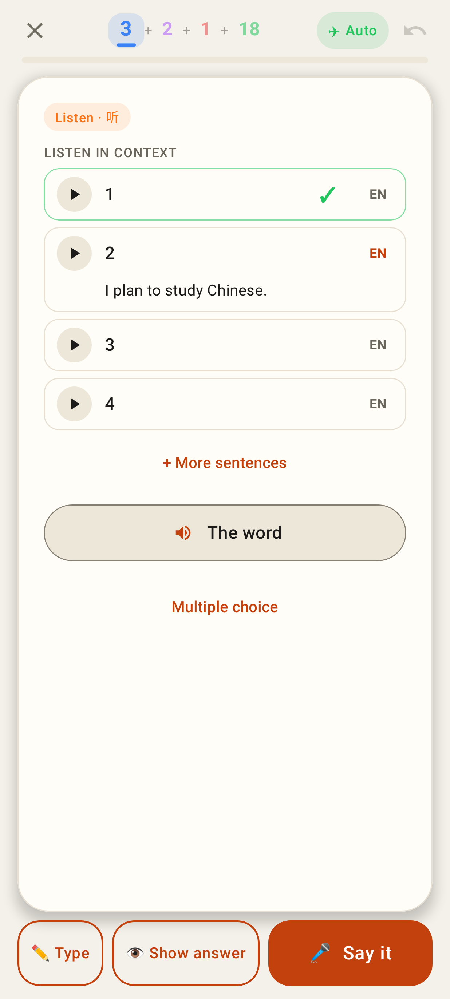
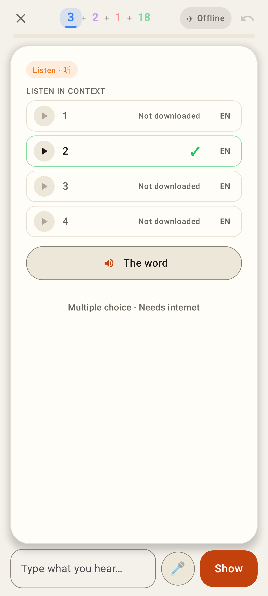
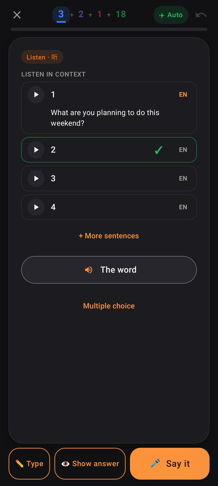

# Listen in context — the listening card's question side

Phone (Pixel Fold folded, 412×915). The web app is light-only today, so its dark shot is the Lab app's.

## Web

The listening card: the card sentence + the set as audio-only rows (▶ · number · EN), + More sentences, then ▶ The word.

Tapping the word before any sentence: the in-page ask — Play a sentence / Play the word anyway.

Sentence 1 heard (✓, the ask gone), EN on row 2 shows only its English.

## Lab app

The same list on the Lab card; the old big speaker became "The word" at the bottom.

The ask, stacked full-width buttons.

Row 1 heard (green border + ✓), EN open on row 2.

Offline: only the row whose clip is on the phone plays; the others say "Not downloaded"; no + More.

Dark theme, a row heard and one row's English shown.
