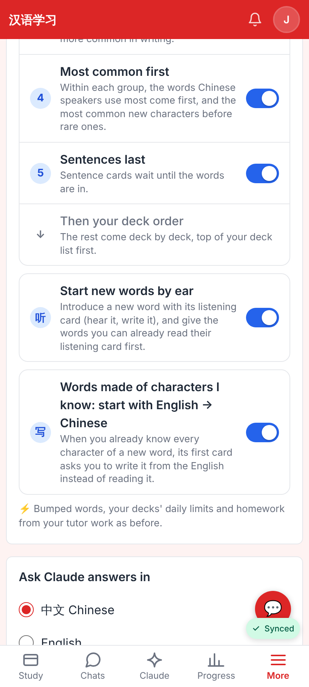
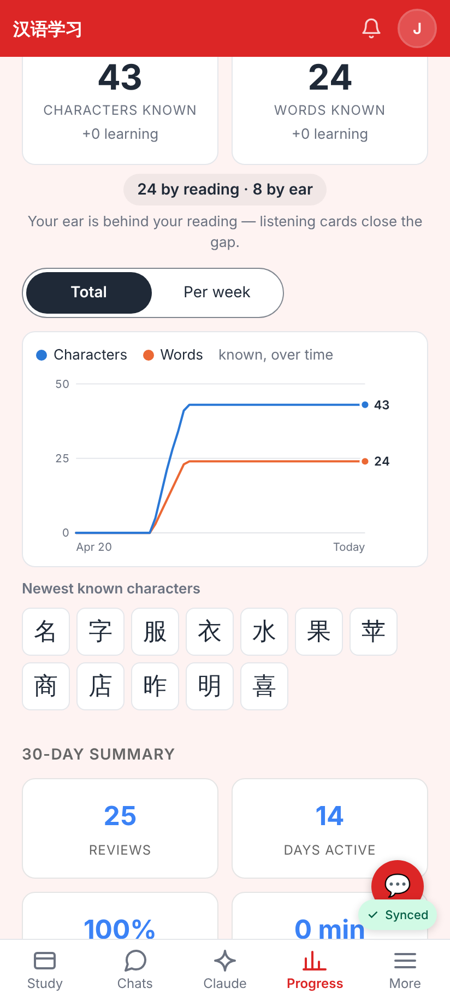
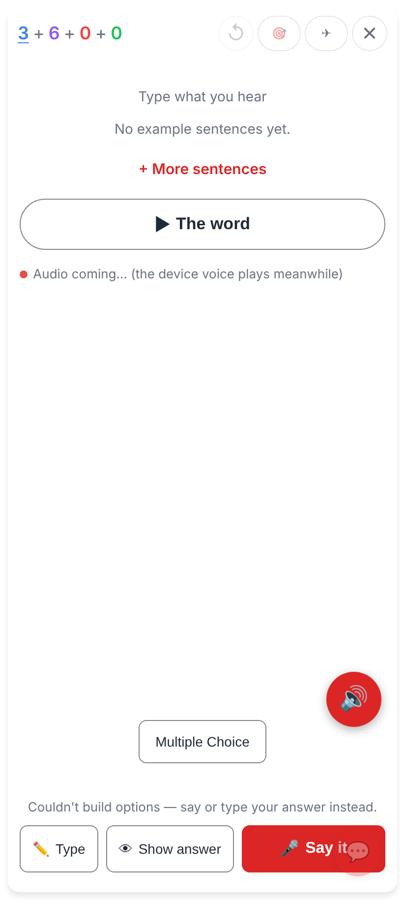
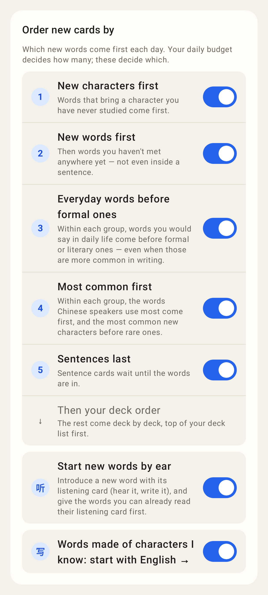
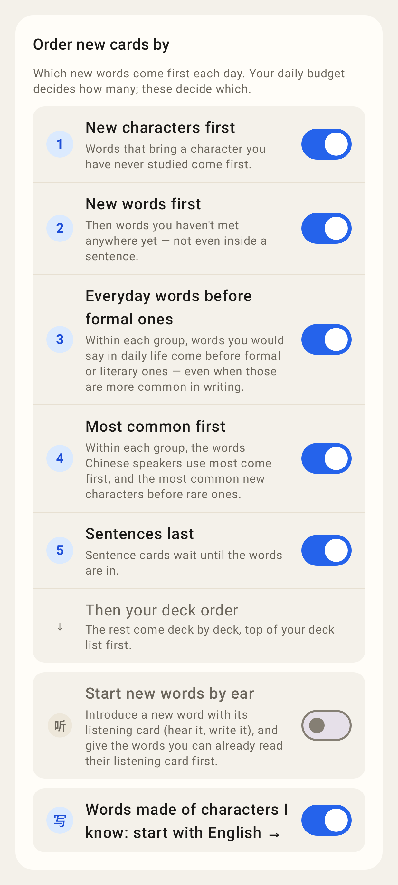
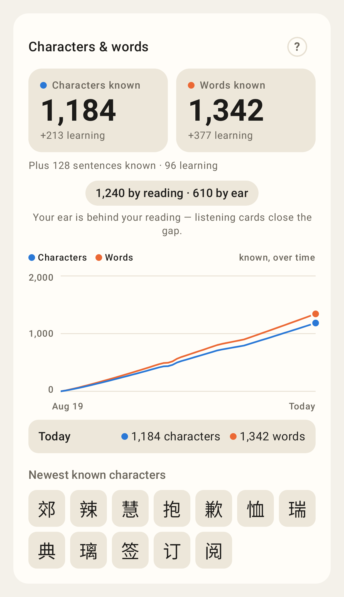

# Listening first — screenshots

Web app, phone viewport (412×915 @2×), a test account with 24 words read well and 8 heard well.

Settings → "Order new cards by": the new **Start new words by ear** switch (on by default) above "Words made of characters I know".

Progress → Characters & words: "24 by reading · 8 by ear" under the tiles, with the hint while the ear lags far behind.

Study: a new word now opens with its listening card ("Type what you hear").

Lab app (Roborazzi, Pixel Fold folded):

Settings → New cards with both switches on (the default).

"Start new words by ear" switched off.

Progress → Characters & words with "1,240 by reading · 610 by ear" and the hint.
