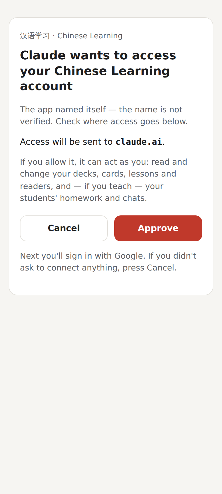
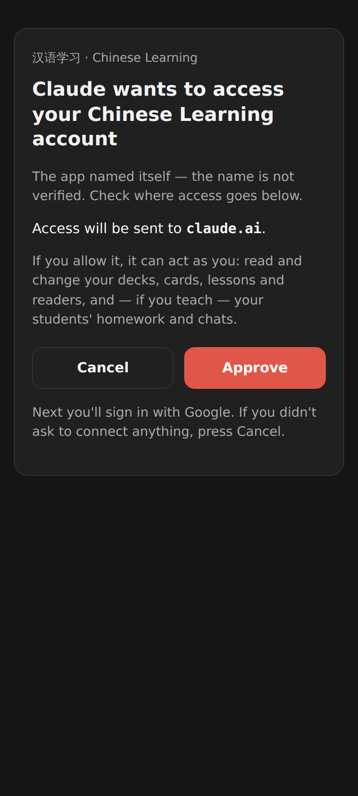

# MCP OAuth hardening — approval page

The page the MCP server now shows before anyone is sent to Google (412×915, 2×).

The approval page in light mode: the client's (self-asserted) name, where access goes (`claude.ai`), Cancel / Approve.

The same page in dark mode.
