# 梗 Meme review (prototype) — screenshots

Web at 412×915 @2×, local worker in E2E_TEST_MODE: the issue is the SAMPLE the E2E stand-in hands in
(well-known older memes, no pictures drawn — the 梗 tile stands in for the Gemini illustration).

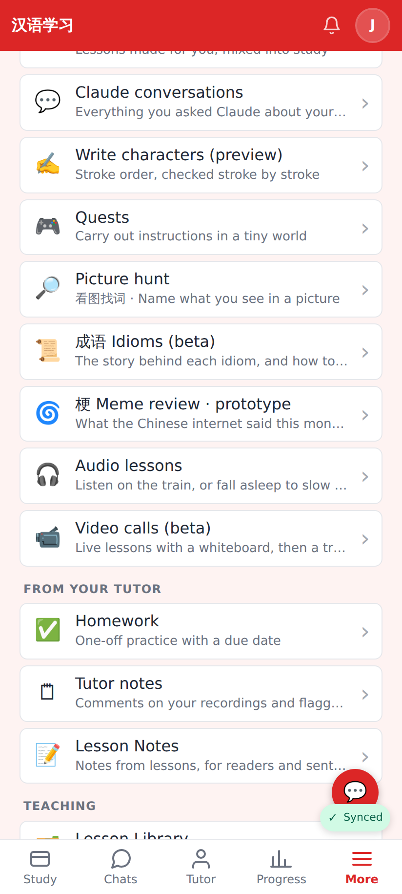
More → Practice: "🌀 梗 Meme review · prototype".

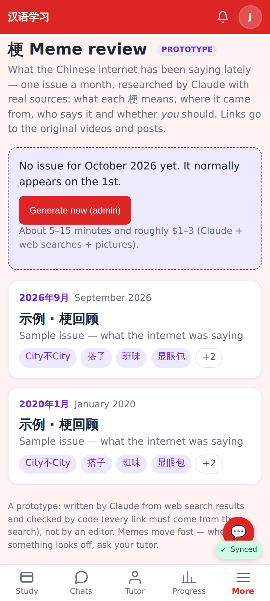
The issue list; an admin sees "Generate now" while the current month has none.

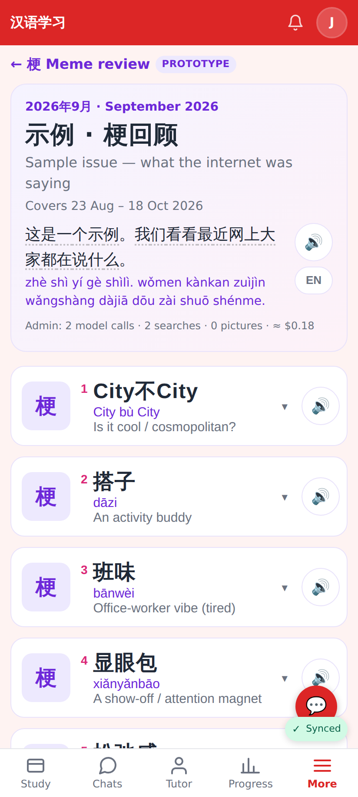
An issue: month, title, coverage, intro (🔊, word chips, EN), admin cost line, one card per meme.

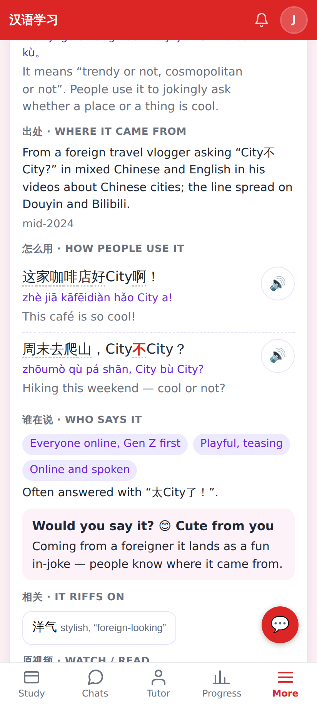
Expanded: meaning in simple Chinese (+ English), origin, chat-style examples with 🔊, who says it, "Would you say it?".

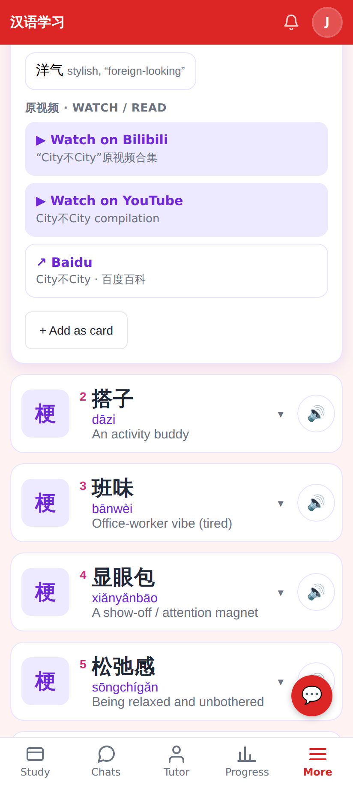
"It riffs on" → the explorer; the original videos / posts and sources open in the browser; + Add as card.

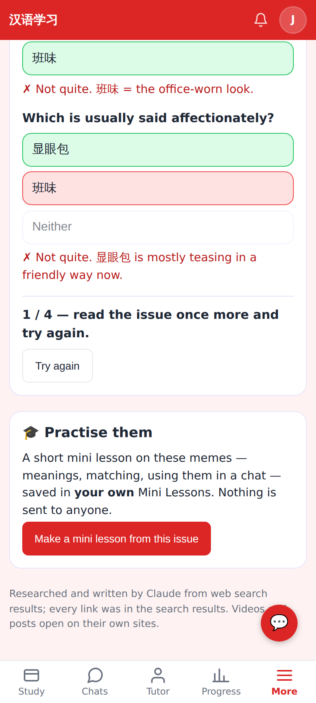
The quiz (practice only).

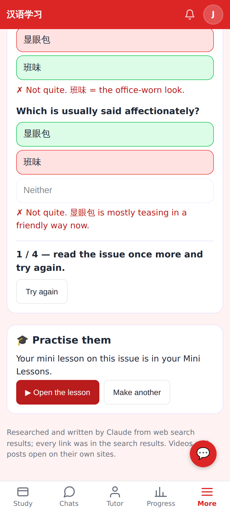
"Make a mini lesson from this issue" → a lesson in his own Mini Lessons → ▶ Open the lesson.

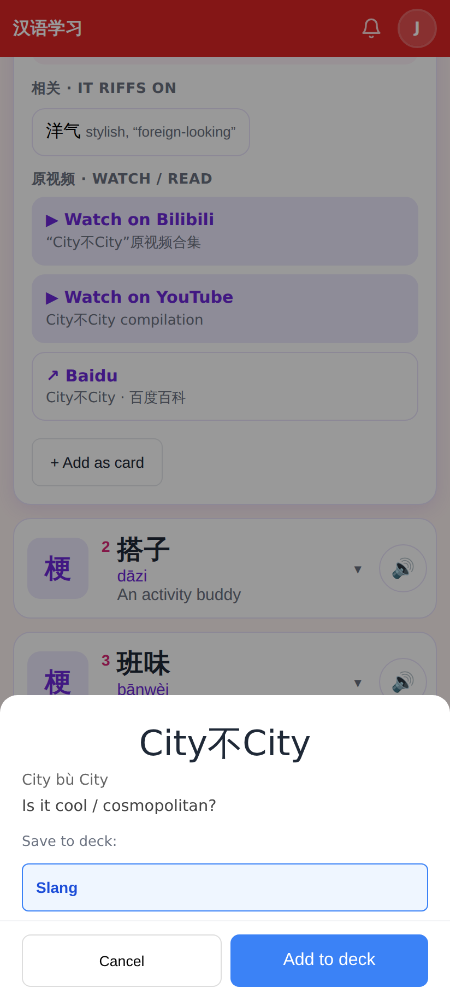
+ Add as card: the existing AddChunkModal with the card-standard fields (meaning, origin, register, "would you say it?").

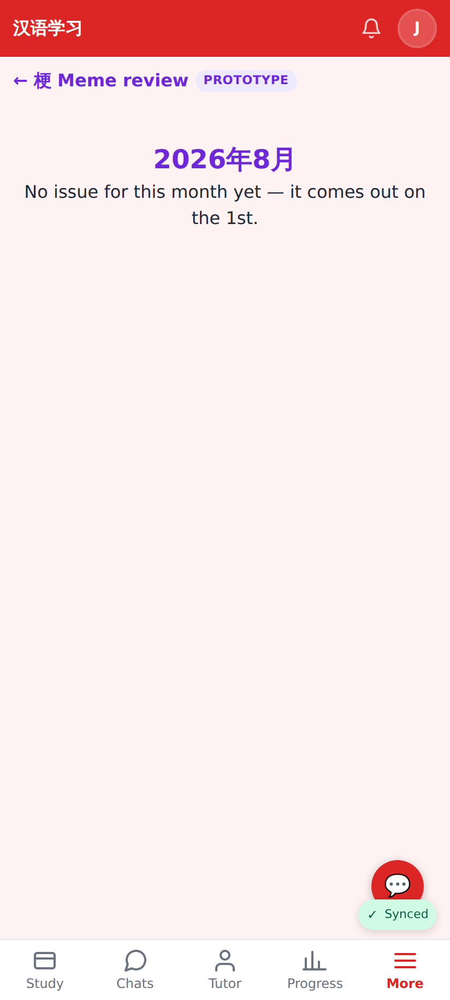
A month without an issue.

## Lab app (Roborazzi)

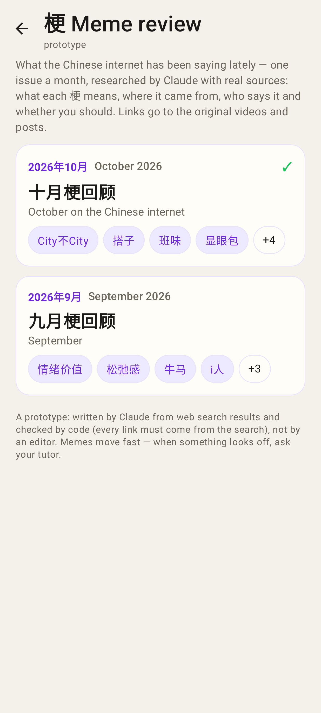
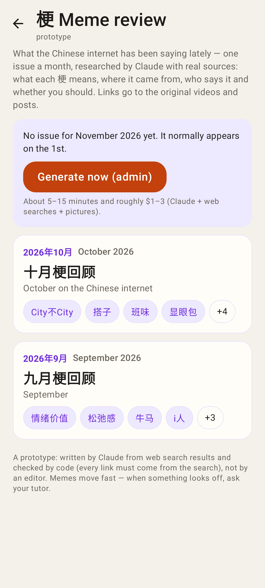
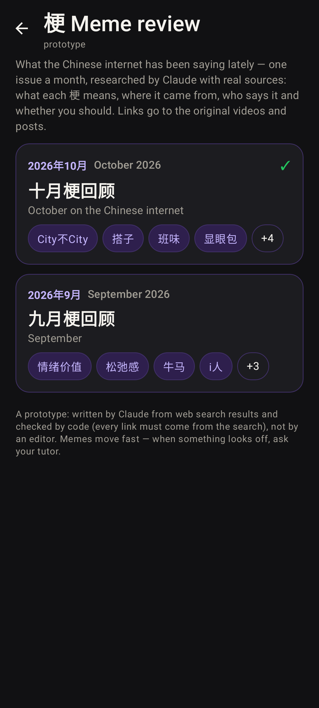
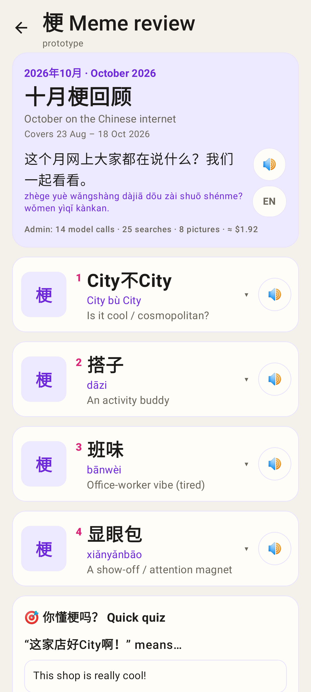
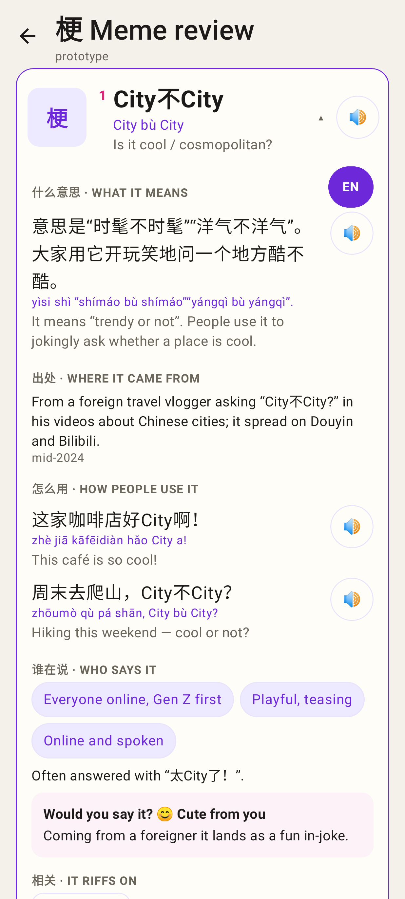
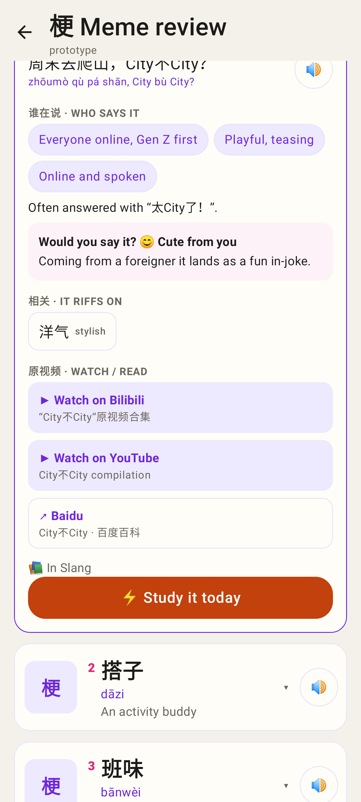
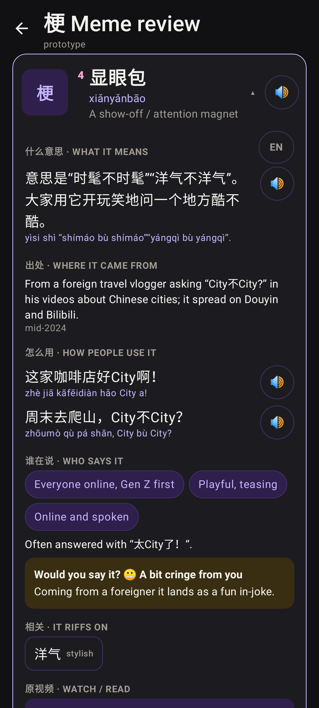
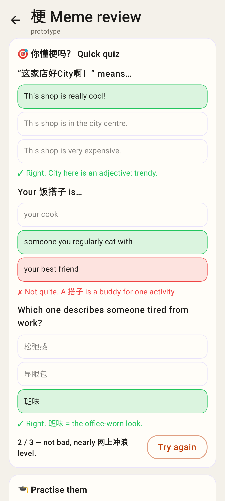
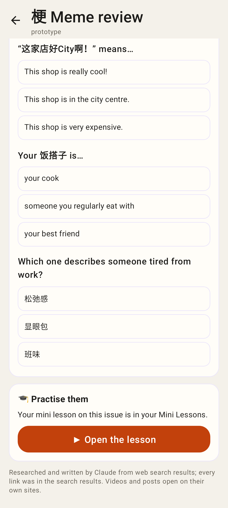
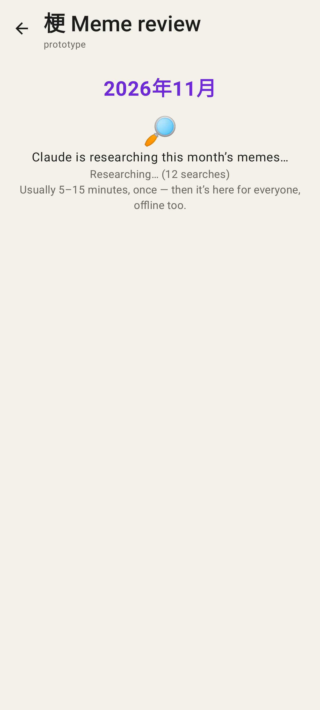
