# Mini lessons: feel, no loading states, 🎤 Say it again

Phone 412×915 at 2× (web: the catalogue's "Try it" player, Claude's replies held back by the test to show the
waiting state; Lab: Roborazzi).

## Say it in Chinese — before / after

Before: Claude's verdict grew INSIDE "Your answer", pushing the model answer and the buttons down.

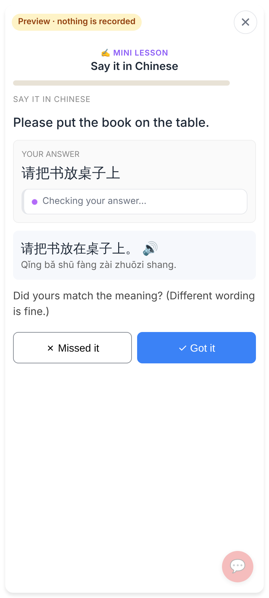
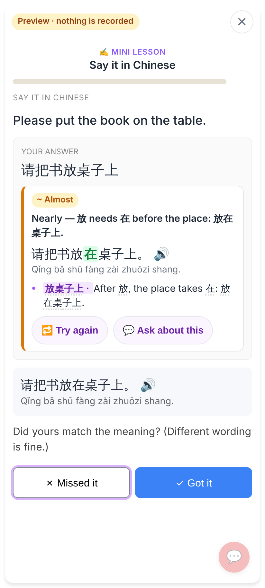

After: his answer (extras underlined) and the model answer (what he missed highlighted) at once, 🎤 Say it again,
the buttons, then "Claude is checking…" LAST — the verdict grows there and nothing above moves.

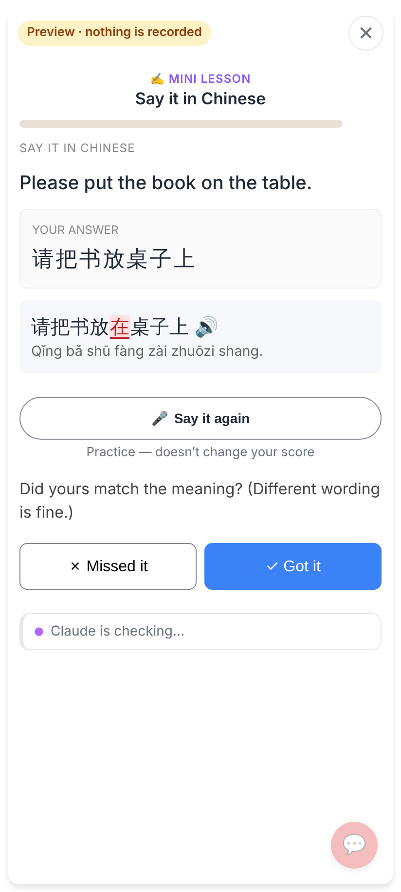
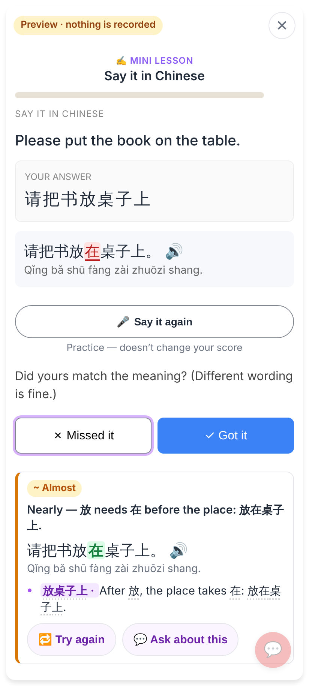
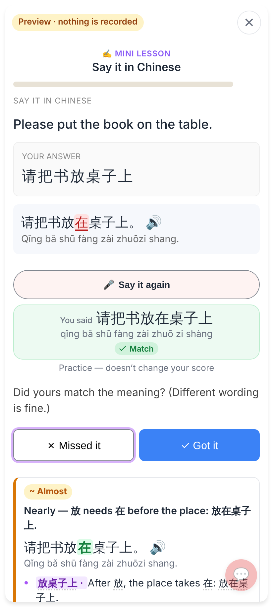
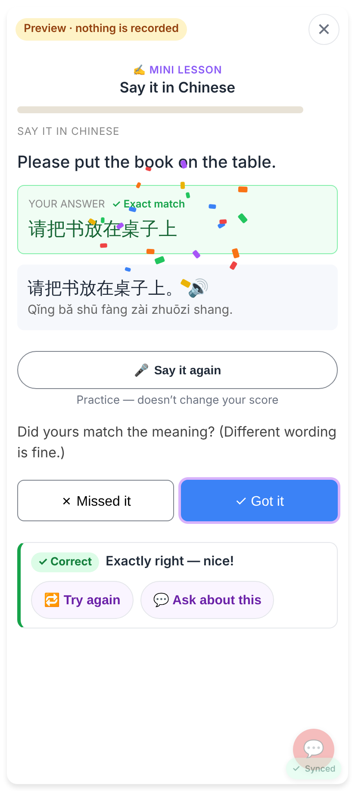

## Make a sentence — before / after

Before: a disabled "Claude is checking…" button until Claude answered.

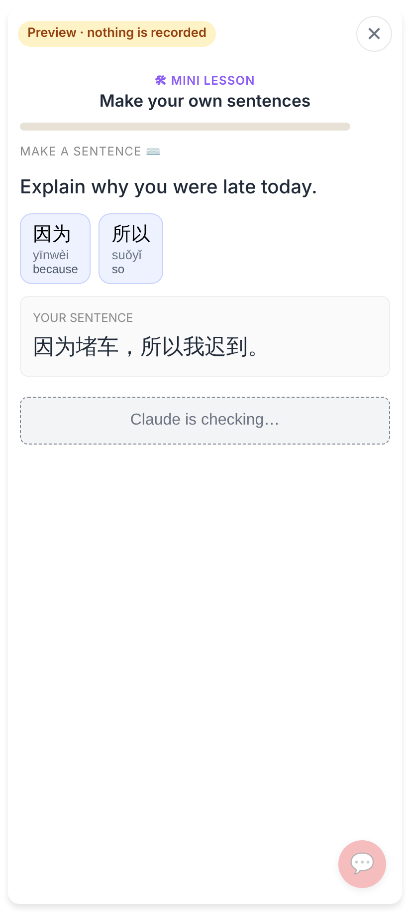
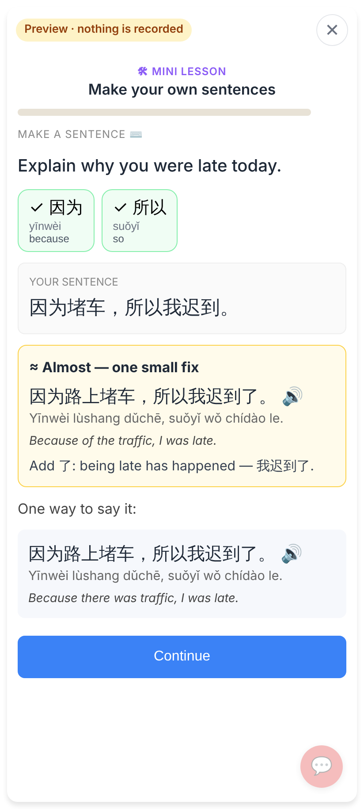

After: the result at once ("Another way to say it:" + 🎤 Say it again, the self-assessment), Claude's check below;
when it lands the two buttons become Continue in the same row, and a new corrected sentence gets its own 🎤 row.

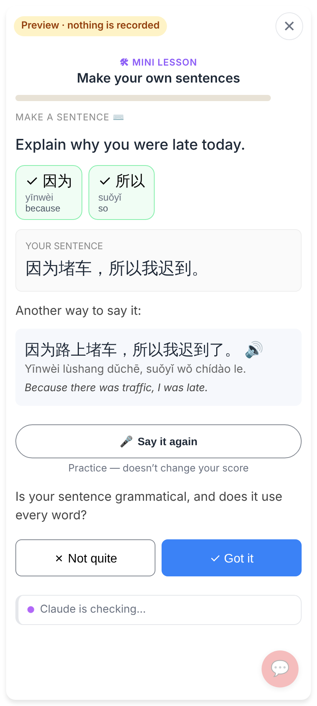
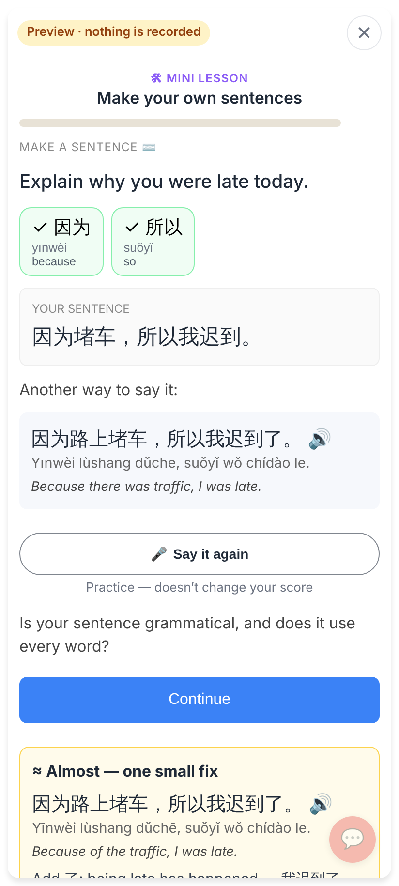

## Another type — Writing (typed), right

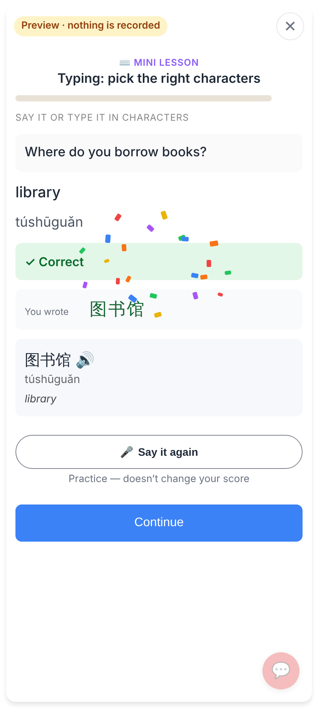

## Lab app

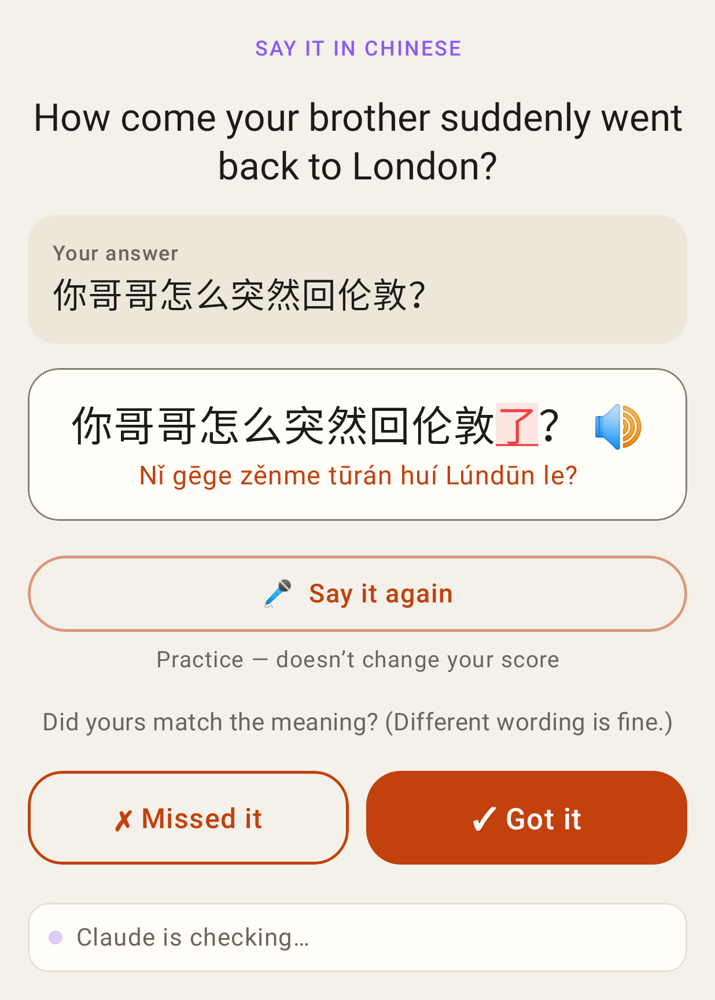
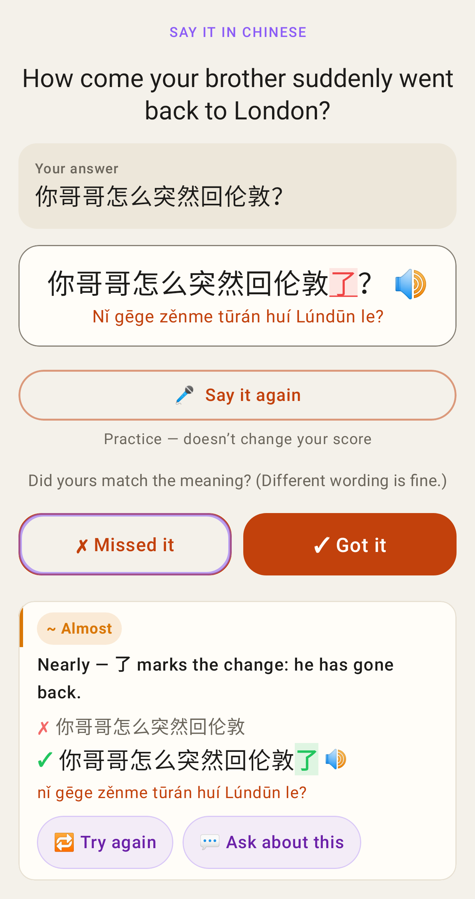
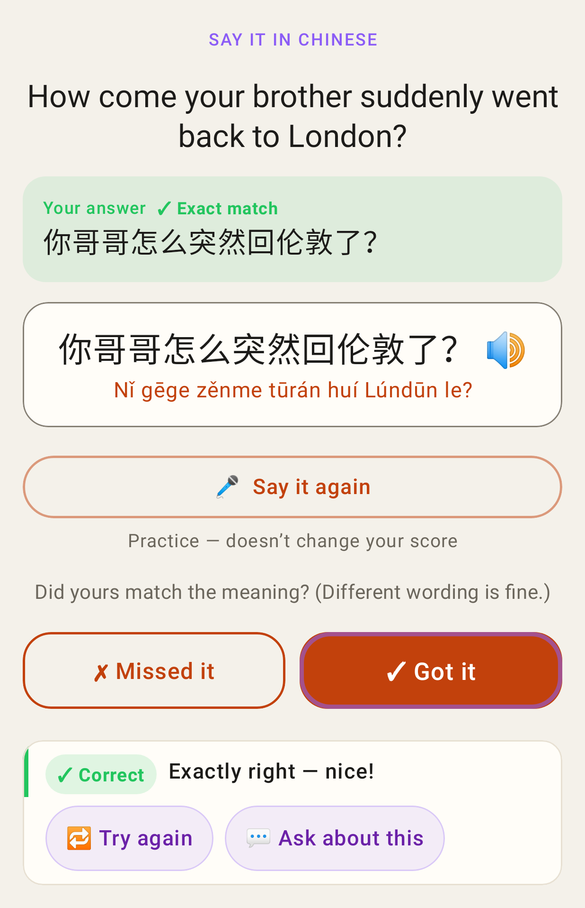
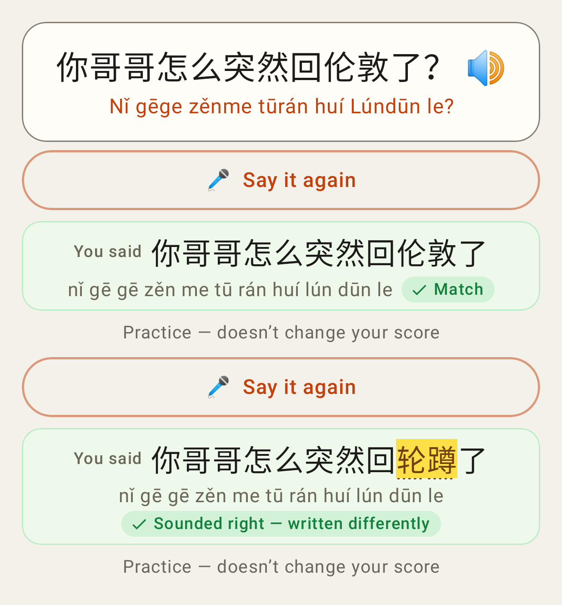
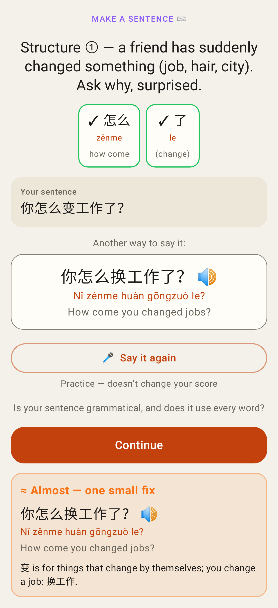
