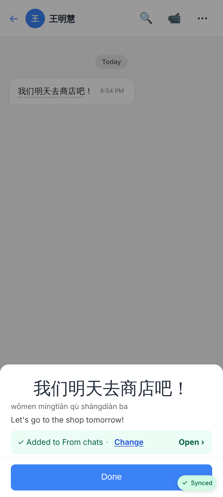
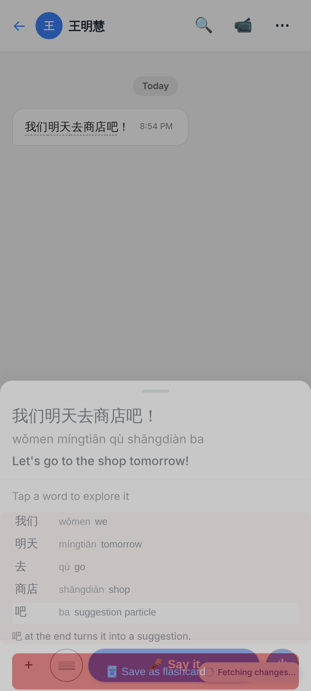
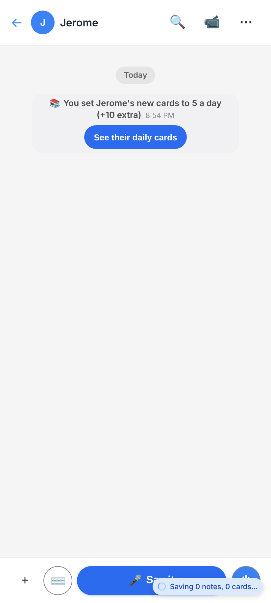
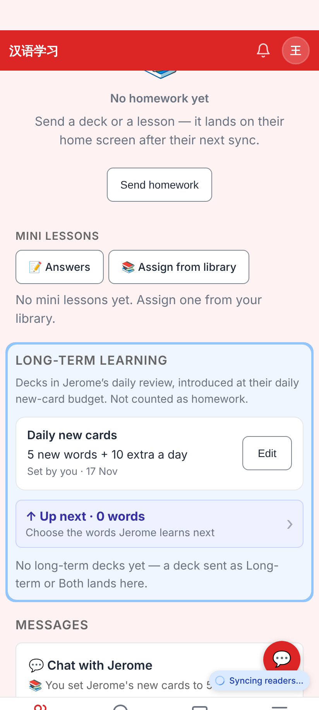
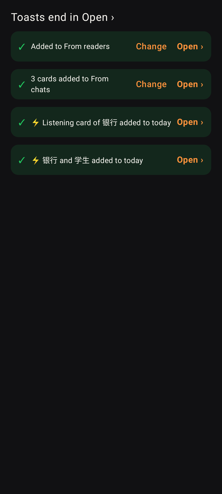

# Nav follow-ups: "Open ›" on toasts, sheets back on back, the budget line links

Phone viewport (412 × 915, 2×). Web light from `e2e/tests/toast-open.spec.ts` (`TOAST_OPEN_SHOTS=…`), Lab dark from
Roborazzi (`ToastOpenTest`).

Web — Save as flashcard from a chat message: the toast ends in **Open ›** (44px target, "Open the card 我们明天去商店吧！").

Web — Open › lands on the new card's hub; back returns to the chat.

Web — the tutor's "📚 You set Jerome's new cards to 5 a day (+10 extra)" line now has **See their daily cards**.

Web — it opens Jerome's page at Long-term learning (`#long-term`), flashed, with the Daily new cards row.

Lab (dark) — "✓ Added to From readers · Change · Open ›" (one card → its hub), "3 cards added to From chats" (→ the
deck), "⚡ Listening card of 银行 added to today" (→ the card) and "⚡ 银行 and 学生 added to today" (→ Up next).
