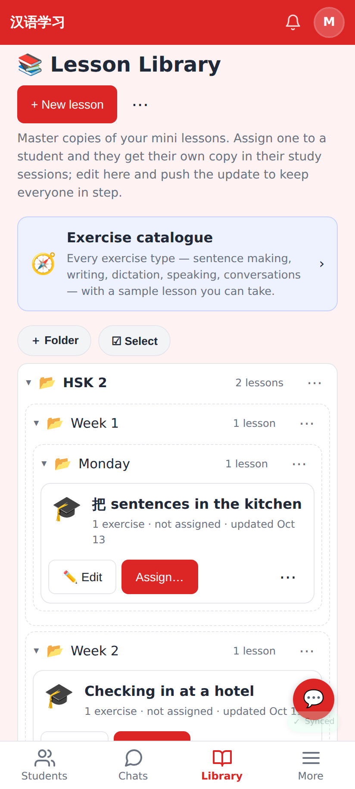
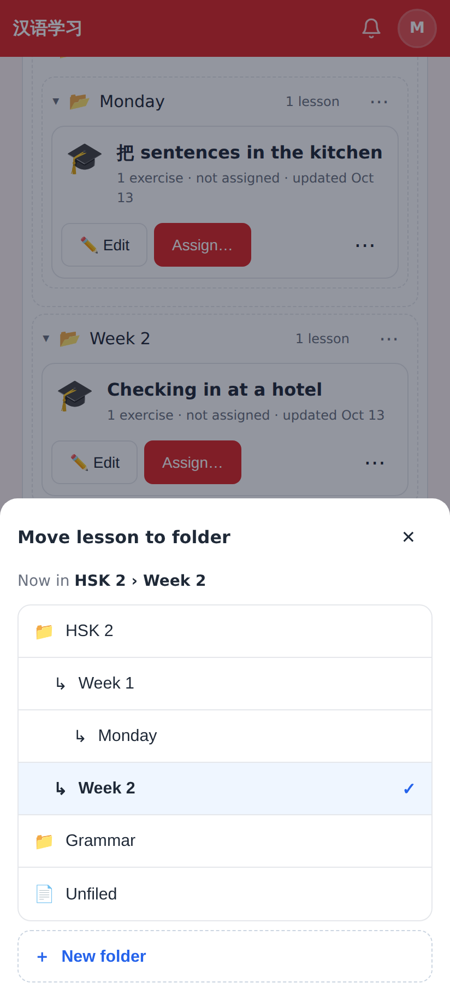
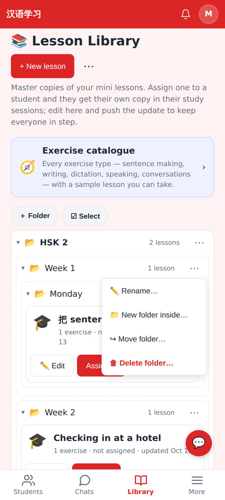
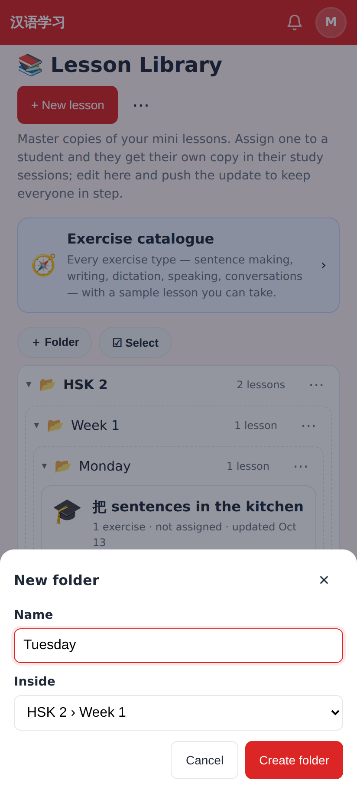
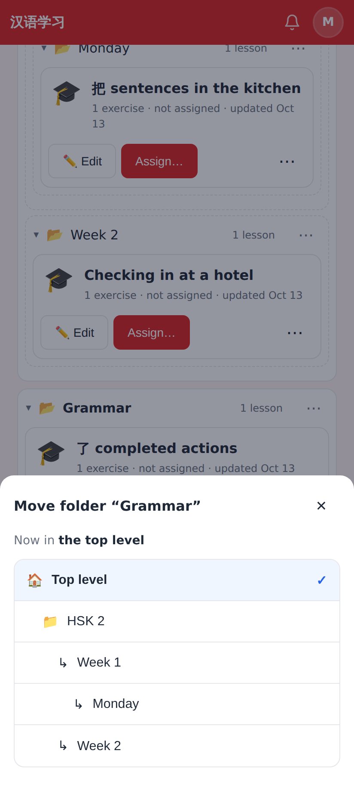
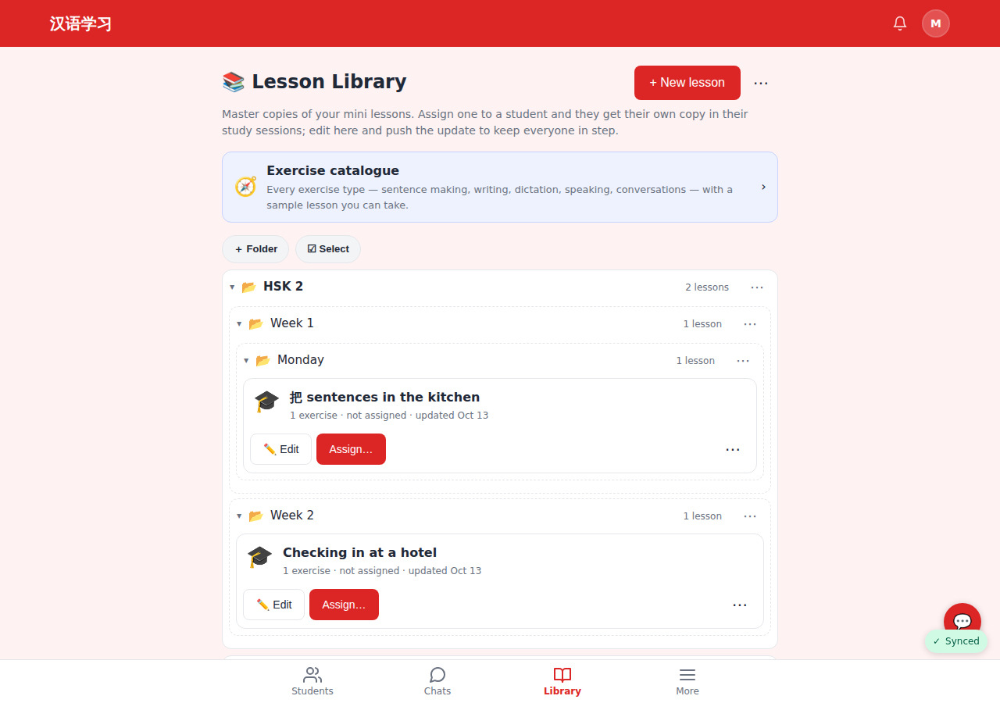
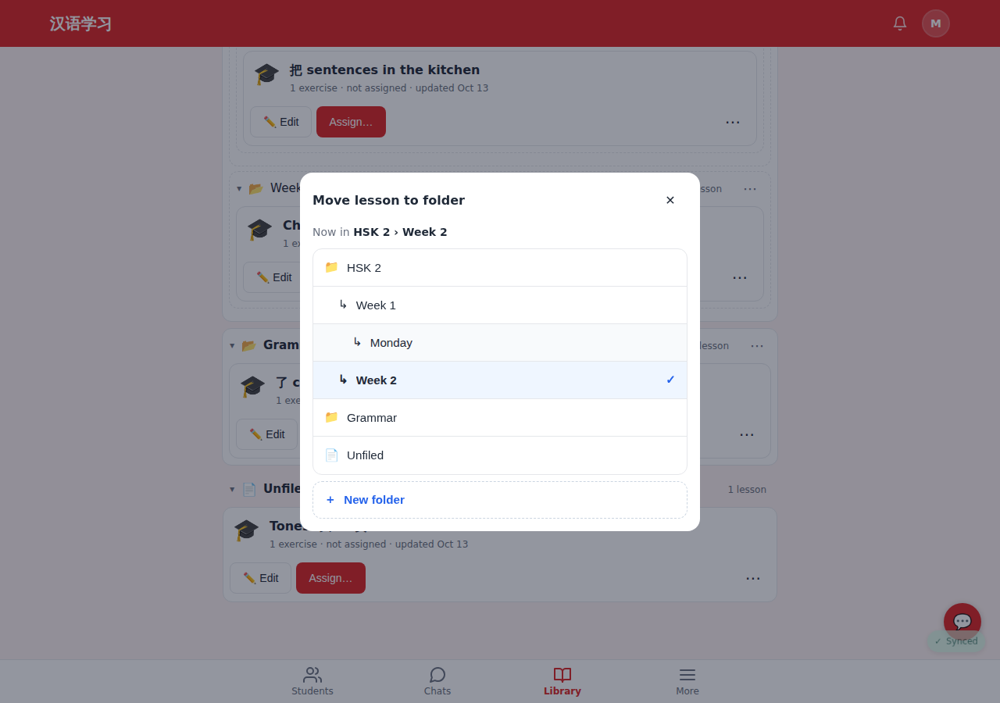

# Nested folders (Lesson Library, decks, readers)

Web, 412×915 @2× (Pixel Fold folded) and 1280 desktop (Minghui uses the library on desktop).

The Library as a tree: HSK 2 › Week 1 › Monday, each level indented, counts rolled up.

Move to folder… — the tree indented, with a "Now in HSK 2 › Week 2" breadcrumb.

A subfolder's ⋯: Rename · New folder inside · Move folder · Delete.

New folder inside Week 1 — "Inside" lists every folder by its path.

Move folder "Grammar" — the top level or any folder (its own subfolders and too-deep places are not offered).

Desktop library with three levels.

Desktop move sheet.
