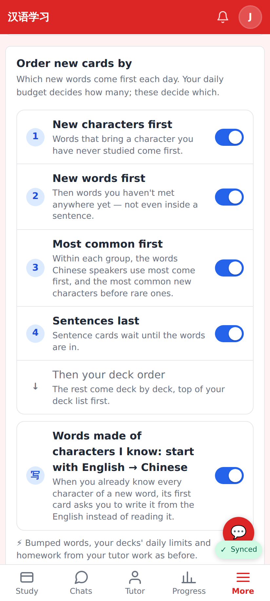
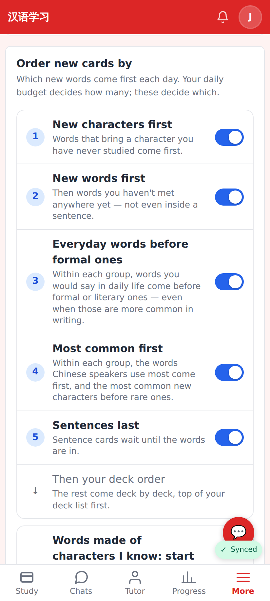
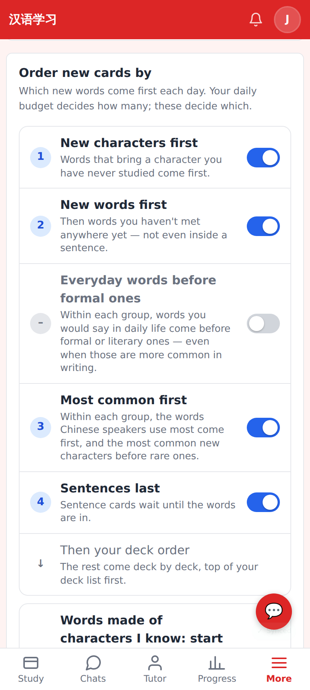
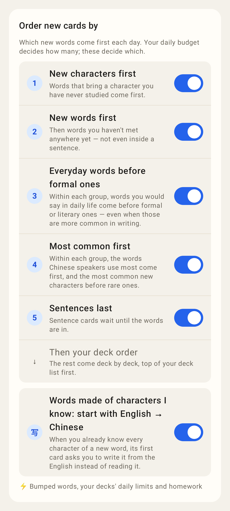
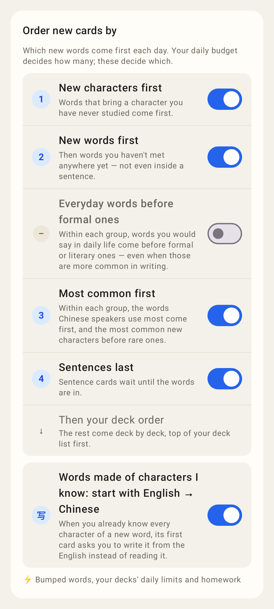

# Everyday words before formal ones — Settings → New cards

Web (412×915, 2×):

Before: "Order new cards by" with four switches.

After: the new switch "Everyday words before formal ones", on by default, right before "Most common first" (it ranks ahead of frequency inside each group).

Switched off: the row greys out and the steps renumber.

Lab app (Roborazzi):

Lab: the same rows and words (parity-tested).

Lab: "Everyday words before formal ones" switched off.
