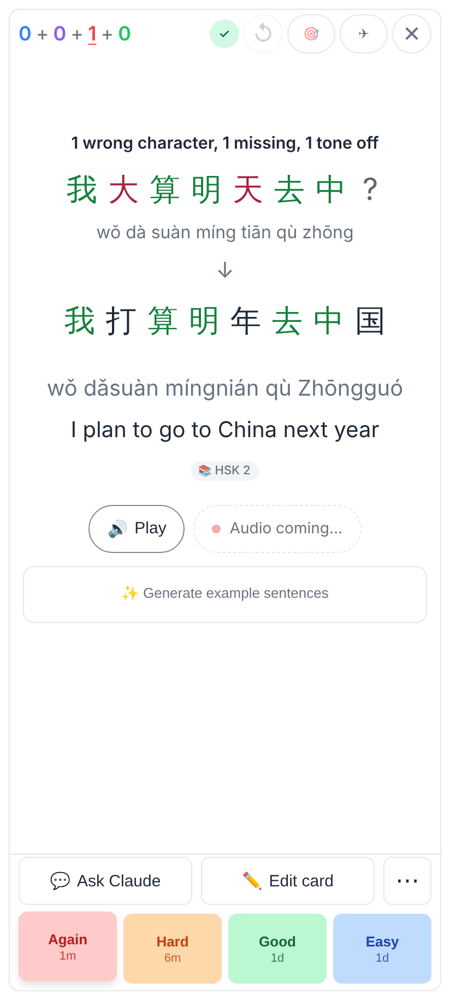
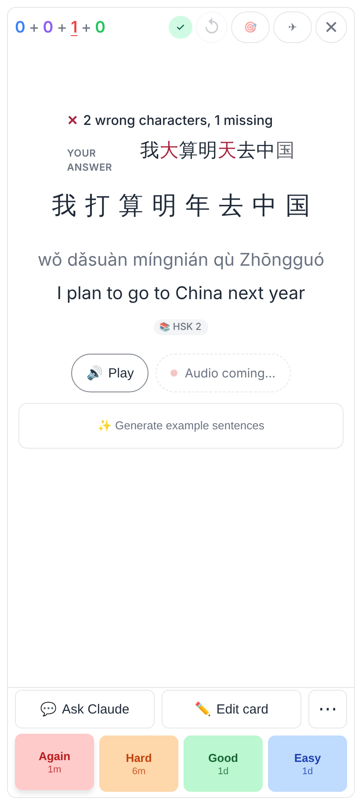
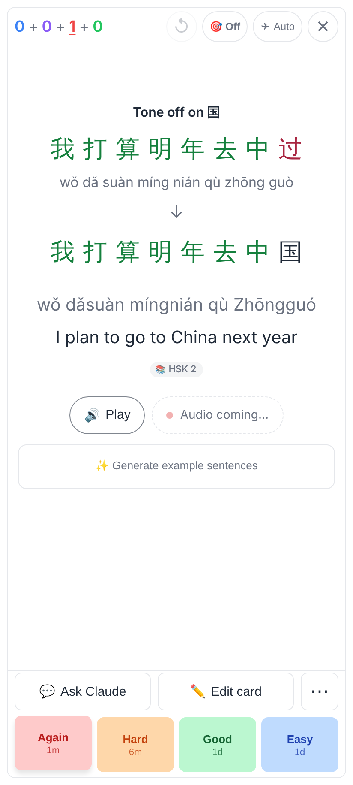
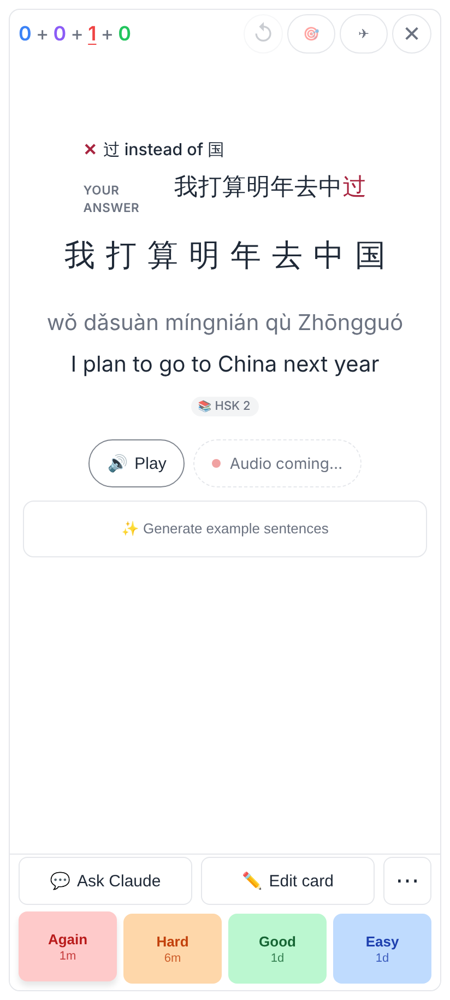
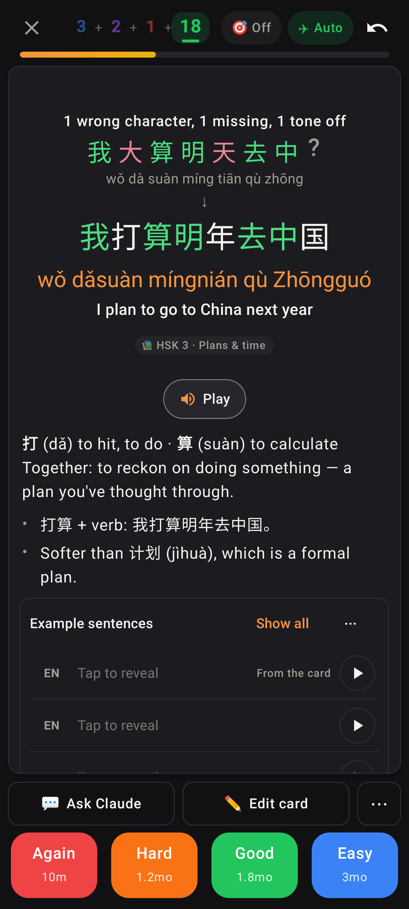
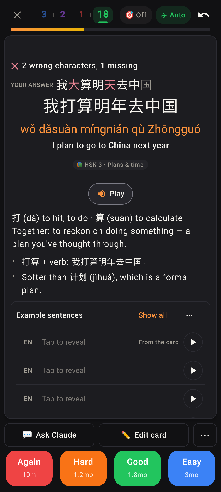

# One answer diff — the typed card back

A wrong typed answer on the back of a meaning → hanzi card (phone, 412×915 @2×). Card: 我打算明年去中国.

## Web (light)

Typed 我大算明天去中 — before: the positional diff (green / rose rows, ↓, the answer). After: the slim answer diff
(one line, "Your answer" marked), then the card's answer.

Typed 我打算明年去中过 (过 guò for 国 guó) — before, the line judged it by sound ("Tone off on 国") while the card
said wrong. After, a typed answer is judged by its characters: "过 instead of 国".

## Lab app (dark)

