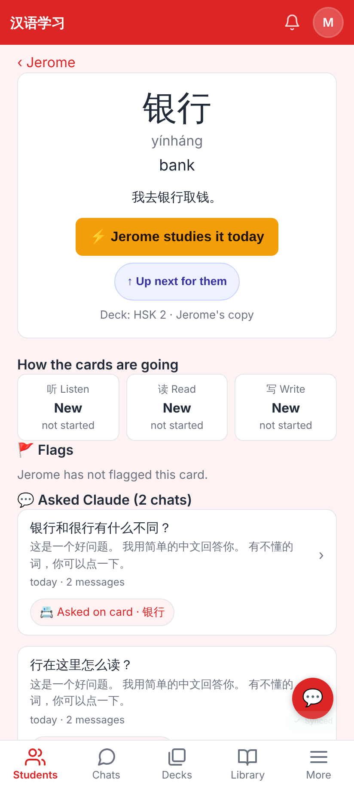
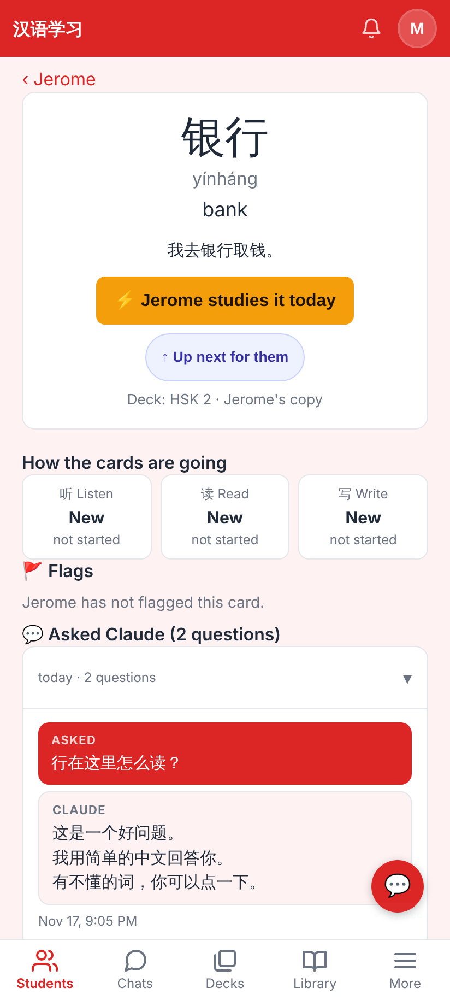
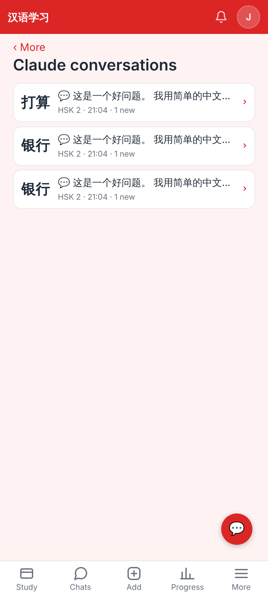
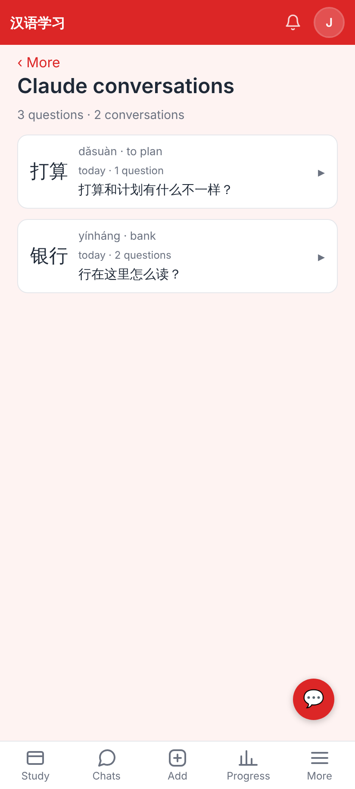
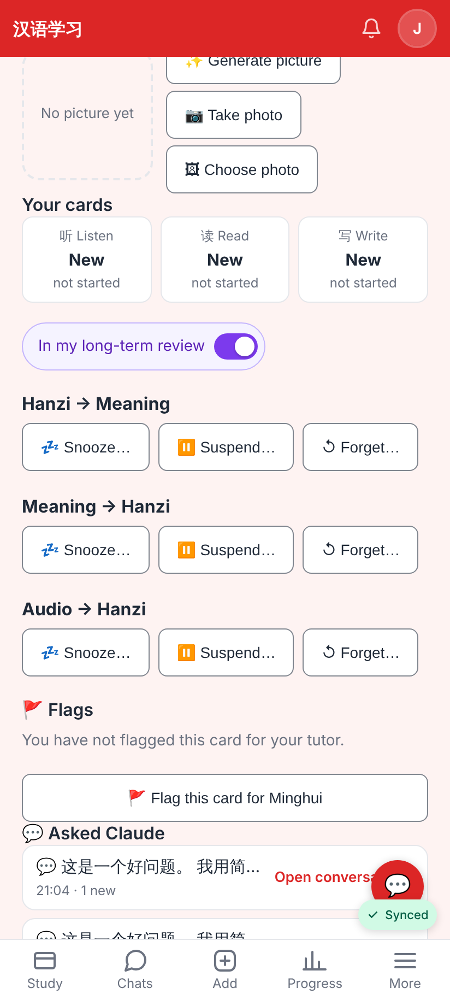
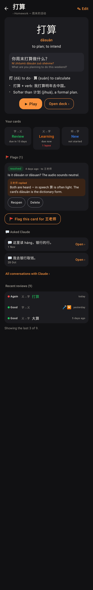
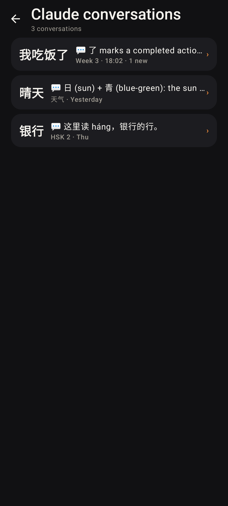
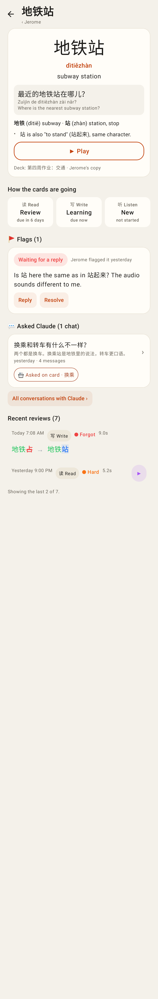

# One store for card questions — screenshots

Every Claude question on a card now lives only in its card thread; the screens list those threads
(each opens the conversation) instead of regrouping Q&A rows on the device.

## Web (phone, light)

The tutor's view of a student's card, after: the card's Claude threads the student lets her read (tap → read-only thread).

Before: the same card's Q&A rows regrouped on the device and expanded inline.

More → Claude conversations, after: one row per card thread with its card, each opening the conversation.

Before — and what an installed older build still shows: `/api/me/claude-chats` is now served from the card threads.

The learner's own card hub (unchanged: its threads; the header no longer counts the old rows).

## Lab app (dark)

The card hub: "💬 Asked Claude" lists the card's threads from the phone's thread cache (offline), each → the thread.

Claude conversations: every card thread with its card (from the Chats tab's thread list).

The tutor's view of a student's card: the card's visible threads (`…/claude-threads?note_id=`).
