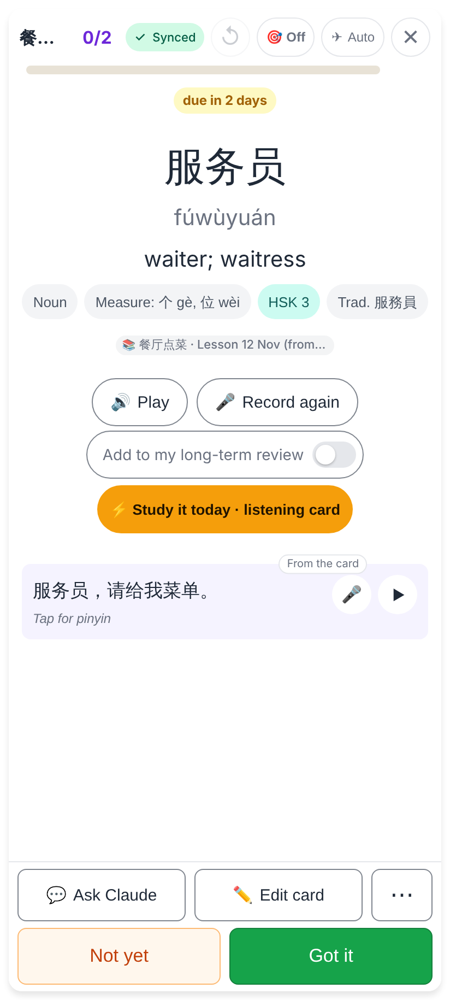
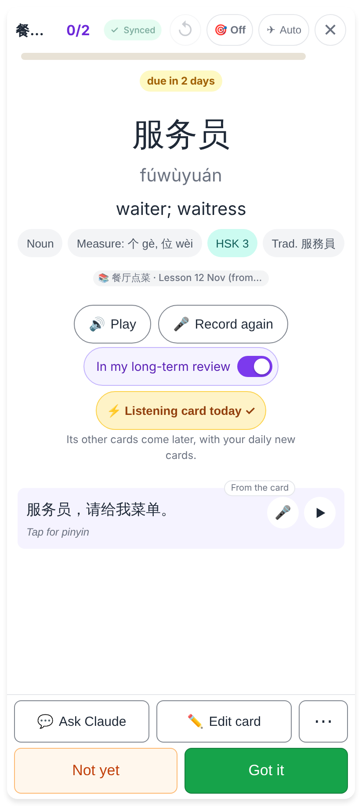
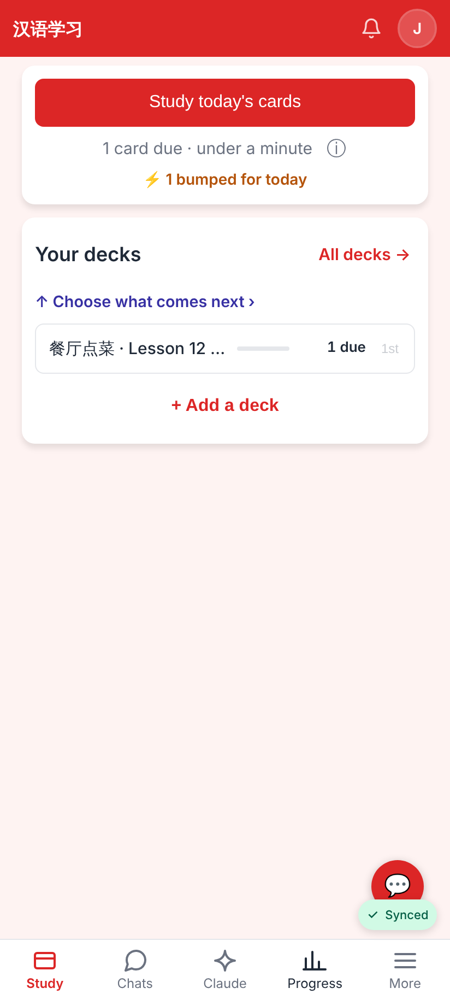

# Homework pass: ⚡ Study it today = 1 listening card

Phone, 412×915 @2×.

The pass's answer side before the tap: "⚡ Study it today · listening card" says what a tap adds (a word with no clip says "· 1 card").

After the tap: "⚡ Listening card today ✓", the word is now in long-term review, and the line under it says its other cards come later with the daily new cards.

Home afterwards: the one-off copy's word added exactly 1 card to today ("1 card due · ⚡ 1 bumped for today"), not 3.
