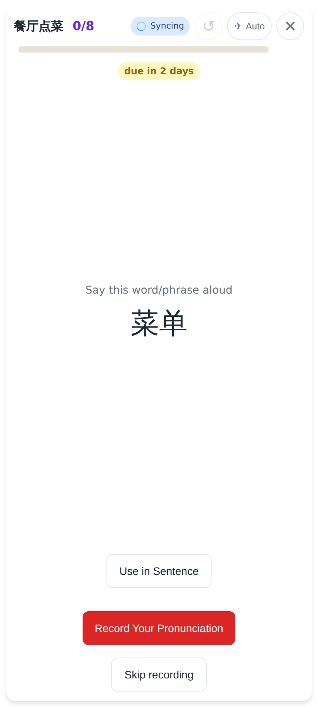
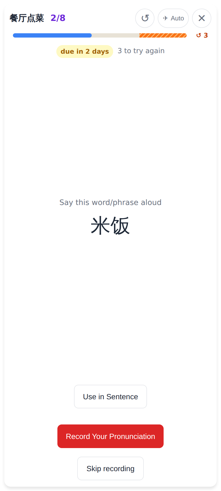
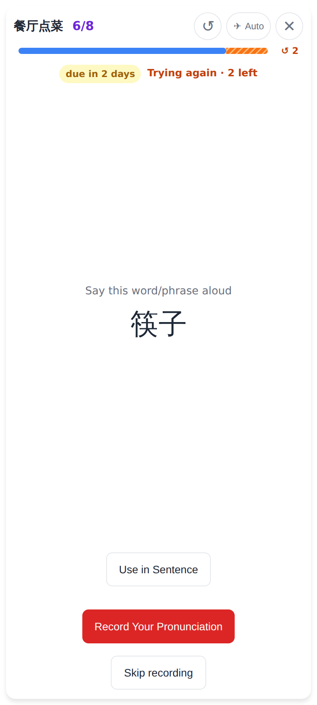
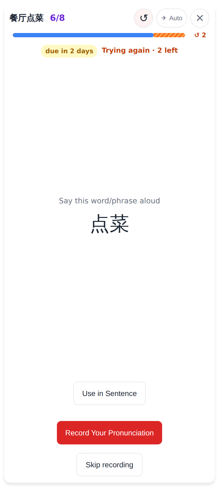
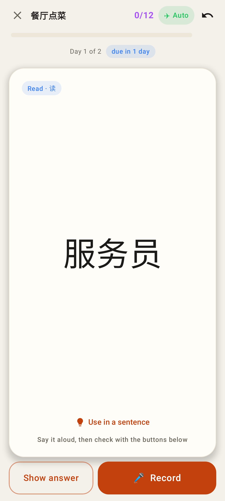
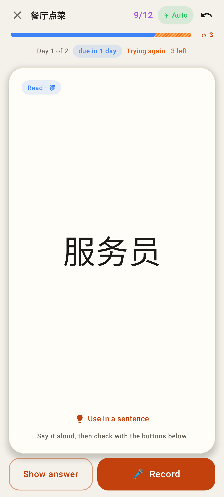
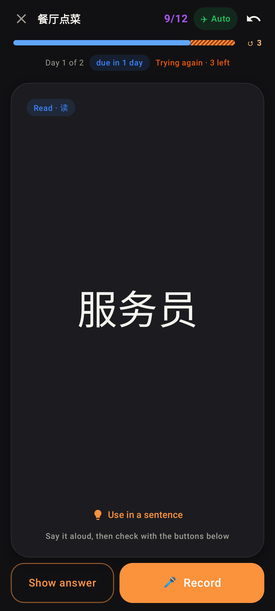
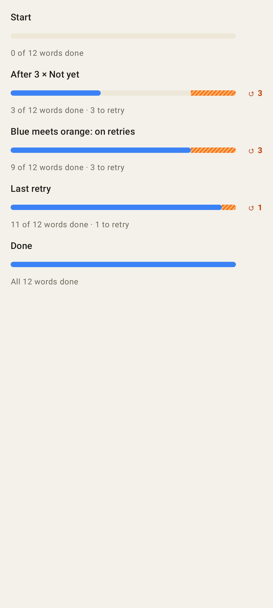
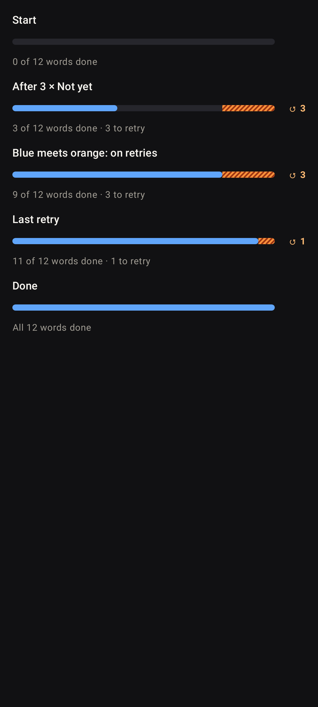

# The retry progress bar in the homework pass (docs/HOMEWORK.md §3c)

Blue = answers given (every Got it and every Not yet), hatched orange with "↺ N" = Not yet words still owed, at the right end. Phone viewport 412×915.

## Web

Start: 8 words, nothing answered.

2 Got it + 3 Not yet: the blue moved 5 of 11 slots, the orange holds the 3 owed words ("↺ 3", "3 to try again").

Every word shown once: the blue has reached the orange — "Trying again · 3 left".

A Got it on a retry ate one orange slot; another Not yet adds a slot and keeps the orange.

↺ undo of that Not yet: the bar goes back exactly.

The web app has no dark theme yet (light under a dark system scheme); the bar has `[data-theme='dark']` tones ready.

## Lab app (Roborazzi)

Start.

After 3 × Not yet.

Blue meets orange: on retries.

The same, dark.

Every state of the bar: start, after Not yet, on retries, last retry, done (full blue).

The same, dark.
