# 📱 Phone practice — Lab app (native)

Roborazzi screenshots (`PhoneScreenshots`, Pixel Fold folded 412×915dp; the last one unfolded).

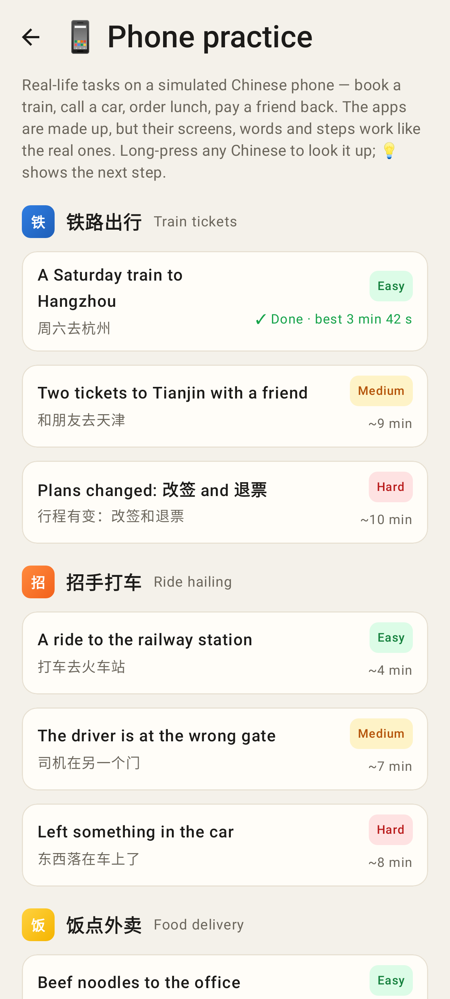
More → Practice → 📱 Phone practice: tasks by app, Easy / Medium / Hard, ✓ Done · best time, In progress.

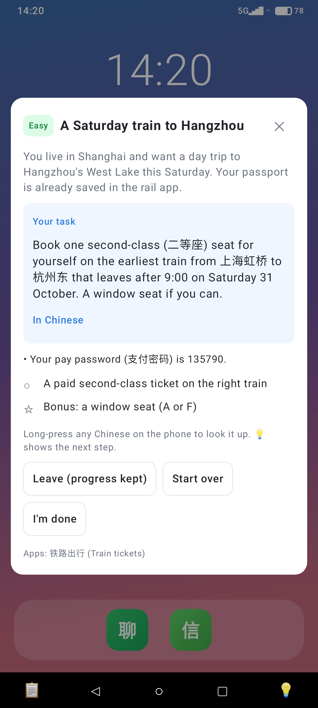
A task opens with its card over the phone's home screen (goal in English, "In Chinese", facts, live checklist).

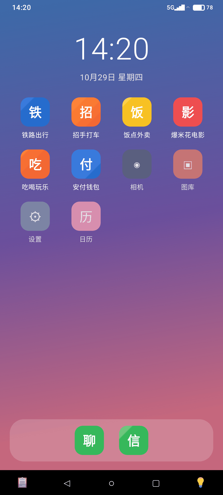
The simulated phone: status bar, apps, dock, ◁ ○ ▢ nav with 📋 and 💡.

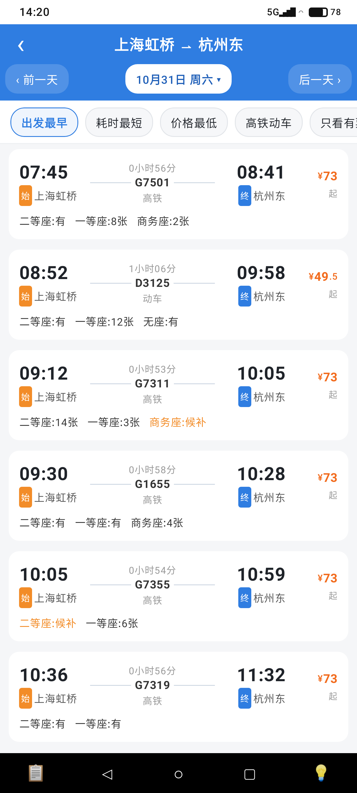
铁路出行: 上海虹桥 → 杭州东 on Saturday, the train list.

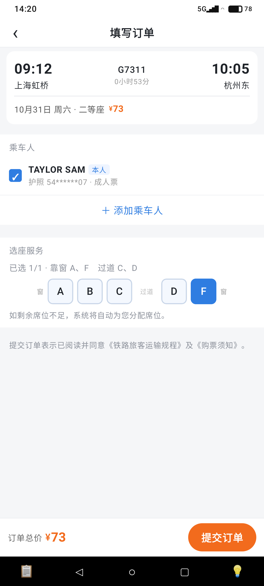
填写订单: 常用乘车人 ticked, 选座 F (靠窗).

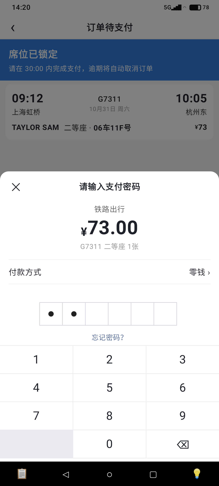
The shared 安付钱包 pay sheet: 支付密码 on the keypad.

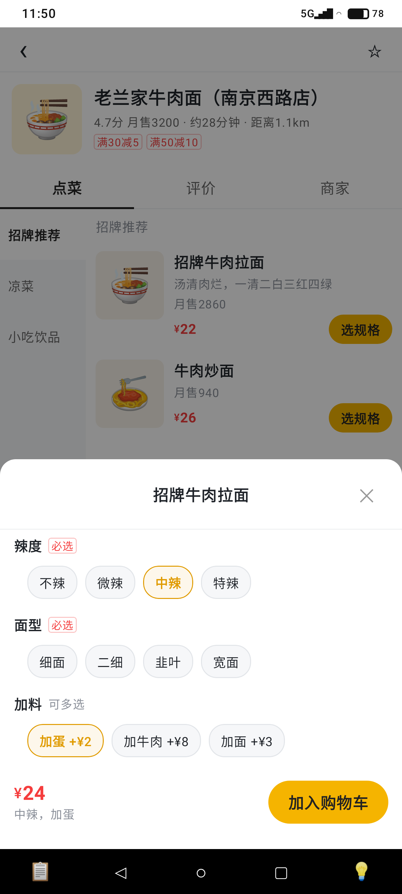
饭点外卖: 选规格 with 必选 groups and 加料.

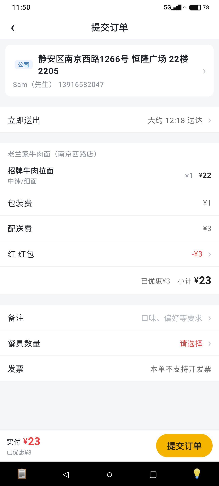
提交订单: address, 满减, 红包, 备注, 餐具数量 (请选择).

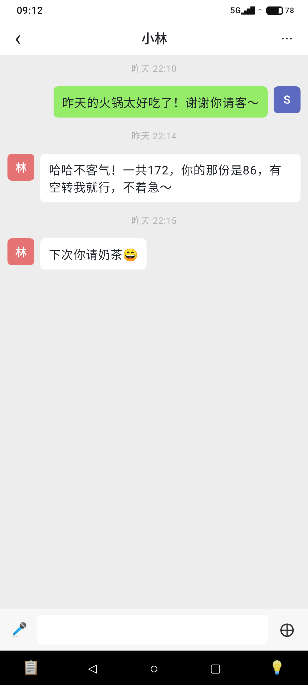
微聊: the friend's thread.

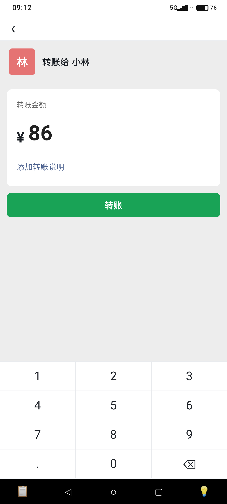
转账 ¥86 on the amount pad.

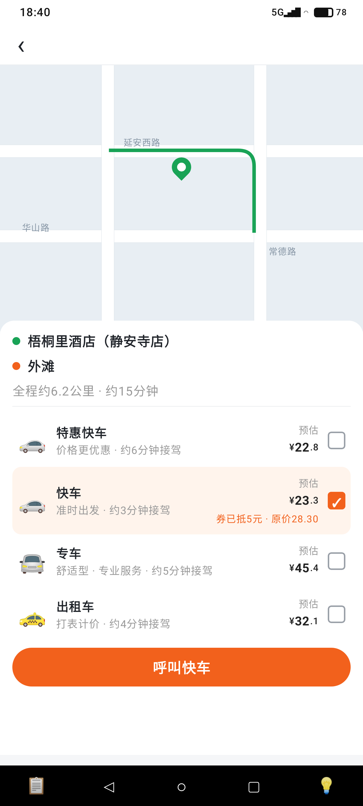
招手打车: car types with 预估价 and coupons.

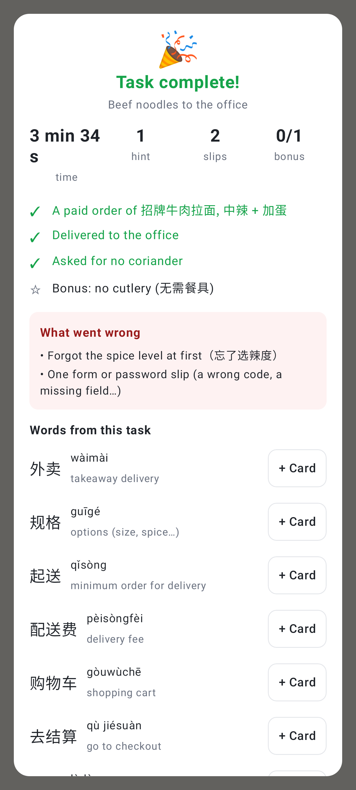
The finish summary: time, hints, slips, goals, what went wrong, words with + Card.

Unfolded: the phone in a frame, a 💡 hint over the shop page.
