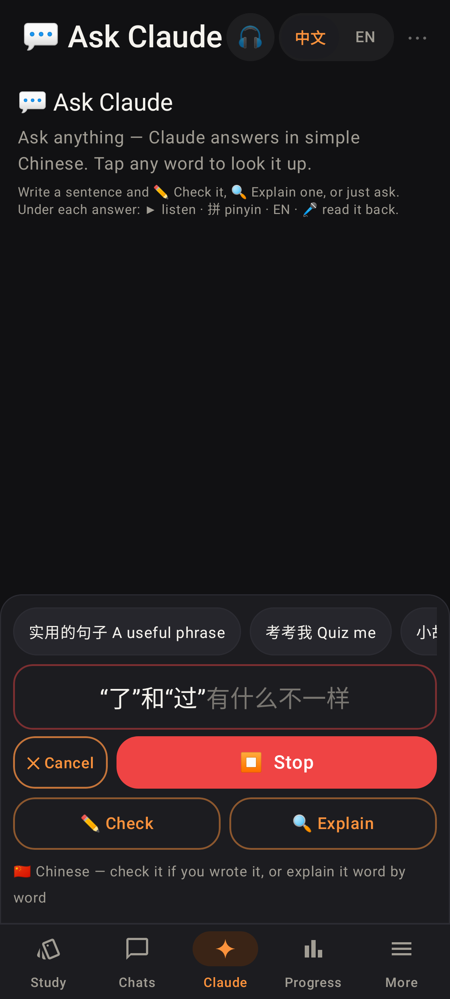
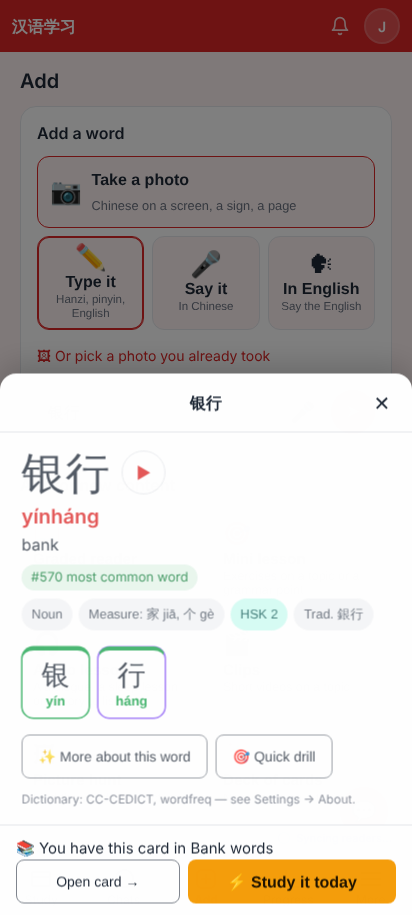
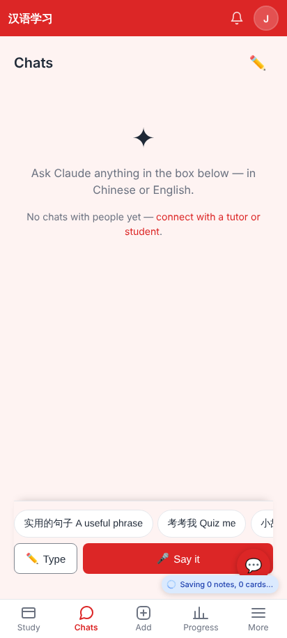

# ＋ Add tab (and the Claude box on Chats)

Phone viewport 412×915 @2×. Web (light) from `e2e/tests/add-tab.spec.ts` (`ADD_TAB_SHOTS`); the Lab app's
Roborazzi shots are not in this PR (see the note at the end). The photo is a synthetic fixture (`e2e/tests/fixtures/images/subtitle-photo.png`:
plain shapes, no real people).

## Before — the ✦ Claude tab

The old tab: a new Claude chat, its title shown twice in the Lab app.

The Lab app's old tab (dark).

## Web

＋ Add: one title, "Add a word" (📷 first and widest; ✏️ · 🎤 · 🗣), then "Ask for new content".

📷 → the photo with the line boxes; the subtitle 太体面了 first as word chips, the tab title's 视频通话 below; the English is gone.

Tap 体面 → the explorer's Word view (the line as its context) → + Add as card.

✏️ Type it: 银行.

A word he already has: "📚 You have this card" → ⚡ Study it today.

📖 Graded reader: one voice-first box + the level.

"✓ Making your reader… Open ›".

The old Claude tab's box — with its chips — is the Chats tab's low bar.

## Lab app

The Lab app's Roborazzi shots (`AddScreenTest`: `add-01…13`, light + dark — the tab, reading, photo words,
English candidates, listening, a typed sentence, the reader / audio boxes, results, the Chats box) could not be
recorded in this session: every local `:app` compile was killed for memory while several builds shared the
machine. The tests themselves run (and pass) in CI's Android Lab Build. Record them with
`./gradlew :app:recordRoborazziDebug --tests '*AddScreenTest*'` (they land in `android-lab/app/screenshots/`).
The Lab screen mirrors the web layout above (same words, same order, `ui/add/AddScreen.kt`).
