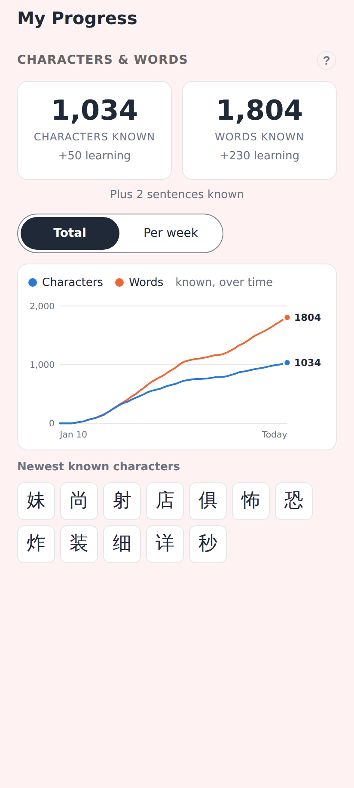
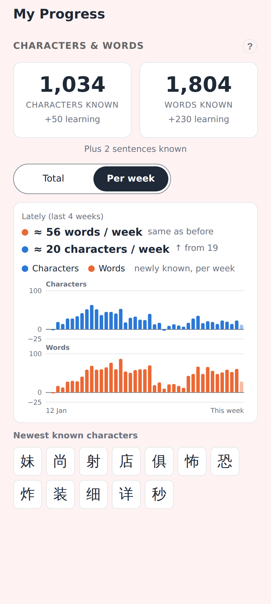
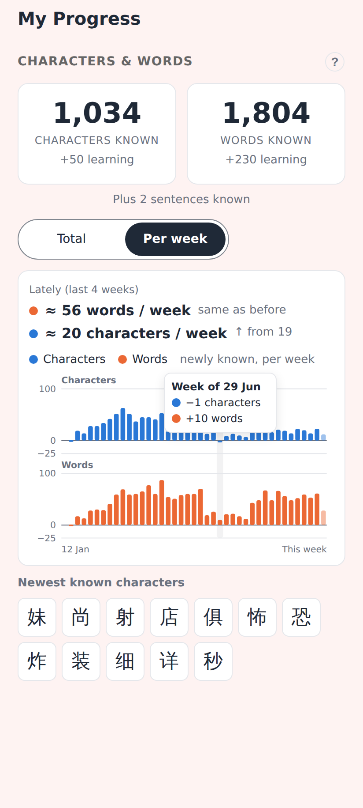
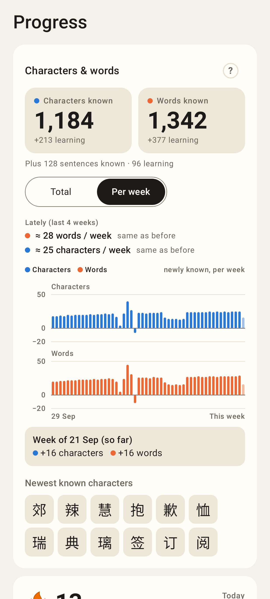
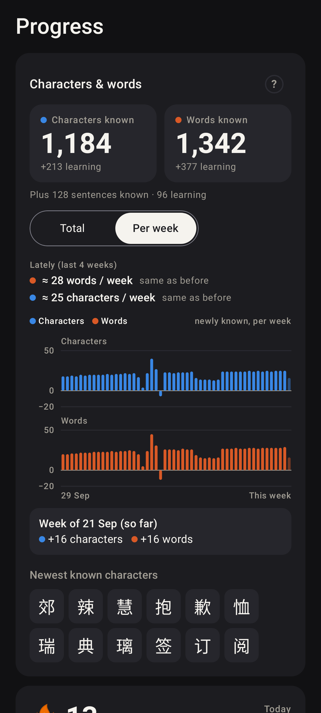
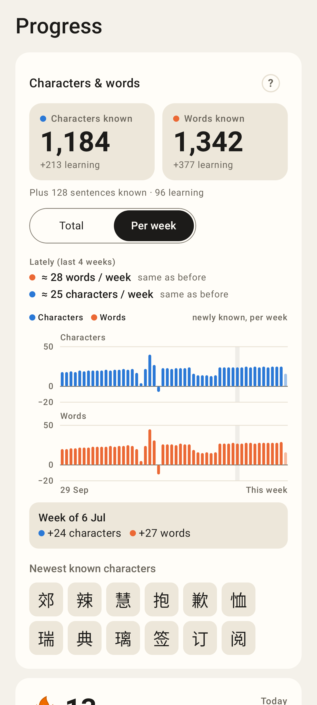
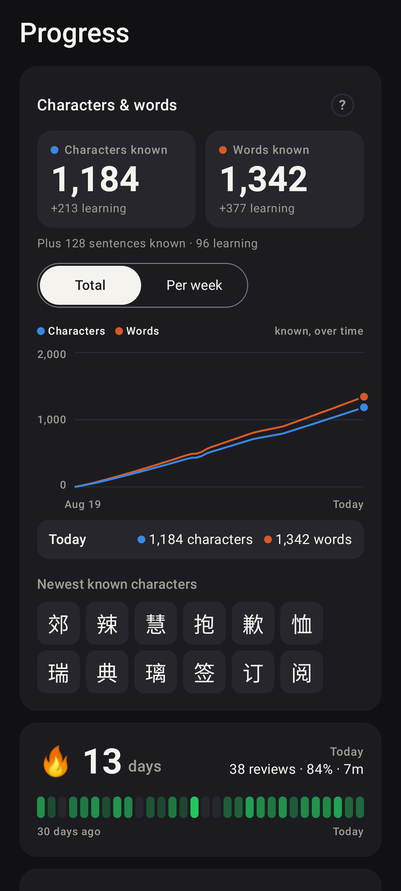
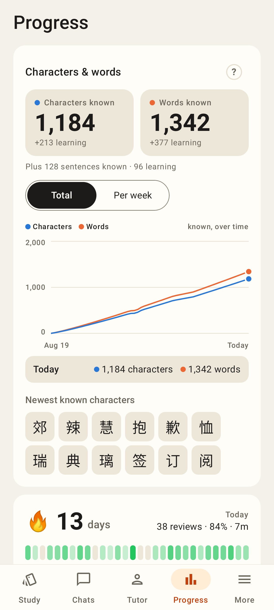

# Progress → Characters & words: Total | Per week

Phone viewport (412×915, 2×). Web shots render the real `KnownCountsView` over a synthetic 9-month
history replayed with the real FSRS (`knownProgressWithRate`); the web app is light-only, so dark mode
is shown in the Lab app.

Web — Total: the totals and the existing line chart, with the new Total | Per week toggle.

Web — Per week: pace of the last 4 weeks (↑ / ↓ vs the 4 before), newly known characters and words per week on one scale, the current week fainter.

Web — tapping a week: "Week of 29 Jun · −1 characters · +10 words" (a week can go below zero when cards lapse).

Lab — Per week (light).

Lab — Per week (dark).

Lab — dragging over the bars: the week's gains below the chart; a negative spring week below the zero line.

Lab — Total (dark): the existing chart with the toggle.

Lab — the Progress tab in its shell (Total by default).
