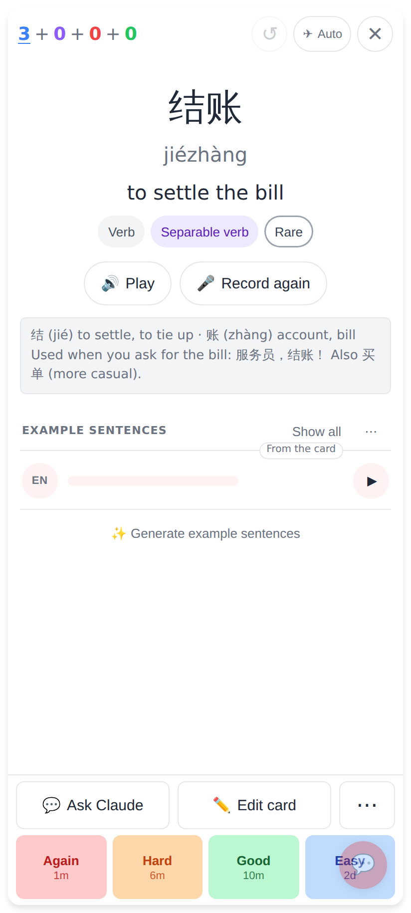
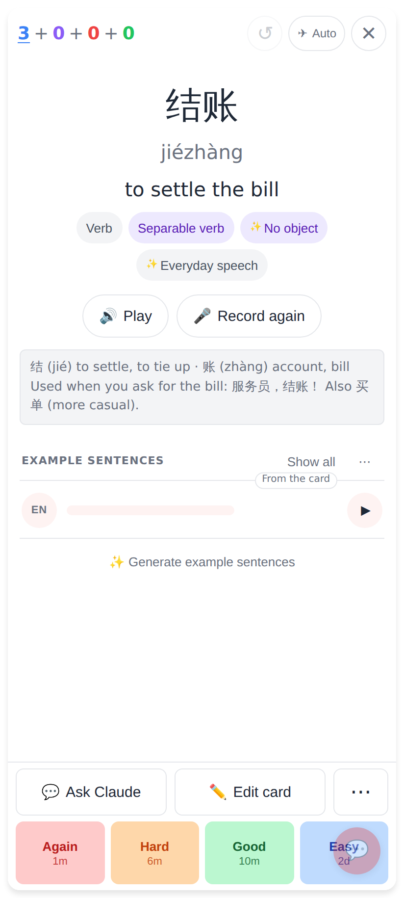
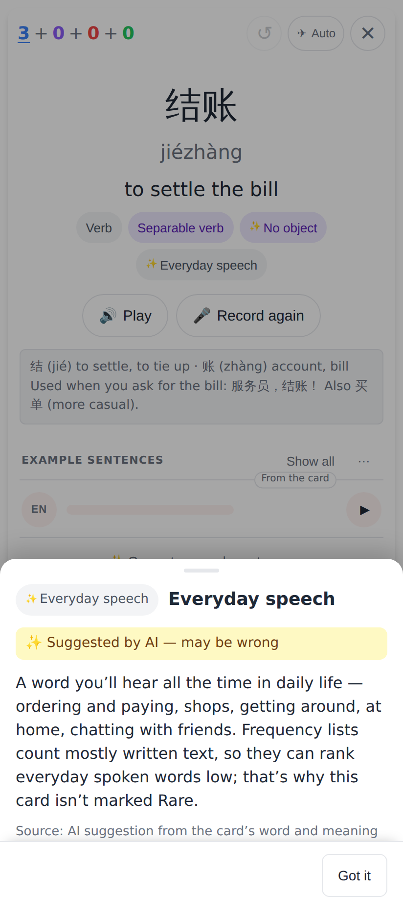
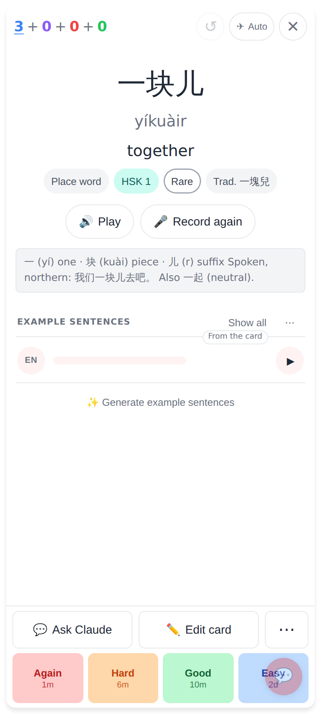
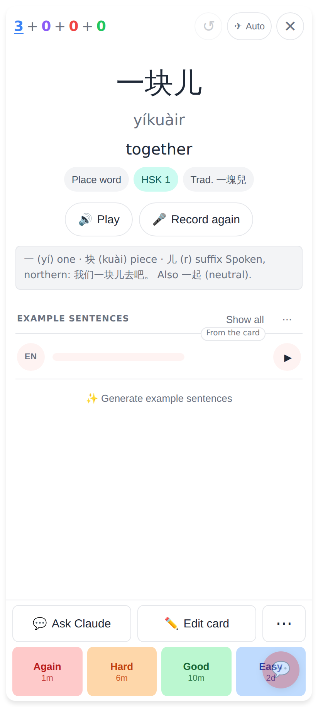
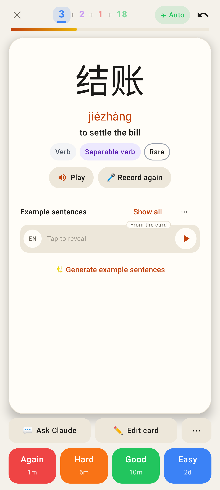
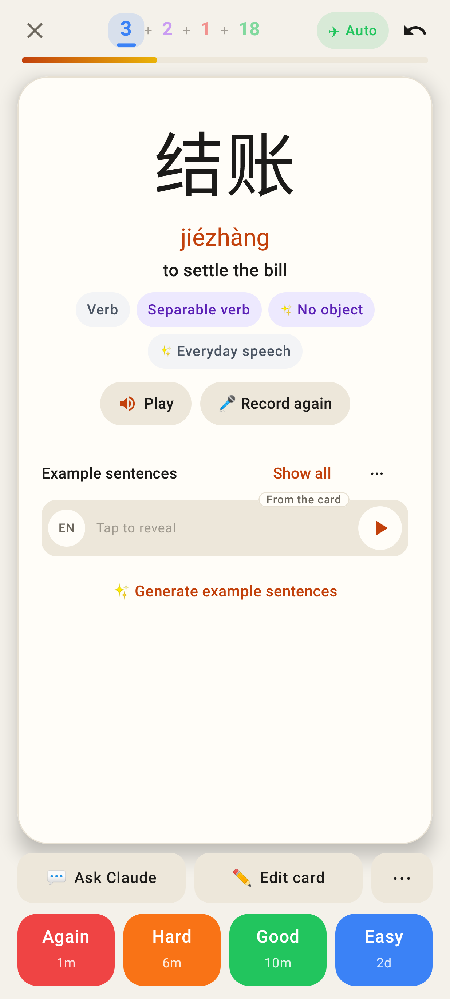
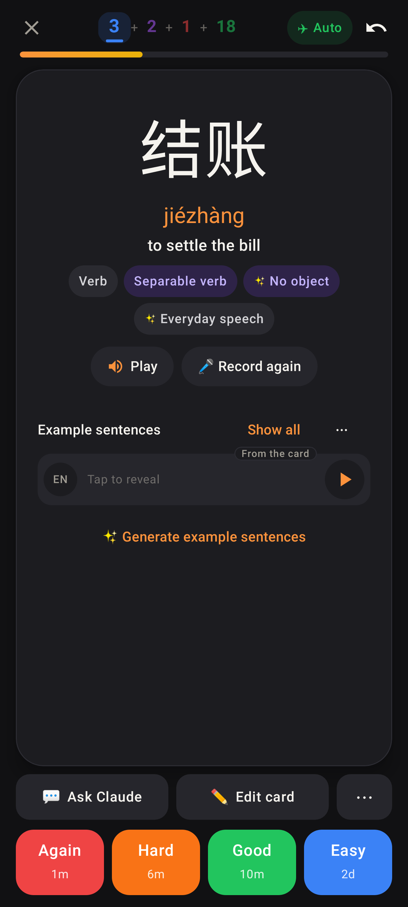
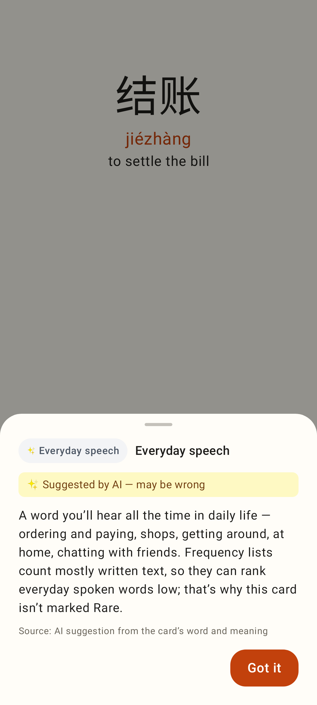
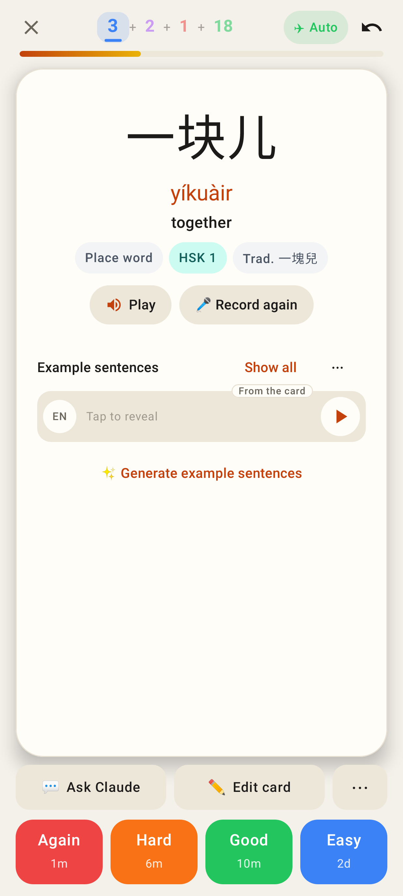

# "Rare" pill: HSK words never Rare + ✨ Everyday speech

Web, phone viewport 412×915 @2×.

Before: 结账 (settle the bill) — everyday restaurant talk — says "Rare" (the written-text list ranks it ~29,000).

After: the AI verdict calls it everyday speech → "✨ Everyday speech" where the frequency pill was, no "Rare".

Tapping the pill: what it means, why the card isn't marked Rare, "Suggested by AI — may be wrong".

Before: 一块儿 (HSK 1) said "Rare".

After: an HSK word is never Rare — no frequency pill (the unmarked middle band). The explorer's grey outlines follow the same rule.

## Lab app (Roborazzi, `WordTagsUiTest`)

Lab, 结账 without a verdict: Rare.

Lab, 结账 with the Everyday speech verdict.

Same, dark theme.

Lab, the Everyday speech sheet.

Lab, 一块儿 (HSK 1): no Rare pill.
