# 🎤 Read it aloud — readable marks in dark and light

The same marked page before and after: 成都是四川的省会，人们都说这里是天府之国。 read as
"成都是十船的省会了人们豆说这里是天国" (四 wrong, 川 / 都 tone off, 府之 missed, an extra 了).
Phone size (412 × 915, 3× Lab / 2× web).

## Lab app

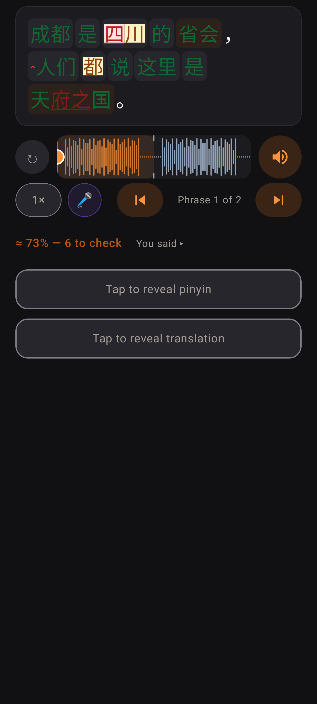
Before, dark: green / red recoloured text on brown chips, light boxes, a green known-word underline under the marks.

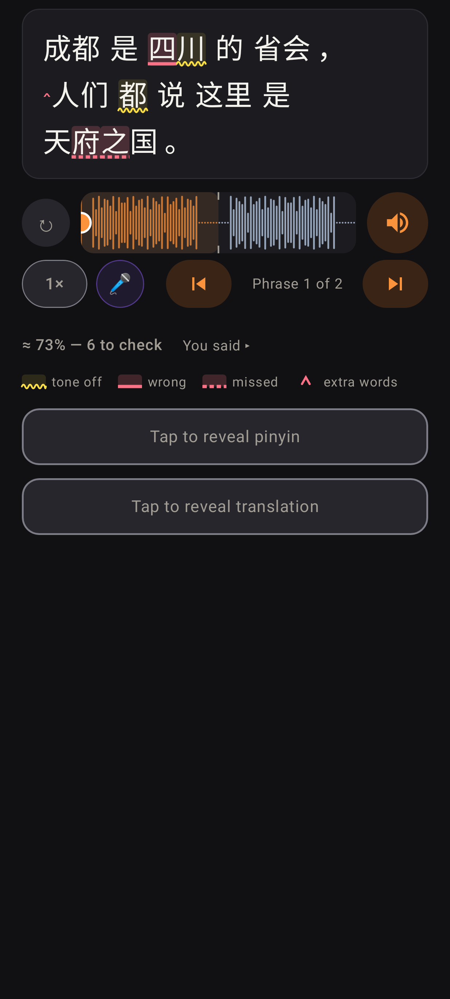
After, dark: body ink everywhere, chips step back; wavy lemon = tone off, solid rose = wrong, dashed rose = missed, ‸ = extra; muted line + legend.

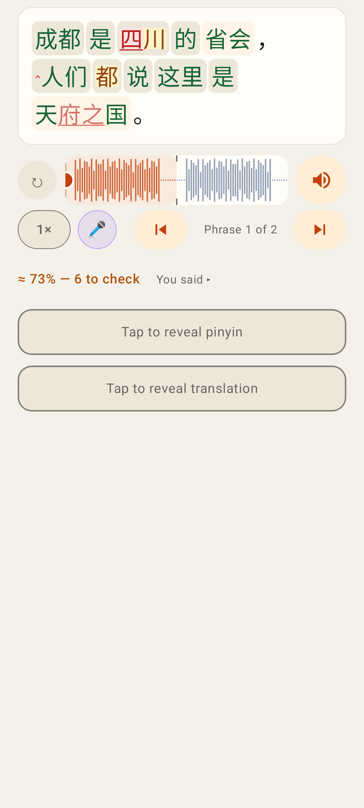
Before, light.

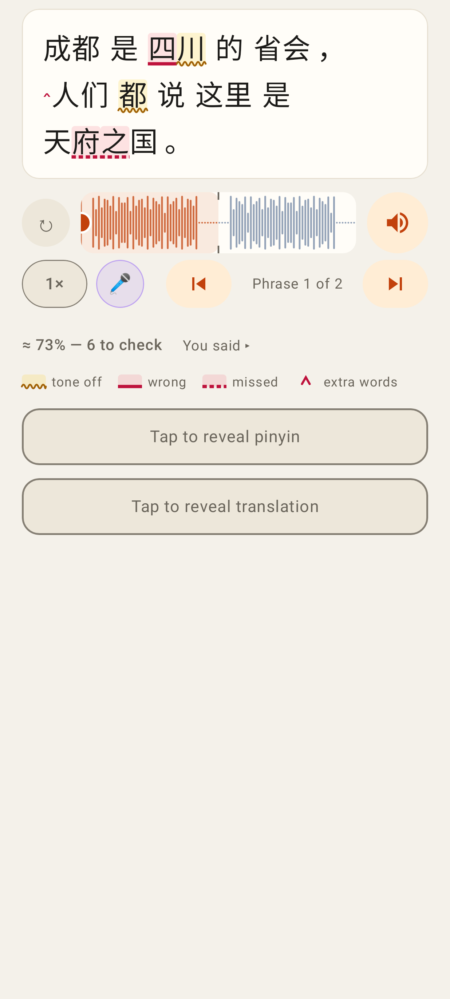
After, light: the same shapes from the light tokens.

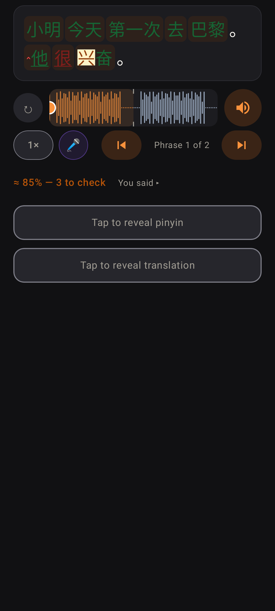
Before, dark: the original sample page (a homophone, a tone slip, a missed 很, an extra 了).

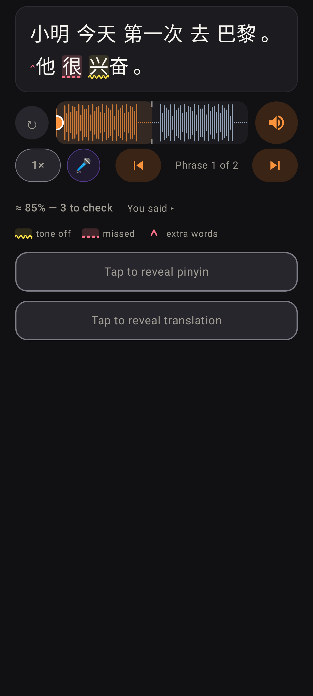
After: the homophone 他 carries no mark (it counts as right); only what needs a look is marked.

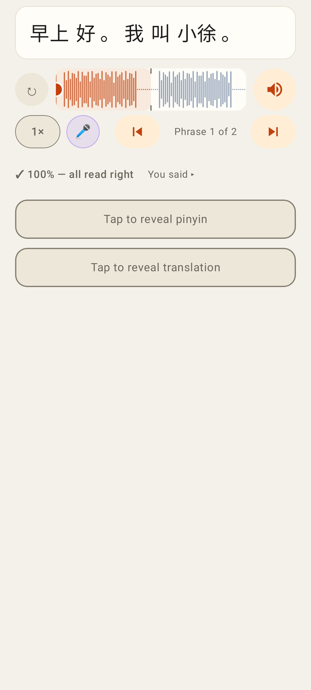
Read right: no marks at all, no legend: the page reads clean.

## Web app

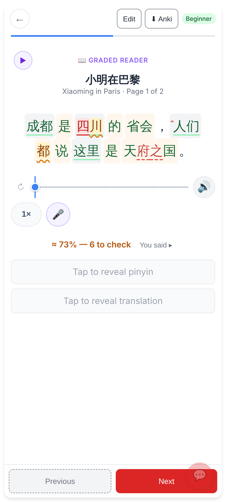
Before, light.

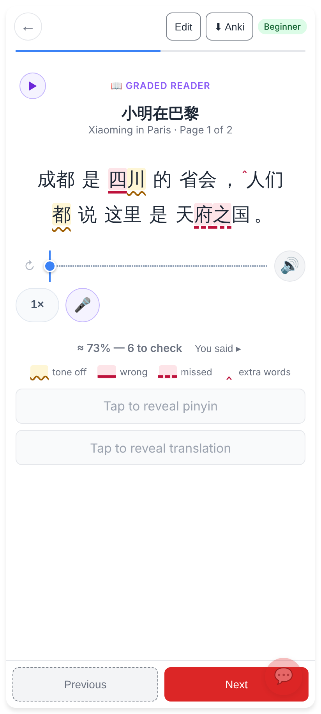
After, light: the same marks, the tiny legend under the line.

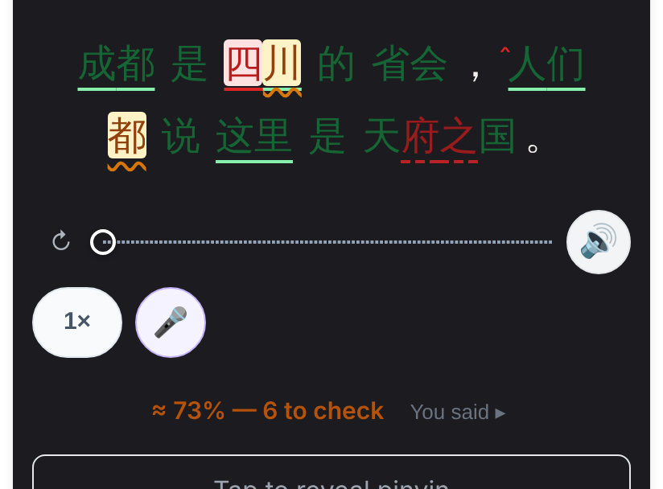
Before, dark preview. The web has no app-wide dark theme yet, so the reading area is painted the Lab's dark card for this shot.

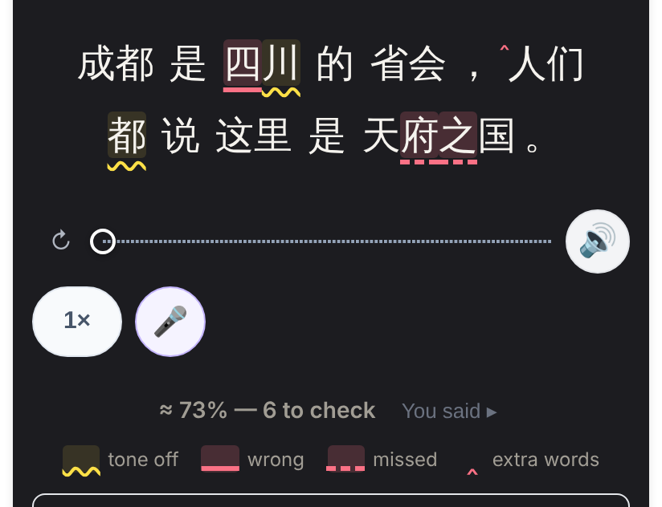
After, dark preview: the `data-theme="dark"` tokens (`--ra-*`).
