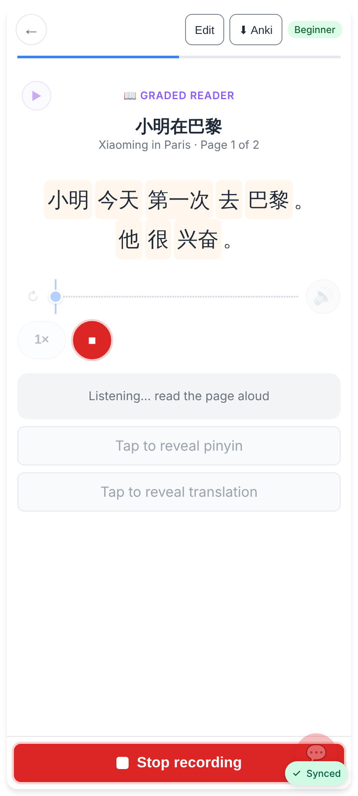
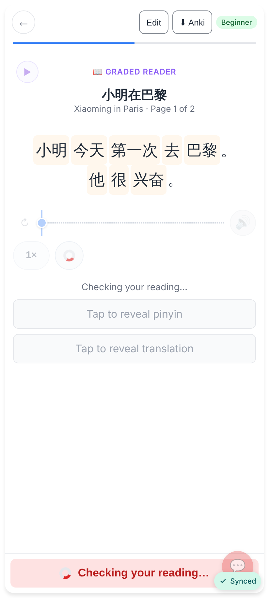
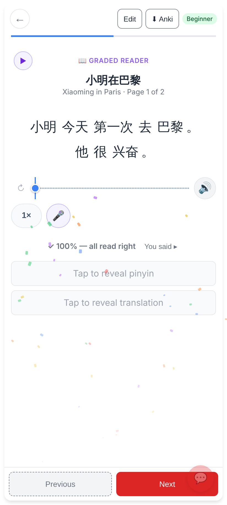
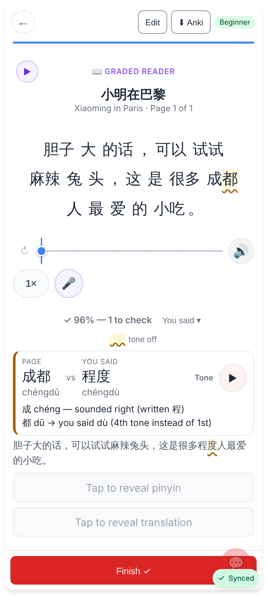
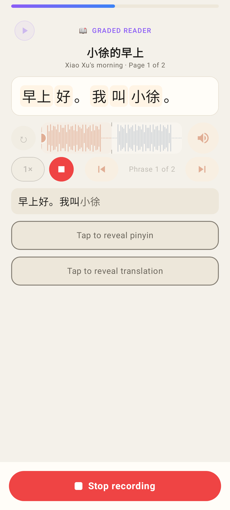
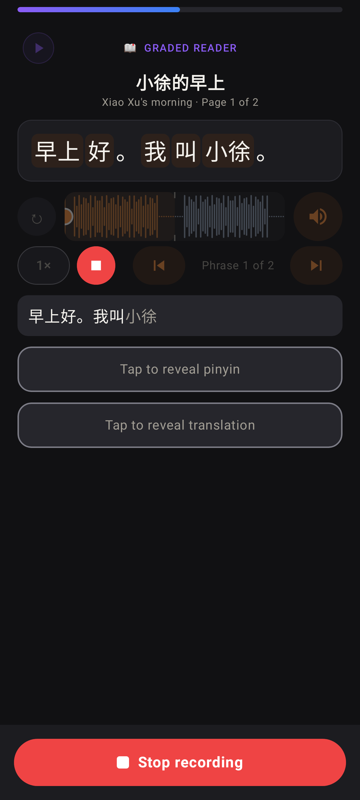
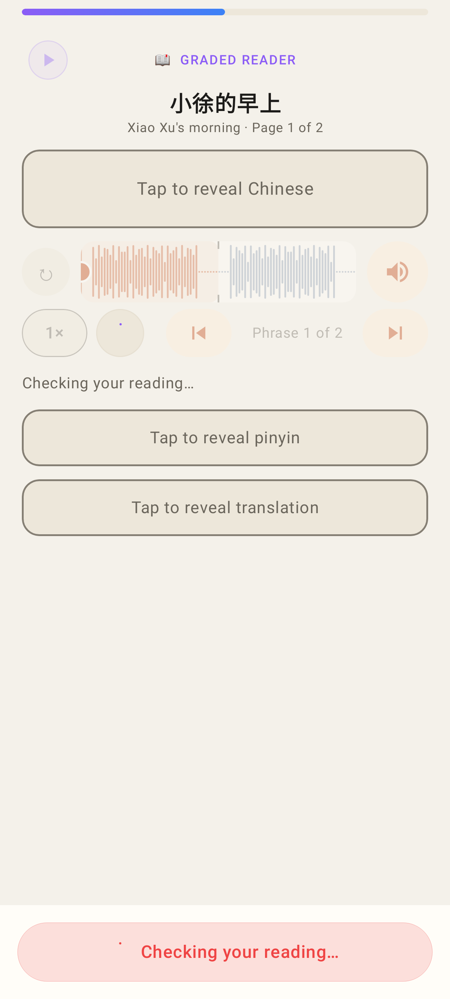
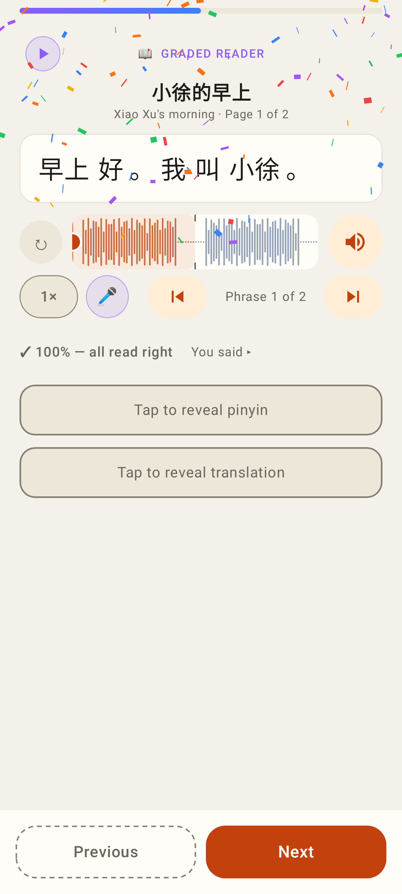
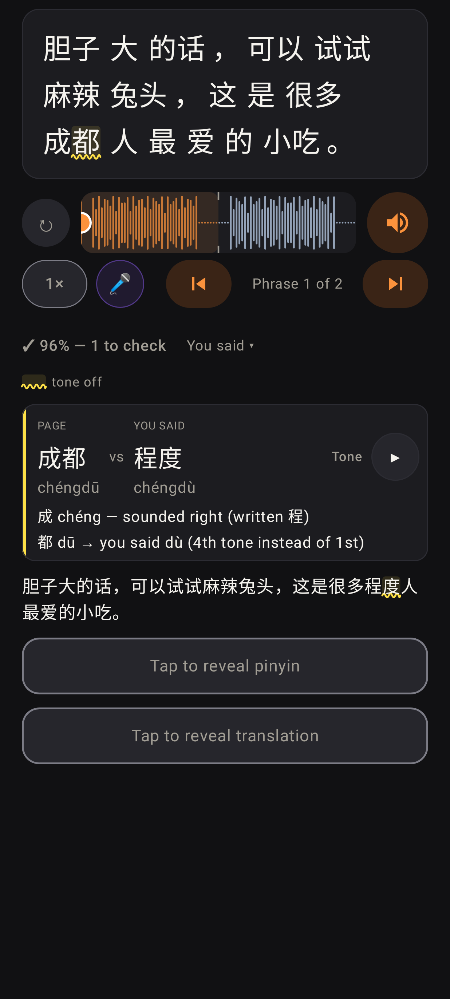
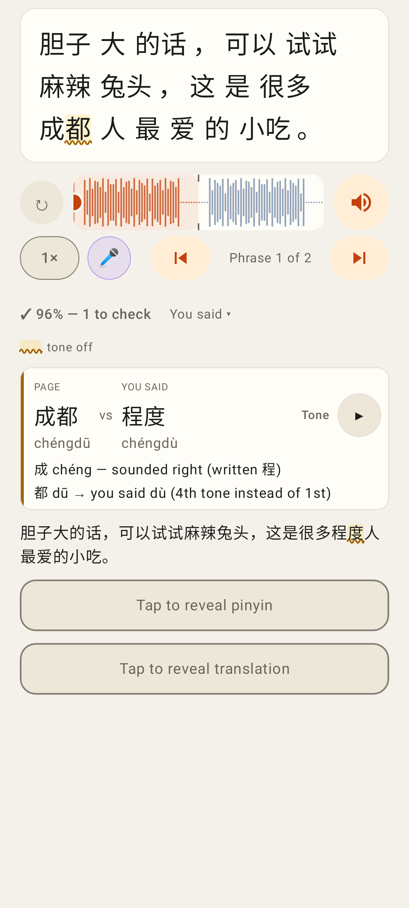

# 🎤 Read it aloud: the page locks while recording, confetti when it's all right, and what it heard vs the page

Phone size (412×915, 2×). Web = `/readers/:id` (the same reading view as the session and homework); Lab = `StudyReaderView`.

## Web

Recording — Previous / Next are replaced by one big red **■ Stop recording**; the audio row and ▶ Play whole story are disabled.

Stopped — the footer quietly says **Checking your reading…** until the result lands (still no way to turn the page).

The whole page read right — confetti; Previous / Next are back.

Jerome's take (成都 heard as 程度): one row — the page's word + pinyin vs what it heard + pinyin, the kind in words ("Tone"), ▶ the page's word, and a reason per character: "成 chéng — sounded right (written 程)" (a homophone, counted right) and "都 dū → you said dù (4th tone instead of 1st)". "You said ▾" marks the transcript the same way (度 wavy). The web app is light-only today, so its dark shot is the Lab's below.

## Lab app

Recording — the same red **Stop recording** footer; ↻, waveform, 🔊, 1×, ⏮ ⏭ and ▶ dimmed and disabled.

The same in dark mode.

Stopped — **Checking your reading…**.

All right — confetti mid-burst (plus the celebrate haptic and a sparkle sound on the phone).

Jerome's example in dark mode — the same row, reasons and marked transcript.

The same in light mode.
